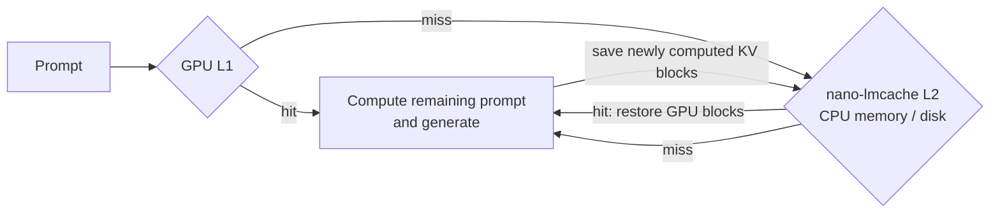

<p align="center">
  
</p>

English | [简体中文](README.zh-CN.md)

# nano-lmcache

**Reuse prompt KV, restore it after restart, and see where every cache hit comes from.**

nano-lmcache implements the core ideas behind
[LMCache](https://github.com/LMCache/LMCache) in small, readable Python modules.
It runs from a dependency-free prefix-cache demo to real Hugging Face
tensors and an external KV cache for
[nano-vLLM](https://github.com/GeeeekExplorer/nano-vllm).
The goal is to explain each principle with as little code as practical,
backed by runnable examples, correctness tests, and measured trade-offs.

[Learning path](docs/tutorial/README.md) · [Documentation](docs/README.md) ·
[GPU validation](docs/gpu-validation.md) · [Benchmarks](docs/nanovllm-benchmark.md)

## What you can do

| Capability | What works today | Try it |
| --- | --- | --- |
| **Reuse shared prefixes** | Match complete token chunks, stop at the first miss, and compute only the uncached suffix. Prefix-aware keys separate different contexts. | [Prefix-cache demo](examples/demo_prefix_cache.py) |
| **Keep KV beyond GPU memory and process lifetime** | Store in memory or on disk; combine tiers with promotion on a slow-tier hit. Entry/byte budgets and leaf-only LRU preserve reachable prefixes. Memory, disk, and tiered backends support shared-thread access. | [Disk demo](examples/demo_disk_cache.py), [tiered demo](examples/demo_tiered_storage.py) |
| **Reuse real model tensors** | Run Hugging Face models on CPU or CUDA, offload KV to pinned CPU memory, and serialize tensors losslessly or with optional lossy INT8 compression. | [Real-model demo](examples/demo_kv_reuse.py), [INT8 experiment](docs/quantized-kv.md) |
| **Restore a real inference engine** | Save complete nano-vLLM KV blocks to external L2, load them back into GPU blocks after restart, and reuse resident GPU L1 blocks on later requests. | [Engine tutorial](docs/tutorial/README.md#7-restore-a-real-engines-cache) |
| **Inspect the entire cache path** | View prefix trees, hit/miss decisions, eviction, promotion, and GPU import/export events in standalone HTML. Stream sorted workload JSONL with bounded cache/detail budgets and exact summary statistics; also import recorded engine traces. | [Viewer tutorial](docs/tutorial/README.md#5-follow-a-lookup-in-the-viewer), [streaming replay](docs/streaming-replay.md), [engine traces](docs/engine-traces.md) |
| **Explore prefill/decode disaggregation** | Transfer checksummed KV between two toy-model roles, verify identical tokens without prompt recomputation, and simulate the scheduling trade-off. | [PD demo](examples/demo_pd_disaggregation.py) — core package only |

The engine integration follows this path: local GPU KV first, external KV
second, then computation for the remaining prompt. Complete blocks from
new computation are saved for future requests.



## Demonstrated results

These are recorded experiments, with their model, hardware, and workload
specified below. Each report includes the setup and reproduction commands.

| Experiment | Result | Evidence |
| --- | --- | --- |
| **Real-engine TTFT** — Qwen3-0.6B, RTX 4090, 8,224-token prompt, 8,192 reused tokens | **125.0 → 52.4 ms** with pinned CPU-memory L2 and empty GPU L1; median of five rounds. | [TTFT report](docs/nanovllm-benchmark.md) |
| **Restart recovery** — Qwen3-0.6B, RTX 4090 | A fresh nano-vLLM process restored **five KV blocks from disk** with empty L1; both questions produced identical answers across cold and restarted processes. | [GPU validation record](docs/gpu-validation.md) |
| **INT8 storage** — synthetic FP16/BF16 KV chunk, Apple M4 CPU | **Raw bytes / INT8 serialized bytes ≈ 1.60×**, including FP32 scale overhead. Compression is lossy and opt-in. | [Compression report](docs/quantized-kv.md) |
| **Prefix-safe eviction** — 1,024-chunk chains, capacity 8,192, Apple arm64 | Heap-based leaf selection reduced total churn time **788 → 208 ms**, preserving the original LRU policy. | [Eviction report](docs/eviction-performance.md) |

The same TTFT experiment found disk L2 slower than recomputation at every
tested size, and short-chain eviction workloads paid extra bookkeeping
cost. The reports show where each approach helps and where it costs more.

## Start here

Requirements: Python 3.11+ and [uv](https://docs.astral.sh/uv/).
Run these commands from the repository root:

```bash
git clone https://github.com/Dami-wq-k03/nano-lmcache.git
cd nano-lmcache
uv sync --locked
uv run python examples/demo_prefix_cache.py
```

The demo shows cold misses, shared-prefix hits, and eviction under entry
and byte limits. It uses small string payloads, so no model download,
PyTorch, or GPU is needed.

The core API is a lookup/store loop. In a `uv run python` session:

```python
from nano_lmcache.core.prefix_cache import ChunkedPrefixCache

cache = ChunkedPrefixCache(chunk_size=2, namespace="demo-model")
cache.store([10, 20, 30, 40, 50, 60], ["kv-0", "kv-1", "kv-2"])
hit = cache.lookup([10, 20, 30, 40, 70, 80])
print(hit.matched_tokens, hit.values)
# 4 ('kv-0', 'kv-1')
```

The second prompt reuses its first four tokens; only `[70, 80]` needs new
KV. Strings stand in for computed KV here; the tensor and engine adapters
store real tensors through the same storage interface.

### Watch reuse survive a restart

Run twice with the same fresh cache directory. Each command starts a new
Python process:

```bash
uv run python examples/demo_disk_cache.py --dir /tmp/nano-lmcache-readme-kv
uv run python examples/demo_disk_cache.py --dir /tmp/nano-lmcache-readme-kv
```

The first run reports `Reused 0/3 chunks`; the second reports
`Reused 3/3 chunks`, recovered from disk.

### See each decision in the viewer

```bash
uv run python -m nano_lmcache.visualize --scenario partial_prefix_hit \
  --output /tmp/nano-lmcache-trace.html
```

Open `/tmp/nano-lmcache-trace.html` in a browser. The HTML includes a prefix
tree and event timeline with Next/Previous and playback controls. It needs
no server or CDN. The same viewer also loads [real engine traces](docs/engine-traces.md).

### Move to a real model or engine

Hugging Face KV reuse runs on CPU with the optional `hf` dependencies:

```bash
uv run --extra hf python examples/demo_kv_reuse.py --model Qwen/Qwen3-0.6B
```

This downloads model weights unless `--model` points to a local directory.
The demo reports reused/computed tokens and compares suffix logits with a
full recomputation. Add `--device cuda --offload` to keep cached KV in
pinned CPU memory while the model runs on CUDA.

For nano-vLLM, follow the [engine tutorial](docs/tutorial/README.md#7-restore-a-real-engines-cache)
to run the disk-backed engine demo twice and observe cold computation,
restoration after restart, and later GPU L1 hits. It needs Linux, an NVIDIA
GPU, local model weights, and the `nanovllm` dependency group.

## Choose your next step

| Goal | Guide | Requirements |
| --- | --- | --- |
| Learn from chunk keys through engine restoration | [Guided learning path](docs/tutorial/README.md) | First five steps: core package only |
| Find a concept, command, or experiment | [Documentation index](docs/README.md) | Varies by topic |
| Understand terminology and design | [Glossary and FAQ](docs/glossary.md), [architecture](docs/architecture.md) | Core package only |
| Understand the engine adapter | [nano-vLLM integration design](docs/nanovllm-integration.md) | GPU to run; source readable independently |
| Explore the full vLLM connector API | [vLLM research notes](docs/vllm-kv-connector.md) | Source review only; connector implementation is future work |
| Study prefill/decode handoff | [PD guide](docs/pd-disaggregation.md) | Toy model; core package only |

The core package has no runtime dependencies. PyTorch and inference-engine
dependencies are optional; installation and test commands live in
[CONTRIBUTING.md](CONTRIBUTING.md).

## Scope and contributing

This is a teaching implementation for understanding LMCache-style systems.
The working engine integration targets nano-vLLM; full vLLM integration is
currently research. PD disaggregation uses a deterministic toy model and a
simulated timeline. Production performance and LMCache API compatibility
are outside the project's current goals.

Task status, prerequisites, and follow-ups are maintained in
[ROADMAP.md](ROADMAP.md). To contribute, choose an open task and follow
[CONTRIBUTING.md](CONTRIBUTING.md).

Released under the [MIT License](LICENSE).
