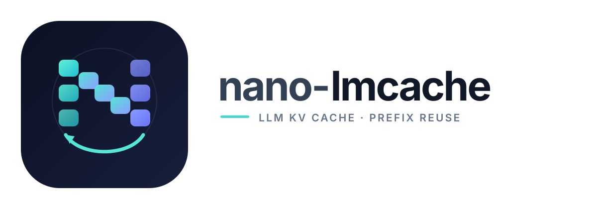

<p align="center">
  
</p>

English | [简体中文](README.zh-CN.md)

# nano-lmcache

Learn KV cache reuse one concept at a time: token chunking, prefix matching,
storage tiers, real model tensors, and an external cache for
[nano-vLLM](https://github.com/GeeeekExplorer/nano-vllm).

This is a teaching project. Each concept has tests and a runnable example
to help you understand systems such as [LMCache](https://github.com/LMCache/LMCache)
and vLLM. The project prioritizes clarity and testability; it does not aim
for production performance or API compatibility with LMCache.

## Start here

Requirements: Python 3.11+ and [uv](https://docs.astral.sh/uv/).
Run these commands from the repository root:

```bash
git clone https://github.com/Dami-wq-k03/nano-lmcache.git
cd nano-lmcache
uv sync --locked
uv run python examples/demo_prefix_cache.py
```

The demo shows cold misses, shared-prefix hits, and eviction under entry
and byte limits. It uses small string payloads, so no model download,
PyTorch, or GPU is needed.

To see each lookup in an offline browser viewer:

```bash
uv run python -m nano_lmcache.visualize --scenario partial_prefix_hit \
  --output /tmp/nano-lmcache-trace.html
```

Open `/tmp/nano-lmcache-trace.html` in a browser. The HTML includes a prefix
tree and event timeline and needs no server or CDN.

## Choose your next step

| Goal | Guide | Requirements |
| --- | --- | --- |
| Learn from chunk keys through engine restoration | [Guided learning path](docs/tutorial/README.md) | First five steps: core package only |
| Find a concept, command, or experiment | [Documentation index](docs/README.md) | Varies by topic |
| Understand terminology and design | [Glossary and FAQ](docs/glossary.md), [architecture](docs/architecture.md) | Core package only |
| Reuse real model KV on CPU or GPU | [Real-model tutorial](docs/tutorial/README.md#6-reuse-real-model-tensors) | Optional `hf` extra; GPU for CUDA offload |
| Restore nano-vLLM KV after restart | [Engine tutorial](docs/tutorial/README.md#7-restore-a-real-engines-cache), [integration design](docs/nanovllm-integration.md) | Linux, NVIDIA GPU, local model, `nanovllm` group |
| Split prefill and decode into two workers | [PD tutorial](docs/tutorial/README.md#8-split-prefill-and-decode), [PD guide](docs/pd-disaggregation.md) | Core package only |
| Record and inspect L1/L2 engine events | [Real engine traces](docs/engine-traces.md) | GPU to record; core package to view |
| Compare cache loading with recompute | [TTFT experiment](docs/nanovllm-benchmark.md) | See the report's setup and limits |

The core package has no runtime dependencies. PyTorch and inference-engine
dependencies are optional; installation and test commands live in
[CONTRIBUTING.md](CONTRIBUTING.md).

## Project status and contributing

Prefix caching, bounded memory/disk storage, thread-safe access to the
memory/disk/tiered backends, real tensors, CPU offload, and nano-vLLM V1
integration are implemented. The offline viewer supports synthetic replay,
FreeInference opaque block replay, and recorded engine traces.

Task status, prerequisites, and follow-ups are maintained in
[ROADMAP.md](ROADMAP.md). To contribute, choose an open task and follow
[CONTRIBUTING.md](CONTRIBUTING.md).

Released under the [MIT License](LICENSE).
