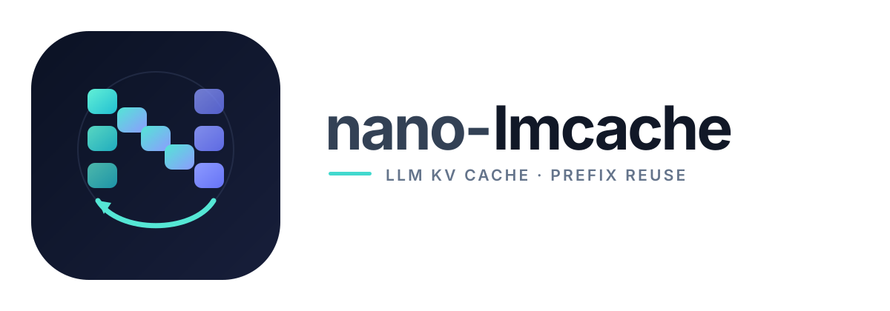

<p align="center">
  
</p>

# nano-lmcache

An educational, step-by-step implementation of KV cache reuse, from a
pure-Python prototype to real GPU tensors and vLLM integration.

nano-lmcache is a teaching project, not a reimplementation or replacement
of [LMCache](https://github.com/LMCache/LMCache). It rebuilds the core
ideas one concept at a time, each with tests and a runnable example, so
that learners can later read production systems like LMCache and vLLM
and understand why they are designed the way they are.

## Goals

- Understand KV cache reuse and prefix matching.
- Implement cache keying and storage abstractions.
- Explore in-memory caching before introducing more complex backends.
- Progress toward integration with real LLM inference engines.

## Development

Requirements: Python 3.11+ and uv.

```bash
uv sync
uv run pytest
uv run ruff check .
uv run mypy src/nano_lmcache
```

## Try it

```bash
uv run python examples/demo_chunking.py       # chunk keys in isolation
uv run python examples/demo_prefix_cache.py   # full cache loop + metrics
uv run python examples/demo_disk_cache.py     # run twice: reuse across restarts
uv run python examples/demo_tiered_storage.py # memory in front of disk
```

With a real model (needs `uv sync --extra hf`):

```bash
uv run python examples/demo_kv_reuse.py --model Qwen/Qwen3-0.6B
uv run python examples/demo_kv_reuse.py --device cuda --offload  # KV in CPU RAM
uv run python examples/demo_kv_reuse.py --device cuda --offload --disk /tmp/kv  # run twice
```

The prefix-cache demo serves four requests against one cache and prints
per-chunk hit/miss decisions plus cumulative reuse metrics.

New to KV cache concepts? Read the [Glossary and FAQ](docs/glossary.md) for short definitions and beginner-friendly answers.

## Roadmap

1. **Nano** (done): Token chunking, prefix-aware chunk keys, an
   in-memory backend, continuous-prefix lookup, and hit/miss metrics.
2. **Mini** (in progress): A storage interface and bounded, prefix-safe
   eviction are in place; disk and tiered backends come next.
3. **GPU and vLLM**: Real KV tensors verified against a real model, GPU
   to CPU offload, and a vLLM KV connector.

See [ROADMAP.md](ROADMAP.md) for the full task list. Tasks are open for
contributors to claim.

## Scope

The initial implementation prioritizes clarity and testability over
production performance. Distributed caching, GPU-specific optimizations,
and inference-engine integration are introduced only when the core
concepts are established.

## Contributing and license

Contributions are welcome. Pick a task from [ROADMAP.md](ROADMAP.md) and
see [CONTRIBUTING.md](CONTRIBUTING.md) for the workflow. nano-lmcache is released under the [MIT License](LICENSE).
