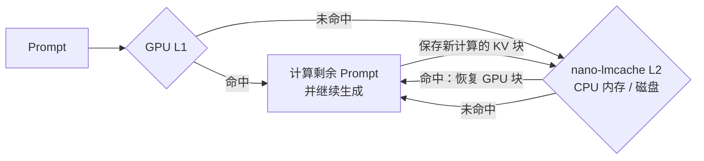

<p align="center">
  
</p>

[English](README.md) | 简体中文

# nano-lmcache

**复用 Prompt KV，重启后恢复缓存，并看清每次命中来自哪里。**

nano-lmcache 用简短、易读的 Python 模块实现
[LMCache](https://github.com/LMCache/LMCache) 背后的核心原理。
从零运行时依赖的前缀缓存示例，到真实 Hugging Face 模型张量，再到
[nano-vLLM](https://github.com/GeeeekExplorer/nano-vllm) 的外部 KV 缓存，都可以实际运行。
项目的目标是用尽量少的代码讲清每个原理，并用示例、正确性测试和实测结果验证它。

[循序渐进教程](docs/zh-CN/tutorial.md) · [文档目录](docs/zh-CN/README.md) ·
[GPU 验证记录（英文）](docs/gpu-validation.md) · [性能实验（英文）](docs/nanovllm-benchmark.md)

## 现在能做什么

| 能力 | 已实现的效果 | 运行入口 |
| --- | --- | --- |
| **复用共享前缀** | 匹配完整 Token 块，遇到第一个缺失块就停止，只计算未缓存的后缀；分块键包含前文信息，区分不同上下文。 | [前缀缓存示例](examples/demo_prefix_cache.py) |
| **让 KV 超出显存和进程生命周期** | 内存、磁盘及分层存储；慢层命中后提升到快层。支持条目数/字节容量限制，叶节点 LRU 保持前缀可达；内存、磁盘和分层后端支持多线程共享实例。 | [磁盘示例](examples/demo_disk_cache.py)、[分层示例](examples/demo_tiered_storage.py) |
| **复用真实模型张量** | 在 CPU 或 CUDA 上运行 Hugging Face 模型，将 KV 卸载到固定页 CPU 内存，并选择无损序列化或可选的有损 INT8 压缩。 | [真实模型示例](examples/demo_kv_reuse.py)、[INT8 实验（英文）](docs/quantized-kv.md) |
| **恢复真实推理引擎的缓存** | 将 nano-vLLM 完整 KV 块存入外部 L2；重启后恢复到 GPU 块，后续请求继续复用 GPU L1。 | [引擎教程](docs/zh-CN/tutorial.md#7-恢复真实引擎的缓存) |
| **观察完整缓存链路** | 在独立 HTML 中查看前缀树、命中/未命中、淘汰、提升和 GPU 导入/导出事件；支持流式回放已排序的工作负载 JSONL、限制缓存与明细预算并导出完整统计，也可导入真实引擎 Trace。 | [查看器教程](docs/zh-CN/tutorial.md#5-在查看器中跟踪查询)、[流式回放](docs/zh-CN/streaming-replay.md)、[引擎 Trace（英文）](docs/engine-traces.md) |
| **探索 Prefill/Decode 分离** | 在两个 toy model 角色之间传递带校验和的 KV，验证 Decode 不重算 Prompt 且生成 Token 一致，并模拟调度取舍。 | [PD 示例](examples/demo_pd_disaggregation.py)，只需核心包 |

引擎集成先复用本地 GPU KV，再查询外部 KV，最后计算剩余 Prompt。
新计算产生的完整块会保存下来，供后续请求复用。



## 已经验证了什么

以下结果来自已记录的实验，模型、硬件和工作负载见表中说明。
每份报告均包含环境和复现命令。

| 实验 | 结果 | 依据 |
| --- | --- | --- |
| **真实引擎首 Token 延迟**：Qwen3-0.6B、RTX 4090、8,224-token Prompt，复用 8,192 tokens | GPU L1 为空时，从固定页 CPU 内存 L2 恢复，TTFT **125.0 → 52.4 ms**；五轮中位数。 | [TTFT 报告（英文）](docs/nanovllm-benchmark.md) |
| **进程重启恢复**：Qwen3-0.6B、RTX 4090 | 新 nano-vLLM 进程在空 L1 下从磁盘恢复 **5 个 KV 块**；两道问题在冷启动与重启后生成的答案一致。 | [GPU 验证记录（英文）](docs/gpu-validation.md) |
| **INT8 存储**：合成 FP16/BF16 KV 块、Apple M4 CPU | **原始字节数 / INT8 序列化字节数 ≈ 1.60×**，已计入 FP32 缩放因子开销。压缩有损，需主动启用。 | [压缩报告（英文）](docs/quantized-kv.md) |
| **前缀安全淘汰**：链深 1,024 块、容量 8,192、Apple arm64 | 用堆选择 LRU 叶节点，保持原淘汰策略，将整轮频繁插入/淘汰耗时从 **788 ms 降到 208 ms**。 | [淘汰报告（英文）](docs/eviction-performance.md) |

同一 TTFT 实验中，磁盘 L2 在所有测试长度下都比重算更慢；短链淘汰负载也会付出额外的维护开销。
报告同时记录了收益与成本，方便判断什么场景值得使用缓存。

## 从这里开始

要求：Python 3.11+ 和 [uv](https://docs.astral.sh/uv/)。以下命令均在仓库根目录执行：

```bash
git clone https://github.com/Dami-wq-k03/nano-lmcache.git
cd nano-lmcache
uv sync --locked
uv run python examples/demo_prefix_cache.py
```

示例展示冷缓存未命中、共享前缀命中，以及条目数和字节容量限制下的淘汰。
数据载荷使用短字符串，不需要下载模型、安装 PyTorch 或使用 GPU。

核心 API 就是查询和存储。在 `uv run python` 会话中运行：

```python
from nano_lmcache.core.prefix_cache import ChunkedPrefixCache

cache = ChunkedPrefixCache(chunk_size=2, namespace="demo-model")
cache.store([10, 20, 30, 40, 50, 60], ["kv-0", "kv-1", "kv-2"])
hit = cache.lookup([10, 20, 30, 40, 70, 80])
print(hit.matched_tokens, hit.values)
# 4 ('kv-0', 'kv-1')
```

第二个 Prompt 复用了前 4 个 Token，只有 `[70, 80]` 需要计算新 KV。
这里的字符串代表已计算的 KV；张量和引擎适配层通过同一存储接口保存真实张量。

### 看缓存跨进程保留下来

使用同一个全新缓存目录运行两次，每条命令都会启动新的 Python 进程：

```bash
uv run python examples/demo_disk_cache.py --dir /tmp/nano-lmcache-readme-kv
uv run python examples/demo_disk_cache.py --dir /tmp/nano-lmcache-readme-kv
```

第一次显示 `Reused 0/3 chunks`，第二次显示 `Reused 3/3 chunks`，缓存来自磁盘恢复。

### 在查看器中逐步观察

```bash
uv run python -m nano_lmcache.visualize --scenario partial_prefix_hit \
  --output /tmp/nano-lmcache-trace.html
```

在浏览器中打开 `/tmp/nano-lmcache-trace.html`，即可查看前缀树和事件时间线，
使用 Next/Previous 和播放控件逐步观察，无需服务端或 CDN。
同一个查看器也能加载[真实引擎 Trace（英文）](docs/engine-traces.md)。

### 运行真实模型或引擎

安装可选 `hf` 依赖，即可在 CPU 上运行 Hugging Face KV 复用：

```bash
uv run --extra hf python examples/demo_kv_reuse.py --model Qwen/Qwen3-0.6B
```

如果 `--model` 不是本地目录，该命令会下载模型权重。
示例会报告复用/计算的 Token 数，并将后缀 logits 与完整重算进行比较。
加上 `--device cuda --offload`，即可让模型在 CUDA 上运行、缓存 KV 留在固定页 CPU 内存。

对于 nano-vLLM，请按[引擎教程](docs/zh-CN/tutorial.md#7-恢复真实引擎的缓存)运行两次磁盘缓存示例，
观察冷启动计算、重启恢复和后续 GPU L1 命中。
需要 Linux、NVIDIA GPU、本地模型权重和 `nanovllm` 依赖组。

## 接下来读什么

| 目标 | 指南 | 环境要求 |
| --- | --- | --- |
| 从分块键一路学到引擎重启恢复 | [循序渐进教程](docs/zh-CN/tutorial.md) | 前五步只需核心包 |
| 查找概念、命令和实验 | [文档目录](docs/zh-CN/README.md) | 按主题说明 |
| 理解术语和设计 | [术语与 FAQ（英文）](docs/glossary.md)、[架构](docs/zh-CN/architecture.md) | 核心包即可 |
| 理解引擎适配层 | [nano-vLLM 集成设计（英文）](docs/nanovllm-integration.md) | 运行需要 GPU；源码可独立阅读 |
| 探索完整 vLLM 的 Connector API | [vLLM Connector 指南（英文）](docs/vllm-kv-connector.md) | 空操作 Connector、真实请求日志与 GPU 输出对照 |
| 学习 Prefill/Decode 交接 | [PD 指南](docs/zh-CN/pd-disaggregation.md) | Toy model，只需核心包 |

核心包没有运行时依赖。PyTorch 和推理引擎依赖均为可选项，安装与测试命令统一见
[贡献指南（英文）](CONTRIBUTING.md)。本页与英文 README 同步维护。

## 项目范围与贡献

这是一个用于理解 LMCache 类系统的教学实现。
nano-vLLM 已支持外部 KV 复用；完整 vLLM 集成已提供经过验证的空操作 Connector，
外部 KV 查询和传输仍待实现。
PD 分离使用确定性的 toy model 和模拟时间线。
生产性能和 LMCache API 兼容性不属于当前项目目标。

任务状态、前置条件和后续工作统一维护在 [ROADMAP.md（英文）](ROADMAP.md)。
贡献前请选择开放任务，并阅读 [CONTRIBUTING.md（英文）](CONTRIBUTING.md)。

项目使用 [MIT 许可证](LICENSE)。
