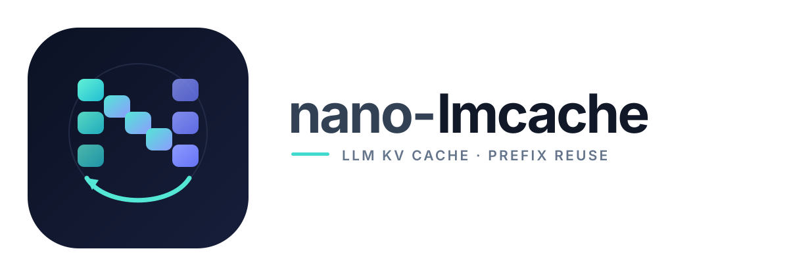

<p align="center">
  
</p>

[English](README.md) | 简体中文

本文译自英文版 [README.md](README.md) commit `2aa6d0a`，内容以英文版为准。架构说明见 [docs/zh-CN/architecture.md](docs/zh-CN/architecture.md)。

# nano-lmcache

一个循序渐进的 KV 缓存复用教学项目，从纯 Python 原型逐步发展到真实 GPU 张量和 vLLM 集成。

nano-lmcache 是一个教学项目，而不是 [LMCache](https://github.com/LMCache/LMCache) 的重新实现或替代品。它将核心概念逐一重新实现，每个概念都配有测试和可运行示例，帮助学习者日后阅读 LMCache 和 vLLM 等生产级系统，并理解它们的设计原因。

## 学习目标

- 理解 KV 缓存复用和前缀匹配。
- 实现缓存键生成和存储抽象。
- 先探索内存缓存，再逐步引入更复杂的后端。
- 逐步实现与真实大语言模型推理引擎的集成。

## 开发环境

要求：Python 3.11 或更高版本，以及 uv。

```bash
uv sync
uv run pytest
uv run ruff check .
uv run mypy src/nano_lmcache
```

## 试运行

```bash
uv run python examples/demo_chunking.py       # 单独演示分块键
uv run python examples/demo_prefix_cache.py   # 完整缓存流程和指标
uv run python examples/demo_disk_cache.py     # 连续运行两次，验证重启后的复用
uv run python examples/demo_tiered_storage.py # 内存层位于磁盘层之前
```

使用真实模型（需要执行 `uv sync --extra hf`）：

```bash
uv run python examples/demo_kv_reuse.py --model Qwen/Qwen3-0.6B
uv run python examples/demo_kv_reuse.py --device cuda --offload
uv run python examples/demo_kv_reuse.py --device cuda --offload --disk /tmp/kv
```

前缀缓存示例会使用同一个缓存处理四个请求，并输出每个分块的命中或未命中情况，以及累计复用指标。

也可以直接回放可控工作负载并生成离线 Trace 可视化页面：

```bash
uv run python -m nano_lmcache.visualize \
  --scenario partial_prefix_hit \
  --output trace.html
```

生成的 HTML 不依赖 CDN 或常驻服务，包含 Chunk 状态、Prefix Key、Prefix Tree、事件详情和逐步播放控制。FreeInference JSONL 会使用独立的 opaque block replay，不会把数据集中的 Block ID 当作模型 Token ID：

```bash
uv run python -m nano_lmcache.visualize \
  --freeinference-jsonl sample.jsonl \
  --limit 100 \
  --output freeinference.html
```

## 路线图

1. **Nano（已完成）**：Token 分块、感知前缀的分块键、内存后端、连续前缀查询，以及命中/未命中指标。
2. **Mini（已完成）**：存储接口、有界且保持前缀安全的淘汰机制、磁盘后端和内存/磁盘分层后端。
3. **GPU 和 nano-vLLM（V1 已完成）**：真实 KV 张量、GPU 到 CPU 的卸载，以及 nano-vLLM 外部 KV Cache 集成。
4. **Visualization Lab（进行中）**：Trace、Synthetic/FreeInference Workload Replay、离线 HTML 播放、Storage 事件和可选的 GPU/nano-vLLM 传输事件。

完整任务列表请参阅 [ROADMAP.md](ROADMAP.md)。欢迎贡献者认领开放任务。

## 项目范围

本项目优先考虑代码的清晰性和可测试性，而不是生产环境中的性能。分布式缓存、GPU 专项优化和推理引擎集成会在核心概念建立之后逐步引入。

## 贡献与许可证

欢迎贡献。请从 [ROADMAP.md](ROADMAP.md) 中选择任务，并阅读 [CONTRIBUTING.md](CONTRIBUTING.md) 了解贡献流程。nano-lmcache 使用 MIT 许可证发布，详情请参阅 [LICENSE](LICENSE)。
