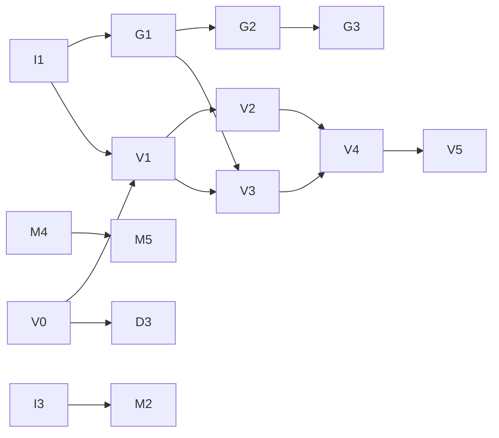

# nano-lmcache 路线图与任务清单

这份文档列出了 nano-lmcache 接下来要做的事情，供想参与的开发者认领。

## 项目定位

nano-lmcache 是一个**教学项目**，不是 LMCache 的复刻，也不是它的替代品。

[LMCache](https://github.com/LMCache/LMCache) 是一个面向生产的 KV cache
系统，功能多、代码量大，初学者很难直接读懂。nano-lmcache 的目标是：

- 把 KV cache 复用拆成一个个独立的概念，每次只引入一个，每一步都有测试和可运行的示例。
- 从纯 Python 原型一路走到**真实 GPU 上的 KV tensor**，最后**接入 vLLM**，
  让学习者亲眼看到前缀复用如何减少真实推理的 prefill 计算。
- 学完这个项目，再去读 LMCache 和 vLLM 的源码时，能看懂它们在解决什么问题、为什么这样设计。

**不是目标：**

- 追求生产级性能或与 LMCache 的 API 兼容。
- 覆盖 LMCache 的全部功能。只实现最能说明原理的那部分。
- 直接复制 LMCache 的代码。可以参考它的设计，但请用自己的方式重写，并解释清楚。

所以，评审一个 PR 时首先看的是：**读者能不能从这段代码和文档里学懂这个概念**。

## 当前进度

已完成（纯 Python，无 GPU 依赖）：

- [x] Token 分块与前缀感知的 chunk key（`core/chunking.py`）
- [x] 内存存储 `MemoryKVCache`（`storage/memory.py`）
- [x] 连续前缀匹配 `ChunkedPrefixCache`（`core/prefix_cache.py`）
- [x] 命中统计 `CacheMetrics`（`core/metrics.py`）
- [x] 存储协议 `CacheStorage`，缓存逻辑不依赖具体后端（`storage/protocol.py`）
- [x] 容量限制与**前缀安全淘汰**：只淘汰叶子节点，不留下无法访问的后缀
- [x] 可运行的 demo（`examples/`）和架构文档（`docs/architecture.md`）

## 如何认领任务

1. 在下方总表里挑一个任务，确认它的前置任务已经完成。
2. 在 GitHub 上开一个 issue（或在已有 issue 下留言），写明任务编号，例如
   `认领 G1`，避免多人重复做。
3. 按 [CONTRIBUTING.md](CONTRIBUTING.md) 的流程开发：先写测试，一个任务一个 PR。
4. PR 描述里对照任务的「验收标准」逐条说明完成情况。

不确定任务该怎么做，或者想提新任务，直接开 issue 讨论。

## 任务总表

| 编号 | 任务 | 难度 | 需要 GPU | 前置 |
| --- | --- | --- | --- | --- |
| **基础设施** | | | | |
| I1 | 可选依赖分组与 GPU 测试标记 | 中 | 否 | – |
| I2 | Issue / PR 模板 | 易 | 否 | – |
| I3 | 基准测试脚手架 | 易 | 否 | – |
| **Mini：缓存行为（纯 Python）** | | | | |
| M1 | 淘汰相关指标 | 易 | 否 | – |
| M2 | 淘汰从 O(n) 优化为 O(1) | 中 | 否 | I3 |
| M3 | 按字节计算容量 | 中 | 否 | – |
| M4 | 本地磁盘后端 | 中 | 否 | – |
| M5 | 内存 + 磁盘分层存储 | 难 | 否 | M4 |
| **GPU：真实 KV tensor** | | | | |
| G1 | 用真实模型验证 KV 复用的正确性 | 中 | 可选 | I1 |
| G2 | GPU → CPU 卸载后端 | 难 | 是 | G1 |
| G3 | 重算 vs 加载的代价测量 | 中 | 是 | G2 |
| **vLLM 集成** | | | | |
| V0 | vLLM KV connector 调研文档 | 中 | 否 | – |
| V1 | 最小 connector 骨架 | 中 | 是 | I1、V0 |
| V2 | Scheduler 侧：上报命中的 token 数 | 难 | 是 | V1 |
| V3 | Worker 侧：从分页 KV cache 保存 chunk | 难 | 是 | V1、G1 |
| V4 | Worker 侧：把缓存的 chunk 加载回 GPU | 难 | 是 | V2、V3 |
| V5 | 端到端 demo 与 TTFT 对比 | 中 | 是 | V4 |
| **教学文档** | | | | |
| D1 | 架构图 | 易 | 否 | – |
| D2 | 分章节教程 | 中 | 否 | – |
| D3 | 概念对照表：nano-lmcache ↔ LMCache ↔ vLLM | 中 | 否 | V0 |

**适合第一次贡献：** I2、M1、D1、I3。

**依赖关系：**

---

## 基础设施

### I1：可选依赖分组与 GPU 测试标记

核心包现在没有任何运行时依赖，这一点要保持：只学缓存原理的人不应该被迫安装 PyTorch。

要做：

- 在 `pyproject.toml` 里增加可选的依赖分组，例如 `torch`、`hf`（transformers）、`vllm`，默认的 `uv sync` 不安装它们。
- GPU / vLLM 相关代码放在独立的子包里（例如 `nano_lmcache/tensor/`、`nano_lmcache/integration/vllm/`），不要在 `nano_lmcache` 顶层导入 torch。
- 增加 pytest 标记（例如 `gpu`、`vllm`）。缺少依赖或没有 CUDA 时自动跳过。
- CI 继续只跑 CPU 测试；在 CONTRIBUTING.md 里写明如何在本地跑 GPU 测试。

验收标准：

- 不装 torch 时，`uv sync && uv run pytest` 照常通过。
- 装了 torch 但没有 GPU 时，GPU 测试显示为 skipped 而不是失败。
- `import nano_lmcache` 不会间接导入 torch。

### I2：Issue / PR 模板

在 `.github/` 下增加任务认领 issue 模板和 PR 模板。PR 模板里列出检查项：测试、三条检查命令、是否更新了示例和文档。

### I3：基准测试脚手架

新建 `benchmarks/` 目录和一个脚本，测量 `store` / `lookup` 在不同 chunk 数量、不同容量下的耗时。不进 CI，只用于对比优化前后。M2 用它来证明优化有效。

---

## Mini：缓存行为（纯 Python）

### M1：淘汰相关指标

现在能看到命中率，但看不到淘汰发生了多少次。

要做：

- 统计被淘汰的条目数，以及因为容量不足或父节点缺失而被拒绝写入的条目数。
- 决定这些数字放在 `CacheMetrics` 还是存储层自己的统计里，并在 PR 里说明理由。
- 在 `examples/demo_prefix_cache.py` 的有容量限制部分打印这些数字。

验收标准：有测试覆盖“写入超过容量时淘汰计数正确”和“超长 prompt 的后缀被拒绝写入时计数正确”。

学到什么：缓存调优离不开可观测性，只看命中率会掩盖问题。

### M2：淘汰从 O(n) 优化为 O(1)

`MemoryKVCache._find_victim` 现在从最旧的条目开始扫描，寻找第一个叶子，最坏情况是 O(n)。

要做：单独维护一个按使用时间排序的叶子集合，让查找淘汰对象变成 O(1)。注意条目在叶子和非叶子之间切换时（增加或删除子节点）要同步更新这个集合。

验收标准：

- `tests/unit/test_bounded_memory.py` 全部通过，行为不变。
- 用 I3 的基准脚本给出优化前后的对比数据。
- 代码注释解释清楚叶子集合在什么时候增删。

### M3：按字节计算容量

真实系统按内存大小限制缓存，而不是按条目数。

要做：`MemoryKVCache` 支持 `max_bytes`，通过一个可注入的函数计算 payload 大小。思考并说明：同时设置 `max_entries` 和 `max_bytes` 时如何处理；单个 payload 比整个容量还大时如何处理。

验收标准：前缀安全的不变量（缓存中每个条目的整条祖先链都在）依然成立，并有测试证明。

### M4：本地磁盘后端

实现满足 `CacheStorage` 协议的 `DiskKVCache`，每个 key 一个文件。

要做：

- 序列化方式要可替换。不要默认用 `pickle` 读取不受信任的文件；在文档里解释为什么。
- 处理写入一半时进程崩溃的情况（例如先写临时文件再重命名）。
- 进程重启后，缓存的内容依然能命中。

验收标准：同一组前缀匹配测试分别在 `MemoryKVCache` 和 `DiskKVCache` 上通过（可以用 pytest 参数化）。

学到什么：缓存为什么能跨进程、跨重启复用，这是 vLLM 自带的 prefix caching 做不到的。

### M5：内存 + 磁盘分层存储

LMCache 的核心思路之一是分层：热数据放快的内存，冷数据放容量大的磁盘。

要做：实现一个组合两个后端的 `TieredStorage`：内存满时淘汰的条目写到磁盘；在磁盘上命中时提升回内存。

验收标准：

- 内存层淘汰的前缀之后仍能从磁盘层命中。
- 两层合起来依然满足前缀安全的不变量。
- 文档说明分层存储如何选择写入和提升策略，以及各自的代价。

---

## GPU：真实 KV tensor

从这里开始需要 PyTorch。目标是把前面“存一个字符串当 payload”换成真实模型产生的 KV tensor。

### G1：用真实模型验证 KV 复用的正确性

**这是整个项目最重要的一个教学节点**：证明缓存复用不只是“能跑”，而是结果正确。

要做：

- 用 HuggingFace transformers 加载一个小模型（例如 Qwen2.5-0.5B 或 GPT-2）。
- 对一段 prompt 做 prefill，按 chunk 切分每一层的 K/V，存进 `ChunkedPrefixCache`。
- 对一个共享前缀的新请求：加载命中的 chunk，拼回 `past_key_values`，只计算剩下的 token。
- 定义一个 chunk 的 KV 在内存里长什么样（层数、K/V、token 数、head 数、head 维度），以及 dtype 和 device。

验收标准：

- 复用前缀 KV 后得到的 logits，和对完整 prompt 从头计算的 logits 在合理误差内一致（`torch.allclose`），并有测试覆盖。
- 反例测试：同样的 token 放在不同的前缀后面，得到的 chunk key 不同，因此不会被错误复用。
- CPU 上也能跑（慢一点没关系），这样没有 GPU 的人也能学这一章。

学到什么：为什么只有前缀能复用（每个 token 的 KV 依赖它之前的所有 token，以及位置编码），这正是 chunk key 要把前缀纳入哈希的原因。

### G2：GPU → CPU 卸载后端

要做：实现一个后端，把 GPU 上的 KV tensor 拷贝到 CPU 内存（pinned memory）存储，命中时再拷回 GPU。

验收标准：

- 拷回 GPU 的 tensor 与原始 tensor 完全一致。
- 演示 pinned memory 和 `non_blocking` 拷贝对传输速度的影响，并记录测量结果。
- 有容量限制时复用前面的前缀安全淘汰逻辑，而不是另写一套。

### G3：重算 vs 加载的代价测量

缓存不总是划算：当前缀很短时，从 CPU 拷回来可能比在 GPU 上重算还慢。

要做：针对不同前缀长度，测量 prefill 重算耗时和从 G2 后端加载耗时，在 `docs/` 中用图表展示交叉点，并解释它和模型大小、GPU 带宽的关系。

学到什么：判断什么时候值得缓存，比实现缓存本身更重要。

---

## vLLM 集成

vLLM 的 KV connector 接口变化较快。**V0 要先固定一个 vLLM 版本**，后续任务都以这个版本为准；升级版本另开任务。下面提到的类名和方法名以固定版本的源码为准。

### V0：vLLM KV connector 调研文档

不需要 GPU，主要是读 vLLM 源码。这是整个 vLLM 方向的入口，也是很好的第一个“读源码”任务。

要做：写 `docs/vllm-kv-connector.md`，内容包括：

- 固定的 vLLM 版本，以及选择它的理由。
- vLLM v1 KV connector 基类的接口，分成 scheduler 侧和 worker 侧两部分，各自在一次请求的什么时机被调用（建议画时序图）。
- vLLM 分页 KV cache（paged attention）的内存布局：block、block table、slot mapping，以及它和我们 chunk 的对应关系（chunk_size 应该是 block_size 的整数倍吗？）。
- vLLM 自带的 automatic prefix caching 和外部 KV cache（LMCache 这类）的区别：前者只在单个实例的 GPU 显存里，后者可以卸载到 CPU/磁盘、跨实例、跨重启。
- vLLM 仓库里自带的示例 connector（把 KV 存到本地文件的那个）可以作为最接近的参考实现。

### V1：最小 connector 骨架

要做：

- 在 `nano_lmcache/integration/vllm/` 下实现一个 out-of-tree connector，通过 vLLM 的 `--kv-transfer-config` 加载（不修改 vLLM 源码）。
- 所有方法先做最简单的实现：永远报告 0 个命中的 token，不保存也不加载，但打印每个方法被调用的顺序和参数。

验收标准：

- 带着这个 connector 启动 vLLM，生成结果和不带时完全一致。
- 在文档里附一份真实请求的调用日志，对照 V0 的时序图解释。

### V2：Scheduler 侧：上报命中的 token 数

要做：在 scheduler 询问“这个请求有多少 token 可以从外部加载”时，用 `ChunkedPrefixCache.lookup` 回答。只上报完整 chunk 的命中，并处理 chunk 与 block 的对齐。

验收标准：日志里能看到第二次发送相同前缀的请求时，上报的命中 token 数正确；第一次为 0。

### V3：Worker 侧：从分页 KV cache 保存 chunk

要做：在 vLLM 计算完每一层后，按 slot mapping 从分页的 KV cache 里取出属于这个请求的 K/V，切成 chunk，存进缓存。

验收标准：保存下来的 chunk 和 G1 中用 transformers 对同一 prompt 算出的 KV 在误差内一致。这是检验“取对了位置”最直接的办法。

### V4：Worker 侧：把缓存的 chunk 加载回 GPU

要做：对 V2 报告命中的部分，在前向计算前把缓存的 chunk 写回 vLLM 为这个请求分配的 block 里。

验收标准：

- 同一个 prompt 第二次请求时，使用贪心解码（temperature=0）的输出与第一次完全一致。
- 第二次请求的 prefill 计算量（或耗时）明显下降。

### V5：端到端 demo 与 TTFT 对比

要做：

- `examples/` 下增加一个 vLLM demo，展示共享长前缀（例如同一份长文档、不同问题）的多个请求。
- 对比三种情况的首 token 延迟（TTFT）：不开任何缓存；只开 vLLM 自带的 prefix caching；使用 nano-lmcache connector，并在 vLLM **重启后**再次请求。
- 第三种情况正是外部 KV cache 的价值所在，用数据说明。

---

## 教学文档

### D1：架构图

在 `docs/architecture.md` 里用 mermaid 画出当前模块关系和一次 `lookup` / `store` 的数据流。GitHub 可以直接渲染 mermaid。

### D2：分章节教程

在 `docs/tutorial/` 下按概念分章：为什么要复用 KV → 分块 → 前缀感知的 key → 连续前缀匹配 → 淘汰为什么必须前缀安全 → 真实 tensor（G1 完成后）→ 接入 vLLM（V4 完成后）。每章对应一段代码和一个可以动手改的小练习。

### D3：概念对照表：nano-lmcache ↔ LMCache ↔ vLLM

列出 nano-lmcache 的每个概念在 LMCache 和 vLLM 源码中对应的模块或类，并说明 nano-lmcache 刻意简化了什么。方便学完的人直接去读真实系统。

---

## 硬件说明

- I、M、D 系列任务和 V0 只需要普通电脑。
- G1 可以在 CPU 上完成；G2、G3 需要 NVIDIA GPU。
- V1–V5 需要一张能运行 vLLM 的 NVIDIA GPU。使用 0.5B 级别的小模型即可，对显存要求不高。
- 没有 GPU 也可以做 V0、D3 这类读源码、写文档的任务，同样很有价值。
