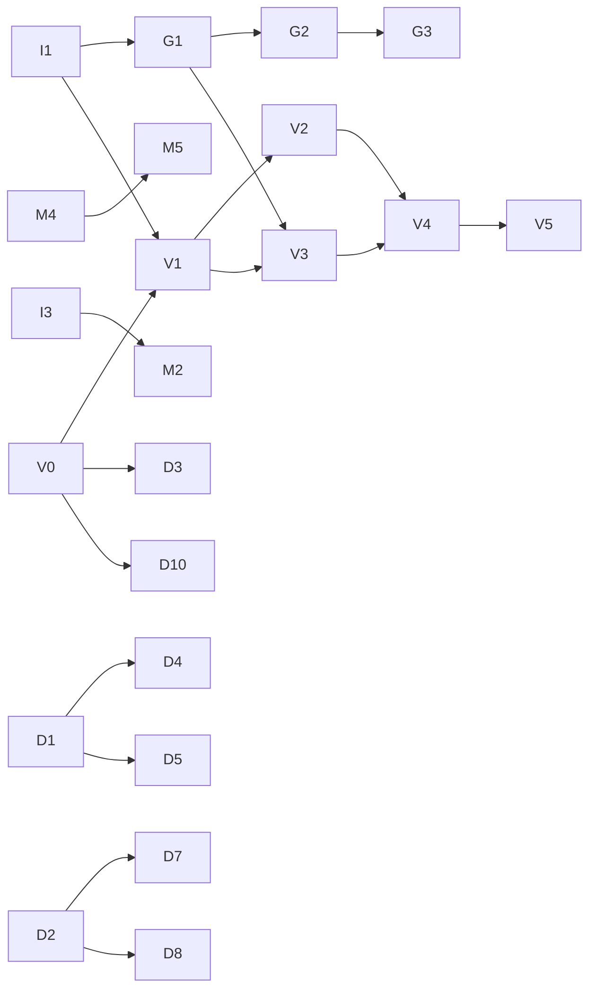

# nano-lmcache Roadmap and Task List

This document lists the work ahead for nano-lmcache, for contributors who
want to pick up a task.

## What this project is

nano-lmcache is a **teaching project**. It is not a reimplementation of
LMCache, and not a replacement for it.

[LMCache](https://github.com/LMCache/LMCache) is a production KV cache
system: feature-rich, large, and hard for newcomers to read directly.
nano-lmcache aims to:

- Break KV cache reuse into independent concepts and introduce them one
  at a time, each with tests and a runnable example.
- Go all the way from a pure-Python prototype to **real KV tensors on a
  GPU**, and finally **integrate with vLLM**, so learners can see prefix
  reuse cut real prefill compute.
- Leave learners able to read the LMCache and vLLM source and understand
  what problems they solve and why they are designed the way they are.

**Non-goals:**

- Production-level performance, or API compatibility with LMCache.
- Covering every LMCache feature. Only the parts that best explain the
  underlying ideas are implemented.
- Copying LMCache code. Borrow its design ideas, but rewrite them in your
  own way and explain them.

So the first question when reviewing a PR is: **can a reader learn the
concept from this code and its docs?**

## Current status

Done (pure Python, no GPU dependency):

- [x] Token chunking and prefix-aware chunk keys (`core/chunking.py`)
- [x] In-memory storage `MemoryKVCache` (`storage/memory.py`)
- [x] Continuous prefix matching `ChunkedPrefixCache` (`core/prefix_cache.py`)
- [x] Hit/miss accounting `CacheMetrics` (`core/metrics.py`)
- [x] Storage protocol `CacheStorage`, so cache logic does not depend on a
      concrete backend (`storage/protocol.py`)
- [x] Capacity limits and **prefix-safe eviction**: only leaves are
      evicted, so no unreachable suffix is ever left behind
- [x] Runnable demos (`examples/`) and architecture notes
      (`docs/architecture.md`)

Done (optional torch / GPU layer):

- [x] Optional `torch` and `hf` extras, `torch` / `gpu` / `vllm` test
      markers, and a core package that never imports torch (I1)
- [x] Real KV tensors: prefix KV reuse with a HuggingFace model, verified
      against a from-scratch forward pass (`tensor/`, G1)
- [x] CUDA 12.4 PyTorch wheels on Linux, so GPU tests run on common
      drivers (`tool.uv.sources` in `pyproject.toml`)

Written by the maintainer and waiting for review: I2, I3, M1, D1. Please
do not claim these.

## How to claim a task

1. Pick a task from the table below and check that its prerequisites are
   done.
2. Open a GitHub issue (or comment on an existing one) naming the task ID,
   for example `Claiming G1`, so two people don't do the same work.
3. Follow the workflow in [CONTRIBUTING.md](CONTRIBUTING.md): tests first,
   one task per PR.
4. In the PR description, go through the task's acceptance criteria one by
   one.

If you are unsure how to approach a task, or want to propose a new one,
open an issue to discuss it.

## Task overview

| ID | Task | Difficulty | Needs GPU | Prerequisites | Status |
| --- | --- | --- | --- | --- | --- |
| **Infrastructure** | | | | | |
| I1 | Optional dependency groups and GPU test markers | Medium | No | – | Done |
| I2 | Issue and PR templates | Easy | No | – | In review |
| I3 | Benchmark scaffolding | Easy | No | – | In review |
| **Mini: cache behavior (pure Python)** | | | | | |
| M1 | Eviction metrics | Easy | No | – | In review |
| M2 | Make eviction cheaper than a linear scan | Medium | No | I3 | Open (needs rework, see below) |
| M3 | Byte-based capacity | Medium | No | – | Open |
| M4 | Local disk backend | Medium | No | – | Open |
| M5 | Tiered memory + disk storage | Hard | No | M4 | Open |
| **GPU: real KV tensors** | | | | | |
| G1 | Verify KV reuse correctness with a real model | Medium | Optional | I1 | Done |
| G2 | GPU to CPU offload backend | Hard | Yes | G1 | Open |
| G3 | Measure recompute vs. load cost | Medium | Yes | G2 | Open |
| **vLLM integration** | | | | | |
| V0 | vLLM KV connector research notes | Medium | No | – | Open |
| V1 | Minimal connector skeleton | Medium | Yes | I1, V0 | Open |
| V2 | Scheduler side: report matched tokens | Hard | Yes | V1 | Open |
| V3 | Worker side: save chunks from the paged KV cache | Hard | Yes | V1, G1 | Open |
| V4 | Worker side: load cached chunks back to the GPU | Hard | Yes | V2, V3 | Open |
| V5 | End-to-end demo and TTFT comparison | Medium | Yes | V4 | Open |
| **Teaching docs** | | | | | |
| D1 | Architecture diagrams | Easy | No | – | In review |
| D2 | Step-by-step tutorial | Medium | No | – | Open |
| D3 | Concept map: nano-lmcache ↔ LMCache ↔ vLLM | Medium | No | V0 | Open |
| D4 | Animation: one `store` and one `lookup` step by step | Medium | No | D1 | Open |
| D5 | Animation: why eviction must be prefix-safe | Medium | No | D1 | Open |
| D6 | Visualization: why only prefixes can be reused | Medium | No | – | Open |
| D7 | Jupyter notebooks for each tutorial chapter | Medium | No | D2 | Open |
| D8 | Exercises with hidden tests and reference solutions | Medium | No | D2 | Open |
| D9 | Glossary and FAQ | Easy | No | – | Open |
| D10 | Illustration: vLLM paged KV cache vs. nano-lmcache chunks | Medium | No | V0 | Open |
| D11 | Chinese translation of README and docs | Easy | No | – | Open |

**Good first contributions:** M3, D2, D9, D11, and V0 (reading source, no GPU).

Teaching material (animations, notebooks, exercises, translations) is as
welcome as code. See the D tasks below.

**Dependencies:**

---

## Infrastructure

### I1: Optional dependency groups and GPU test markers

**Status: done.** The `vllm` extra is deliberately missing: add it together
with the version pin in V0/V1.

The core package has no runtime dependencies, and that must stay true:
someone learning the cache concepts should never be forced to install
PyTorch.

To do:

- Add optional dependency groups to `pyproject.toml`, for example `torch`,
  `hf` (transformers), and `vllm`. A plain `uv sync` must not install
  them.
- Put GPU and vLLM code in separate subpackages (for example
  `nano_lmcache/tensor/` and `nano_lmcache/integration/vllm/`). Never
  import torch from the top-level `nano_lmcache` package.
- Add pytest markers (for example `gpu` and `vllm`) that skip
  automatically when the dependency or CUDA is missing.
- Keep CI CPU-only, and document in CONTRIBUTING.md how to run the GPU
  tests locally.

Acceptance criteria:

- Without torch installed, `uv sync && uv run pytest` passes as before.
- With torch installed but no GPU, GPU tests show as skipped, not failed.
- `import nano_lmcache` does not import torch, directly or indirectly.

### I2: Issue and PR templates

Add a task-claim issue template and a PR template under `.github/`. The
PR template should list the checks: tests, the three check commands, and
whether examples and docs were updated.

### I3: Benchmark scaffolding

Add a `benchmarks/` directory with a script that measures `store` and
`lookup` time across different chunk counts and capacities. It does not
run in CI; it exists to compare before and after an optimization. M2 uses
it to prove its speedup.

---

## Mini: cache behavior (pure Python)

### M1: Eviction metrics

Today you can see the hit rate, but not how often eviction happened.

To do:

- Count evicted entries, and entries rejected because the cache was full
  or their parent was missing.
- Decide whether these counters belong in `CacheMetrics` or in a
  storage-level stats object, and justify the choice in the PR.
- Print them in the bounded part of `examples/demo_prefix_cache.py`.

Acceptance criteria: tests cover "eviction count is correct when writes
exceed capacity" and "rejection count is correct when a long prompt's
suffix does not fit".

What you learn: tuning a cache requires observability; the hit rate
alone can hide problems.

### M2: Make eviction cheaper than a linear scan

`MemoryKVCache._find_victim` scans from the oldest entry looking for the
first leaf, which is O(n) in the worst case.

**This task needs a design decision first.** A plain recency-ordered
leaf set gives O(1), but an entry that becomes a leaf (its last child was
evicted) must slot into that order by its *last access time*, not at the
end, or the eviction order changes. An `OrderedDict` cannot insert in the
middle. Options to compare in your PR:

- A heap of `(last_access_tick, key)` with lazy deletion: keeps today's
  exact order, O(log n) amortized.
- Treat a newly exposed leaf as most recently used: O(1), but a different,
  documented policy. Existing tests may need to change; say why that is
  acceptable.

Measure before optimizing. With the I3 churn benchmark, eviction currently
adds only a modest overhead for short chains, so the win is mainly for
deep chains and large capacities. If the numbers do not justify the added
complexity, closing this task with that evidence is a valid outcome.

Acceptance criteria:

- `tests/unit/test_bounded_memory.py` passes unchanged.
- Before/after numbers from the I3 benchmark script, including a deep-chain
  case.
- Comments explain the chosen data structure and when entries enter and
  leave it.

### M3: Byte-based capacity

Real systems limit a cache by memory size, not by entry count.

To do: support `max_bytes` in `MemoryKVCache`, with payload size computed
by an injectable function. Decide and document what happens when both
`max_entries` and `max_bytes` are set, and when a single payload is
larger than the whole capacity.

Acceptance criteria: the prefix-safety invariant (every stored entry has
its whole ancestor chain stored) still holds, with tests proving it.

### M4: Local disk backend

Implement a `DiskKVCache` that satisfies the `CacheStorage` protocol,
with one file per key.

To do:

- Make serialization pluggable. Do not default to `pickle` for reading
  files that might not be trusted, and explain why in the docs.
- Handle a crash in the middle of a write (for example, write to a
  temporary file, then rename).
- Cached content must still hit after a process restart.

Acceptance criteria: the same prefix-matching tests pass against both
`MemoryKVCache` and `DiskKVCache` (pytest parametrization works well
here).

What you learn: why a cache can be reused across processes and restarts,
which vLLM's built-in prefix caching cannot do.

### M5: Tiered memory + disk storage

Tiering is one of LMCache's core ideas: hot data lives in fast memory,
cold data in larger, slower disk storage.

To do: implement a `TieredStorage` that combines two backends. Entries
evicted from a full memory tier are written to disk; a hit on disk is
promoted back to memory.

Acceptance criteria:

- A prefix evicted from the memory tier still hits from the disk tier.
- The two tiers together still satisfy the prefix-safety invariant.
- Docs explain the write and promotion policies chosen and their costs.

---

## GPU: real KV tensors

PyTorch is needed from here on. The goal is to replace the string
payloads used so far with KV tensors produced by a real model.

### G1: Verify KV reuse correctness with a real model

**Status: done** (`nano_lmcache/tensor/`, `examples/demo_kv_reuse.py`).
Follow-ups welcome: models with sliding-window or linear-attention layers
are rejected today, because a chunk stacks all layers into one tensor.

**This is the single most important teaching milestone in the project**:
proving that cache reuse is not just "it runs" but "the results are
correct".

To do:

- Load a small model with HuggingFace transformers (for example
  Qwen2.5-0.5B or GPT-2).
- Prefill a prompt, split each layer's K/V into chunks, and store them in
  `ChunkedPrefixCache`.
- For a new request that shares a prefix, load the matched chunks,
  reassemble them into `past_key_values`, and compute only the remaining
  tokens.
- Define what one chunk's KV looks like in memory (layers, K/V, tokens,
  heads, head dimension), along with its dtype and device.

Acceptance criteria:

- Logits computed with reused prefix KV match logits from computing the
  full prompt from scratch, within a reasonable tolerance
  (`torch.allclose`), covered by a test.
- A negative test: the same tokens after a different prefix get a
  different chunk key, so they are never wrongly reused.
- Runs on CPU too (slowly is fine), so people without a GPU can learn
  this chapter.

What you learn: why only prefixes can be reused (each token's KV depends
on every token before it, and on its position), which is exactly why the
chunk key hashes in the prefix.

### G2: GPU to CPU offload backend

To do: implement a backend that copies KV tensors from the GPU into CPU
memory (pinned memory) for storage, and copies them back to the GPU on a
hit.

Acceptance criteria:

- Tensors copied back to the GPU are identical to the originals.
- Demonstrate and record how pinned memory and `non_blocking` copies
  affect transfer speed.
- With a capacity limit, reuse the existing prefix-safe eviction logic
  instead of writing a second one.

### G3: Measure recompute vs. load cost

Caching does not always pay off: for a short prefix, copying KV back from
the CPU can be slower than recomputing it on the GPU.

We already see this in `examples/demo_kv_reuse.py`: on an RTX 4090 with
Qwen3-0.6B and a ~270 token prompt, reusing 256 cached tokens took about
60 ms, while recomputing the whole prompt took about 45 ms. Logits matched,
but the cache bookkeeping (stacking, cloning, rebuilding the HF cache)
cost more than the skipped compute. Part of this task is to separate
fixed overhead from per-token cost and find where reuse starts to win.

To do: for a range of prefix lengths, measure prefill recompute time and
load time from the G2 backend. Chart the crossover point in `docs/` and
explain how it depends on model size and GPU bandwidth.

What you learn: knowing when caching is worth it matters more than
implementing the cache itself.

---

## vLLM integration

vLLM's KV connector API changes quickly. **V0 must pin a vLLM version
first**, and all later tasks target that version; upgrading is a separate
task. Class and method names mentioned below should be checked against
the source of the pinned version.

### V0: vLLM KV connector research notes

No GPU needed; this is mostly reading vLLM source. It is the entry point
for all vLLM work, and a good first "read the source" task.

To do: write `docs/vllm-kv-connector.md`, covering:

- The pinned vLLM version and why it was chosen.
- The interface of vLLM's v1 KV connector base class, split into its
  scheduler-side and worker-side halves, and when each method is called
  during a request (a sequence diagram is recommended).
- The memory layout of vLLM's paged KV cache (paged attention): blocks,
  block tables, and slot mapping, and how they relate to our chunks.
  Should `chunk_size` be a multiple of `block_size`?
- How vLLM's built-in automatic prefix caching differs from an external
  KV cache such as LMCache: the former lives only in one instance's GPU
  memory; the latter can offload to CPU or disk and be shared across
  instances and restarts.
- The example connector that ships in the vLLM repository (the one that
  stores KV in local files) is the closest reference implementation.

### V1: Minimal connector skeleton

To do:

- Implement an out-of-tree connector in `nano_lmcache/integration/vllm/`,
  loaded through vLLM's `--kv-transfer-config` without modifying vLLM.
- Keep every method trivial at first: always report 0 matched tokens,
  never save or load, but log the order and arguments of every call.

Acceptance criteria:

- vLLM started with this connector generates exactly the same output as
  without it.
- The docs include a real request's call log, explained against the V0
  sequence diagram.

### V2: Scheduler side: report matched tokens

To do: when the scheduler asks how many tokens of a request can be loaded
externally, answer with `ChunkedPrefixCache.lookup`. Report only
complete-chunk hits, and handle alignment between chunks and blocks.

Acceptance criteria: logs show the correct matched token count the second
time a request with the same prefix arrives, and 0 the first time.

### V3: Worker side: save chunks from the paged KV cache

To do: after vLLM computes each layer, use the slot mapping to gather
this request's K/V out of the paged KV cache, split it into chunks, and
store them.

Acceptance criteria: the saved chunks match, within tolerance, the KV
that transformers computes for the same prompt in G1. This is the most
direct way to check that the right slots were read.

### V4: Worker side: load cached chunks back to the GPU

To do: for the part V2 reported as matched, write the cached chunks into
the blocks vLLM allocated for the request, before the forward pass.

Acceptance criteria:

- With greedy decoding (temperature=0), the second request for the same
  prompt produces exactly the same output as the first.
- The second request's prefill compute (or time) drops noticeably.

### V5: End-to-end demo and TTFT comparison

To do:

- Add a vLLM demo under `examples/` with several requests sharing a long
  prefix (for example, one long document with different questions).
- Compare time to first token (TTFT) in three setups: no caching; vLLM's
  built-in prefix caching only; and the nano-lmcache connector, querying
  again **after restarting vLLM**.
- The third setup is exactly where an external KV cache earns its keep;
  show it with data.

---

## Teaching docs

### D1: Architecture diagrams

Add mermaid diagrams to `docs/architecture.md` showing the current module
relationships and the data flow of one `lookup` and one `store`. GitHub
renders mermaid directly.

### D2: Step-by-step tutorial

Write one chapter per concept under `docs/tutorial/`: why reuse KV →
chunking → prefix-aware keys → continuous prefix matching → why eviction
must be prefix-safe → real tensors (after G1) → vLLM integration (after
V4). Each chapter maps to a piece of code and ends with a small hands-on
exercise.

### D3: Concept map: nano-lmcache ↔ LMCache ↔ vLLM

For each nano-lmcache concept, list the corresponding module or class in
the LMCache and vLLM source, and explain what nano-lmcache deliberately
simplifies. This lets people who finish the project go straight to
reading the real systems.

### D4: Animation: one `store` and one `lookup` step by step

Make the data flow in `docs/architecture.md` move. Show a prompt being
split into chunks, each chunk getting its prefix-aware key, and then the
entries appearing in storage (`store`) or being matched one after another
until the first miss (`lookup`).

Format is open, as long as it can be viewed without installing anything
heavy: a self-contained HTML/JS page, an animated SVG, or a GIF generated
by a script kept in the repo (for example with Manim or matplotlib). Put
it under `docs/animations/` and embed or link it from the README or
architecture doc.

Acceptance criteria: the animation uses the real chunking function (or
data produced by it), not hand-drawn numbers that could drift from the
code, and the source that generates it is committed.

### D5: Animation: why eviction must be prefix-safe

Show a chain of chunks `A → B → C → D` and what goes wrong if the oldest
entry (`A`) is evicted first: `B`, `C`, `D` stay in storage but can never
be matched. Then show the leaf-only policy, step by step, with capacity
pressure. Same format and placement rules as D4.

Acceptance criteria: the final frame states the invariant ("every stored
entry has its whole ancestor chain stored") and links to the test that
enforces it.

### D6: Visualization: why only prefixes can be reused

Explain visually that a token's KV depends on every earlier token and on
its position, so the same tokens after a different prefix produce
different KV. A heatmap or arrow diagram of causal attention works well.
It could also be an interactive page where the reader edits the first
token and sees which chunk keys change.

Acceptance criteria: ties back to the negative test in G1 and to why the
chunk key hashes in the parent key.

### D7: Jupyter notebooks for each tutorial chapter

For each D2 chapter, add a notebook under `notebooks/` that runs the real
code cell by cell with printed intermediate values (chunks, keys, hit
counts, cache contents). Notebooks must run on CPU, use only the core
package unless the chapter is about tensors, and have outputs cleared in
git (or be checked by CI with `nbmake`/`nbval`).

### D8: Exercises with hidden tests and reference solutions

Turn the "small hands-on exercise" at the end of each D2 chapter into a
real exercise: a stub file with `TODO`s, tests the learner can run, and a
separate reference solution. Exercises must not break the main test
suite (for example by living under `exercises/` and being excluded from
default collection).

### D9: Glossary and FAQ

Write `docs/glossary.md` (KV cache, prefill, decode, TTFT, chunk, prefix,
leaf, eviction, paged attention, ...) and an FAQ for questions newcomers
keep asking ("Why not cache by full prompt?", "Why is reuse sometimes
slower?"). Each entry should be short and link to the code or chapter
that explains it.

### D10: Illustration: vLLM paged KV cache vs. nano-lmcache chunks

Draw how a request's tokens map onto vLLM blocks, block tables, and slot
mapping, and how those relate to nano-lmcache chunks, including the
`chunk_size` vs. `block_size` alignment question. Complements the V0
notes and prepares readers for V2 to V4.

### D11: Chinese translation of README and docs

Translate the README, architecture doc, and tutorial into Chinese (for
example `README.zh-CN.md`, `docs/zh-CN/`). Keep the English version the
source of truth: each translated file should state which English commit
it was translated from, so drift is easy to spot.

---

## Hardware

- The I, M, and D tasks, plus V0, need only an ordinary computer.
- G1 can be done on a CPU; G2 and G3 need an NVIDIA GPU.
- On Linux, `torch` comes from the CUDA 12.4 wheel index, which runs on
  NVIDIA drivers >= 525. Check with
  `uv run python -c "import torch; print(torch.cuda.is_available())"`.
- V1 to V5 need an NVIDIA GPU that can run vLLM. A small model around
  0.5B parameters is enough, so memory requirements are modest.
- Without a GPU you can still do V0 and D3, which are about reading
  source and writing docs, and are just as valuable.
