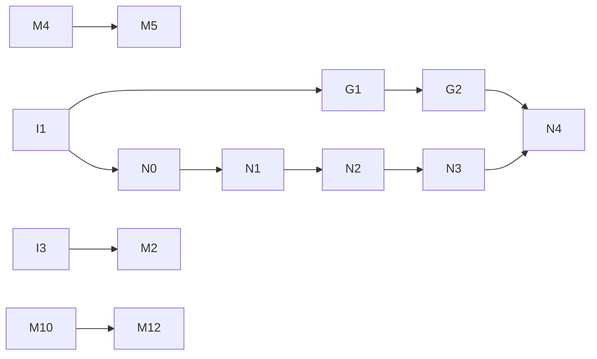

# nano-lmcache Roadmap and Task List

This document lists the work ahead for nano-lmcache, for contributors who
want to pick up a task.

## What this project is

nano-lmcache is a **teaching project**. It is not a reimplementation of
LMCache, and not a replacement for it.

[LMCache](https://github.com/LMCache/LMCache) is a production KV cache
system: feature-rich, large, and hard for newcomers to read directly.
nano-lmcache aims to:

- Break KV cache reuse into independent concepts and introduce them one
  at a time, each with tests and a runnable example.
- Go all the way from a pure-Python prototype to **real KV tensors on a
  GPU**, and finally **serve as the external KV cache of a real inference
  engine**, [nano-vLLM](https://github.com/GeeeekExplorer/nano-vllm), so
  learners can see prefix reuse cut real prefill compute.
- Leave learners able to read the LMCache and vLLM source and understand
  what problems they solve and why they are designed the way they are.

**Non-goals:**

- Production-level performance, or API compatibility with LMCache.
- Covering every LMCache feature. Only the parts that best explain the
  underlying ideas are implemented.
- Copying LMCache code. Borrow its design ideas, but rewrite them in your
  own way and explain them.

So the first question when reviewing a PR is: **can a reader learn the
concept from this code and its docs?**

## Current status

Done (pure Python, no GPU dependency):

- [x] Token chunking and prefix-aware chunk keys (`core/chunking.py`)
- [x] In-memory storage `MemoryKVCache` (`storage/memory.py`)
- [x] Continuous prefix matching `ChunkedPrefixCache` (`core/prefix_cache.py`)
- [x] Hit/miss accounting `CacheMetrics` (`core/metrics.py`)
- [x] Storage protocol `CacheStorage`, so cache logic does not depend on a
      concrete backend (`storage/protocol.py`)
- [x] Capacity limits and **prefix-safe eviction**: only leaves are
      evicted, so no unreachable suffix is ever left behind
- [x] Shared prefix-safe eviction bookkeeping `PrefixLRUIndex`
      (`storage/eviction.py`), used by every bounded backend
- [x] Disk backend `DiskKVCache`: one file per entry, crash-safe writes,
      survives restarts (`storage/disk.py`, M4)
- [x] Write-through tiered storage `TieredStorage`, memory in front of
      disk (`storage/tiered.py`, M5)
- [x] O(log n) leaf-heap eviction with the exact same LRU order (M2) and
      byte-based capacity for the memory backend (M3)
- [x] Runnable demos (`examples/`), architecture notes
      (`docs/architecture.md`), and a glossary and FAQ (`docs/glossary.md`)

Done (optional torch / GPU layer):

- [x] Optional `torch` and `hf` extras, `torch` / `gpu` / `vllm` test
      markers, and a core package that never imports torch (I1)
- [x] Real KV tensors: prefix KV reuse with a HuggingFace model, verified
      against a from-scratch forward pass (`tensor/`, G1)
- [x] CUDA 12.4 PyTorch wheels on Linux, so GPU tests run on common
      drivers (`tool.uv.sources` in `pyproject.toml`)
- [x] GPU to pinned CPU memory offload `CPUOffloadKVCache`, with a copy
      bandwidth benchmark (`tensor/offload.py`, G2)
- [x] Safe tensor serialization for the disk tier, giving a full
      GPU -> CPU -> disk hierarchy (`tensor/serializers.py`)

## How to claim a task

1. Pick a task from the table below and check that its prerequisites are
   done.
2. Open a GitHub issue (or comment on an existing one) naming the task ID,
   for example `Claiming G1`, so two people don't do the same work.
3. Follow the workflow in [CONTRIBUTING.md](CONTRIBUTING.md): tests first,
   one task per PR.
4. In the PR description, go through the task's acceptance criteria one by
   one.

If you are unsure how to approach a task, or want to propose a new one,
open an issue to discuss it.

## Task overview

| ID | Task | Difficulty | Needs GPU | Prerequisites | Status |
| --- | --- | --- | --- | --- | --- |
| **Infrastructure** | | | | | |
| I1 | Optional dependency groups and GPU test markers | Medium | No | – | Done |
| I2 | Issue and PR templates | Easy | No | – | Done |
| I3 | Benchmark scaffolding | Easy | No | – | Done |
| **Mini: cache behavior (pure Python)** | | | | | |
| M1 | Eviction metrics | Easy | No | – | Done |
| M2 | Make eviction cheaper than a linear scan | Medium | No | I3 | Done |
| M3 | Byte-based capacity | Medium | No | – | Done |
| M4 | Local disk backend | Medium | No | – | Done |
| M5 | Tiered memory + disk storage | Hard | No | M4 | Done |
| M6 | Skip rewriting chunks that are already cached | Easy | No | – | Open |
| M7 | Detect corrupted disk entries | Easy | No | – | Open |
| M8 | Cache inspector CLI | Easy | No | – | Open |
| M9 | Byte-based capacity for the disk backend | Medium | No | – | Open |
| M10 | Thread-safe storage | Medium | No | – | Open |
| M11 | Pluggable eviction policies | Hard | No | – | Open |
| M12 | Shared cache server for several processes | Hard | No | M10 | Open |
| **GPU: real KV tensors** | | | | | |
| G1 | Verify KV reuse correctness with a real model | Medium | Optional | I1 | Done |
| G2 | GPU to CPU offload backend | Hard | Yes | G1 | Done |
| G3 | Measure recompute vs. load cost | Medium | Yes | G2 | Merged into N4 |
| G4 | Byte-based capacity for CPU offload | Medium | Optional | – | Open |
| G5 | Compress cached KV with int8 quantization | Medium | No | – | Open |
| G6 | Model-aware cache namespaces | Easy | No | – | Open |
| **nano-vLLM integration** | | | | | |
| N0 | KV block format: export and import nano-vLLM blocks | Medium | No | I1 | Done |
| N1 | External prefix lookup, cache keys, model namespace | Medium | No | N0 | Done |
| N2 | Restore L2 hits into nano-vLLM's GPU blocks | Hard | Yes | N1 | Done |
| N3 | Save newly completed KV blocks | Medium | Yes | N2 | Done |
| N4 | Correctness, reuse across restarts, TTFT benchmarks | Medium | Yes | N3 | Open |
| **Teaching docs** | | | | | |
| D1 | Architecture diagrams | Easy | No | – | Done |
| D9 | Glossary and FAQ | Easy | No | – | Done |
| D11 | Chinese translation of README and docs | Easy | No | – | Done |

**Good first contributions:** M6, M7, M8, and G6 (no GPU needed).
**Most wanted next:** N4, which measures when the nano-vLLM L2 cache pays
off (needs a GPU), and M6, a quick win for every disk-backed run.

**Dependencies:**

---

## Infrastructure

### I1: Optional dependency groups and GPU test markers

**Status: done.** An extra for the inference engine is deliberately missing:
N2 adds one for nano-vLLM, the first time engine code runs in tests.
Engine adapters live in `nano_lmcache/integrations/`.

The core package has no runtime dependencies, and that must stay true:
someone learning the cache concepts should never be forced to install
PyTorch.

To do:

- Add optional dependency groups to `pyproject.toml`, for example `torch`,
  `hf` (transformers), and `vllm`. A plain `uv sync` must not install
  them.
- Put GPU and vLLM code in separate subpackages (for example
  `nano_lmcache/tensor/` and `nano_lmcache/integration/vllm/`). Never
  import torch from the top-level `nano_lmcache` package.
- Add pytest markers (for example `gpu` and `vllm`) that skip
  automatically when the dependency or CUDA is missing.
- Keep CI CPU-only, and document in CONTRIBUTING.md how to run the GPU
  tests locally.

Acceptance criteria:

- Without torch installed, `uv sync && uv run pytest` passes as before.
- With torch installed but no GPU, GPU tests show as skipped, not failed.
- `import nano_lmcache` does not import torch, directly or indirectly.

### I2: Issue and PR templates

Add a task-claim issue template and a PR template under `.github/`. The
PR template should list the checks: tests, the three check commands, and
whether examples and docs were updated.

### I3: Benchmark scaffolding

Add a `benchmarks/` directory with a script that measures `store` and
`lookup` time across different chunk counts and capacities. It does not
run in CI; it exists to compare before and after an optimization. M2 uses
it to prove its speedup.

---

## Mini: cache behavior (pure Python)

### M1: Eviction metrics

Today you can see the hit rate, but not how often eviction happened.

To do:

- Count evicted entries, and entries rejected because the cache was full
  or their parent was missing.
- Decide whether these counters belong in `CacheMetrics` or in a
  storage-level stats object, and justify the choice in the PR.
- Print them in the bounded part of `examples/demo_prefix_cache.py`.

Acceptance criteria: tests cover "eviction count is correct when writes
exceed capacity" and "rejection count is correct when a long prompt's
suffix does not fit".

What you learn: tuning a cache requires observability; the hit rate
alone can hide problems.

### M2: Make eviction cheaper than a linear scan

**Status: done** (leaf heap in `storage/eviction.py`,
`docs/eviction-performance.md`).

`PrefixLRUIndex._find_victim` (shared by the memory, disk, and CPU
offload backends) scans from the oldest entry looking for the
first leaf, which is O(n) in the worst case.

**This task needs a design decision first.** A plain recency-ordered
leaf set gives O(1), but an entry that becomes a leaf (its last child was
evicted) must slot into that order by its *last access time*, not at the
end, or the eviction order changes. An `OrderedDict` cannot insert in the
middle. Options to compare in your PR:

- A heap of `(last_access_tick, key)` with lazy deletion: keeps today's
  exact order, O(log n) amortized.
- Treat a newly exposed leaf as most recently used: O(1), but a different,
  documented policy. Existing tests may need to change; say why that is
  acceptable.

Measure before optimizing. With the I3 churn benchmark, eviction currently
adds only a modest overhead for short chains, so the win is mainly for
deep chains and large capacities. If the numbers do not justify the added
complexity, closing this task with that evidence is a valid outcome.

Acceptance criteria:

- `tests/unit/test_bounded_memory.py` passes unchanged.
- Before/after numbers from the I3 benchmark script, including a deep-chain
  case.
- Comments explain the chosen data structure and when entries enter and
  leave it.

### M3: Byte-based capacity

**Status: done** (`max_bytes` in `MemoryKVCache` and `PrefixLRUIndex`).

Real systems limit a cache by memory size, not by entry count.

To do: support `max_bytes` in `MemoryKVCache`, with payload size computed
by an injectable function. Decide and document what happens when both
`max_entries` and `max_bytes` are set, and when a single payload is
larger than the whole capacity.

Acceptance criteria: the prefix-safety invariant (every stored entry has
its whole ancestor chain stored) still holds, with tests proving it.

### M4: Local disk backend

**Status: done** (`storage/disk.py`, `examples/demo_disk_cache.py`).
Follow-up ideas: safe concurrent writers (today one process per
directory), byte-based disk capacity (M3).

Implement a `DiskKVCache` that satisfies the `CacheStorage` protocol,
with one file per key.

To do:

- Make serialization pluggable. Do not default to `pickle` for reading
  files that might not be trusted, and explain why in the docs.
- Handle a crash in the middle of a write (for example, write to a
  temporary file, then rename).
- Cached content must still hit after a process restart.

Acceptance criteria: the same prefix-matching tests pass against both
`MemoryKVCache` and `DiskKVCache` (pytest parametrization works well
here).

What you learn: why a cache can be reused across processes and restarts,
which vLLM's built-in prefix caching cannot do.

### M5: Tiered memory + disk storage

**Status: done** (`storage/tiered.py`, `examples/demo_tiered_storage.py`).
It is write-through; `docs/architecture.md` explains why write-back would
break prefix safety. A write-back variant that solves that is an open,
harder follow-up.

Tiering is one of LMCache's core ideas: hot data lives in fast memory,
cold data in larger, slower disk storage.

To do: implement a `TieredStorage` that combines two backends. Entries
evicted from a full memory tier are written to disk; a hit on disk is
promoted back to memory.

Acceptance criteria:

- A prefix evicted from the memory tier still hits from the disk tier.
- The two tiers together still satisfy the prefix-safety invariant.
- Docs explain the write and promotion policies chosen and their costs.

### M6: Skip rewriting chunks that are already cached

`run_with_prefix_cache` (`tensor/hf.py`) ends by calling
`cache.store(token_ids, ...)` for **every** complete chunk, including the
ones `lookup` just matched. For `MemoryKVCache` that only refreshes
recency, but `DiskKVCache.put` re-serializes the payload, rewrites the
file and `fsync`s it. A request that reuses 90% of its prompt still pays
to write 100% of it.

To do: let a caller store only the chunks after a prefix it knows is
cached, for example `ChunkedPrefixCache.store(..., start_chunk=n)`, where
chunk keys before `n` are still computed (to chain parent keys) but not
written. Use it from `run_with_prefix_cache`, and skip splitting the
reused chunks too. Decide and document what happens if a prefix chunk was
evicted between `lookup` and `store`. Hint: its children are then rejected
as having a missing parent, which is safe but worth explaining.

Acceptance criteria:

- A test with a storage wrapper that counts `put` calls shows that
  repeating a request writes nothing new, and extending a cached prompt
  writes only the new chunks.
- The step list in the `run_with_prefix_cache` docstring is updated.

What you learn: the cost of a cache is not only lookups; write
amplification can eat the savings.

### M7: Detect corrupted disk entries

Entry files can be damaged by a full disk, a bad sector, or someone
editing the directory. `_recover` only checks that a file's header
parses, so a damaged payload is found later, inside `get`, where
`serializer.loads` raises and the whole lookup crashes. A cache must never
take serving down: a damaged entry should simply be a miss.

To do: record a checksum of the payload in the header (compare SHA-256
with `zlib.crc32` and justify your choice), verify it on `get` and during
recovery, and on a mismatch delete the entry. Careful: deleting an entry
that has children would strand them, breaking the prefix-safety
invariant, so the entry's whole subtree must go. `PrefixLRUIndex` needs a
way to discard a key and its descendants. Count corrupted entries in
`StorageStats`. Decide what to do with files written before this change
(no checksum) and document it.

Acceptance criteria:

- Tests flip a byte in and truncate an entry file: `lookup` returns the
  prefix before the damaged chunk instead of raising, the damaged entry
  and its descendants are deleted, and the invariant holds.
- The corrupted-entry counter is tested.

What you learn: production caches treat their own storage as untrusted
input.

### M8: Cache inspector CLI

Add `python -m nano_lmcache.inspect <directory>`, which prints what a
`DiskKVCache` directory holds:

- the number of entries and total bytes;
- the prefix chains as a tree (roots, depth, fan-out);
- the leaves in LRU order, which are the next eviction victims.

It must be **read-only**. Opening a `DiskKVCache` cleans up the directory,
so the tool has to read the entry files itself. Add a `--json` flag for
machine-readable output.

Acceptance criteria:

- Tests build a directory with `DiskKVCache`, run the inspector, and check
  its output.
- A test shows the inspector changes no files: the listing, contents, and
  mtimes are unchanged.
- The README mentions the tool.

What you learn: making a data structure's invariants visible is the
fastest way to debug it.

### M9: Byte-based capacity for the disk backend

M3 added `max_bytes` to `MemoryKVCache` only. On disk, the scarce
resource is disk space, and size is exact: the entry file's length
(header plus payload).

To do: add `max_bytes` to `DiskKVCache`, passing each file's size to
`PrefixLRUIndex.admit`. On restart, recover sizes from the files with
`restore(..., size_bytes=...)`. Opening a directory that already exceeds
the limit should behave like the existing `max_entries` check.

Acceptance criteria:

- `tests/unit/test_backend_contract.py` and the disk tests pass, with
  byte-limited variants added.
- `nbytes` is identical before and after a restart.
- Randomized tests show the prefix-safety invariant holds under byte
  pressure, as in `tests/unit/test_byte_capacity.py`.

### M10: Thread-safe storage

A serving engine handles requests on several threads, but no backend has
a lock. Python's GIL does not make compound operations atomic: two
threads can both see room in `PrefixLRUIndex.admit` and exceed the
limit, or one can evict an entry while another is reading its file.

To do: make `MemoryKVCache`, `DiskKVCache`, and `TieredStorage` safe
under concurrent `put` and `get`. Choose the lock granularity (one lock
per backend, or inside the index) and explain the trade-off. For the disk
backend, decide which file I/O may happen outside the lock and why that
is safe.

Acceptance criteria:

- A stress test runs many threads doing random `store` and `lookup`
  through `ChunkedPrefixCache` on each backend, then checks the capacity
  limits, the prefix-safety invariant, and that the stats add up.
- The PR shows that the stress test fails, or can fail, without the locks.
- Docs explain what is now thread-safe and what is still not
  multi-process-safe.

What you learn: correctness under concurrency has to be designed, not
assumed.

### M11: Pluggable eviction policies

`PrefixLRUIndex` hard-codes LRU among leaves. Prefix safety (only leaves,
the incoming chain protected) is the mechanism; which leaf goes first is
a policy, and LRU is not obviously the best one for prefix caching. A
long, unique tail is less likely to be reused than a short shared system
prompt.

To do: separate the policy from the mechanism behind a small interface.
Keep today's LRU heap as the default, and implement at least one
alternative, such as LFU, FIFO, or deepest-leaf-first. Extend
`benchmarks/bench_prefix_cache.py` with a workload of shared system
prompts and diverse tails, and compare hit rates.

Acceptance criteria:

- The default behavior is unchanged: `tests/unit/test_bounded_memory.py`
  and the eviction tests pass unmodified.
- Each policy has randomized tests that check the prefix-safety
  invariant.
- The PR reports hit rates per policy, and the docs explain when each one
  wins.

What you learn: separating mechanism from policy, and measuring a policy
on a realistic workload.

### M12: Shared cache server for several processes

`MemoryKVCache` lives inside one process, and `DiskKVCache` allows only
one writer per directory. LMCache shares KV between engine instances
through a cache server. Build a minimal one using only the standard
library:

- `nano_lmcache.server`: serves any `CacheStorage` over TCP.
- `RemoteKVCache`: a client that implements `CacheStorage`, using a small
  length-prefixed protocol (`PUT key parent payload`, `GET key`) and a
  `Serializer` for payloads.

A prefix lookup walks chunks one at a time, so each chunk costs a network
round trip. Add a batched request, or a server-side prefix lookup, and
measure the difference.

Acceptance criteria:

- A test starts the server on localhost in a thread and shows that two
  clients share entries.
- `RemoteKVCache` passes the backend contract tests.
- A server that is down or unreachable behaves as a miss, not a crash.
- The PR includes a benchmark comparing per-chunk and batched lookups.

What you learn: what a remote KV tier costs, and why batching matters.

---

## GPU: real KV tensors

PyTorch is needed from here on. The goal is to replace the string
payloads used so far with KV tensors produced by a real model.

### G1: Verify KV reuse correctness with a real model

**Status: done** (`nano_lmcache/tensor/`, `examples/demo_kv_reuse.py`).
Follow-ups welcome: models with sliding-window or linear-attention layers
are rejected today, because a chunk stacks all layers into one tensor.

**This is the single most important teaching milestone in the project**:
proving that cache reuse is not just "it runs" but "the results are
correct".

To do:

- Load a small model with HuggingFace transformers (for example
  Qwen2.5-0.5B or GPT-2).
- Prefill a prompt, split each layer's K/V into chunks, and store them in
  `ChunkedPrefixCache`.
- For a new request that shares a prefix, load the matched chunks,
  reassemble them into `past_key_values`, and compute only the remaining
  tokens.
- Define what one chunk's KV looks like in memory (layers, K/V, tokens,
  heads, head dimension), along with its dtype and device.

Acceptance criteria:

- Logits computed with reused prefix KV match logits from computing the
  full prompt from scratch, within a reasonable tolerance
  (`torch.allclose`), covered by a test.
- A negative test: the same tokens after a different prefix get a
  different chunk key, so they are never wrongly reused.
- Runs on CPU too (slowly is fine), so people without a GPU can learn
  this chapter.

What you learn: why only prefixes can be reused (each token's KV depends
on every token before it, and on its position), which is exactly why the
chunk key hashes in the prefix.

### G2: GPU to CPU offload backend

**Status: done** (`tensor/offload.py`, `benchmarks/bench_offload.py`).
On an RTX 4090, pinned memory copies at ~26 GB/s versus ~11 GB/s for
pageable memory; see `docs/architecture.md`. G3 is now unblocked.

To do: implement a backend that copies KV tensors from the GPU into CPU
memory (pinned memory) for storage, and copies them back to the GPU on a
hit.

Acceptance criteria:

- Tensors copied back to the GPU are identical to the originals.
- Demonstrate and record how pinned memory and `non_blocking` copies
  affect transfer speed.
- With a capacity limit, reuse the existing prefix-safe eviction logic
  instead of writing a second one.

### G3: Measure recompute vs. load cost

**Status: merged into N4**, which measures the same trade-off inside a
real engine. The notes below are input for N4.

Caching does not always pay off: for a short prefix, copying KV back from
the CPU can be slower than recomputing it on the GPU.

We already see this in `examples/demo_kv_reuse.py`: on an RTX 4090 with
Qwen3-0.6B and a ~270 token prompt, reusing 256 cached tokens took about
60 ms, while recomputing the whole prompt took about 45 ms. Logits matched,
but the cache bookkeeping (stacking, cloning, rebuilding the HF cache)
cost more than the skipped compute. Part of this task is to separate
fixed overhead from per-token cost and find where reuse starts to win.

To do: for a range of prefix lengths, measure prefill recompute time and
load time from the G2 backend. Chart the crossover point in `docs/` and
explain how it depends on model size and GPU bandwidth.

What you learn: knowing when caching is worth it matters more than
implementing the cache itself.

### G4: Byte-based capacity for CPU offload

`CPUOffloadKVCache` reports `nbytes` but can only limit entries. Pinned
host memory is the scarce resource here, and tensor sizes are exact
(`tensor.nbytes`), unlike the `sys.getsizeof` default in the memory
backend.

To do: add `max_bytes` to `CPUOffloadKVCache`, passing each tensor's
size to `PrefixLRUIndex.admit`.

Acceptance criteria:

- Tests in the tensor group run on a CPU (`device="cpu",
  pin_memory=False`) and cover multi-entry eviction and oversized
  tensors.
- The prefix-safety invariant is tested under byte pressure.
- A `TieredStorage` with a byte-limited offload tier in front of disk
  still passes the tiered tests.

### G5: Compress cached KV with int8 quantization

KV chunks are large: layers × 2 × heads × tokens × head_dim, at 2 bytes
per value in fp16. LMCache's CacheGen work compresses KV before storing
it. Start simple, with int8 quantization.

To do: add an opt-in `QuantizedTensorSerializer` that stores int8 values
plus scales and decodes back to the original dtype. Choose the scale
granularity (per tensor, per head, or per channel) and justify it.
Measure:

- compression ratio;
- encode and decode time;
- the maximum K/V error;
- most importantly, the effect on the model: compare logits and greedy
  tokens of a reused run against a full recompute, with the G1 setup.

Acceptance criteria:

- CPU-runnable tests with a tiny model.
- The PR reports the numbers above.
- Docs explain when the error is acceptable and why this is never on by
  default.

What you learn: lossy KV compression is a trade between storage and
accuracy, and only the model's output can judge it.

### G6: Model-aware cache namespaces

The namespace is the only thing that keeps KV from different models
apart, and today the caller can pass any string. Reusing KV computed by
another model, revision, or dtype silently produces wrong outputs.

To do: add `namespace_for(model)` in `tensor/hf.py`, which derives a
stable namespace (for example a hash of sorted JSON) from what determines
KV: model name and revision, dtype, layer, head, and head-size counts,
and RoPE settings. Explain which config fields matter and which do not:
generation settings, for example, do not change KV. Use the helper in
`examples/demo_kv_reuse.py`.

Acceptance criteria:

- Tests with a tiny model show that the namespace is identical across
  processes, and changes when the dtype or a KV-relevant config field
  changes.
- The core package still never imports torch.

What you learn: a cache key must capture everything that determines the
cached value.

---

## nano-vLLM integration

nano-lmcache becomes the **external (L2) KV cache** of
[nano-vLLM](https://github.com/GeeeekExplorer/nano-vllm), a ~1,200-line
reimplementation of vLLM's core. nano-vLLM keeps its own GPU prefix cache
(L1); nano-lmcache stores the blocks the GPU no longer has, in CPU memory,
on disk, or both, so they can be reused across processes and restarts.
An L2 hit is not free: the block still has to be copied back to the GPU.

The design is in [`docs/nanovllm-integration.md`](docs/nanovllm-integration.md):
which nano-vLLM code is involved, what each side owns, and ten rules the
integration must keep. It pins nano-vLLM commit `bb823b3`; every task
below targets that commit, and upgrading is a separate task. `attach()`
installs the hooks into a running engine, so nano-vLLM stays an
unmodified dependency (`uv sync --group nanovllm`); all cache logic stays
in nano-lmcache.

Version 1 scope, for every task below:

- `kvcache_block_size = 256` and `chunk_size = 256`: one chunk is one block.
- `tensor_parallel_size = 1` and `enforce_eager = True`.
- Only complete, computed blocks are stored.
- The last block of a prompt is never reused, matching nano-vLLM's own
  prefix cache, so there are always tokens left to compute logits from.
- Synchronous loads and stores; Python 3.11 or 3.12.

### N0: KV block format

**Status: done** (`src/nano_lmcache/integrations/nanovllm/kv_blocks.py`).

`export_block(kv_cache, block_id)` copies one physical block out of
nano-vLLM's KV cache `[2, layers, blocks, block_size, kv_heads, head_dim]`
into nano-lmcache's chunk format `[layers, 2, kv_heads, block_size,
head_dim]`, and `import_block` writes one back. Tests run on CPU tensors,
without nano-vLLM.

### N1: External prefix lookup, cache keys, model namespace

**Status: done** (`integrations/nanovllm/layout.py`, `external_cache.py`;
see "Keys, namespace, and lookup" in the design doc).

No GPU and no nano-vLLM install needed.

To do: in `integrations/nanovllm/`, map a prompt's token IDs to
nano-lmcache chunk keys over whole blocks, and build the cache namespace
from everything that changes a block's bytes: model identity and
revision, dtype, layers, KV heads, head size, block size, and the
tensor-parallel layout (design rule 10; G6 does the same for the
HuggingFace path). Provide the calls N2 and N3 need:

- given the number of L1 hits, count the L2 blocks that follow, using
  membership checks only (design rule 3);
- fetch those blocks' payloads;
- given completed blocks, say which ones L2 does not have yet.

Acceptance criteria:

- The last-block limit holds (design rule 1): a prompt of exactly `k`
  full blocks reports at most `k - 1` reusable blocks.
- Counting never reads a payload.
- A different model, revision, dtype, or KV head layout never hits.
- Works on `MemoryKVCache`, `CPUOffloadKVCache`, `DiskKVCache` with
  `TensorSerializer`, and `TieredStorage`.

### N2: Restore L2 hits into nano-vLLM's GPU blocks

**Status: done** (`integrations/nanovllm/engine.py`: `ExternalBlockManager`
and `attach()`; dependency group `nanovllm`; tests marked `nanovllm`).
With Qwen3-0.6B, a 1,501-token prompt restored 5 blocks from pinned CPU
memory, prefilled only the remaining 221 tokens, and generated exactly the
tokens of a cold run.

To do: extend `can_allocate` to add the L2 blocks after the L1 hits, make
`allocate` fetch them, attach fresh GPU blocks, register their L1 hashes,
and set `num_cached_tokens`, and copy the payloads in with N0's
`import_block` before the forward pass. Add an optional dependency group
for nano-vLLM, with tests marked so they skip without it. See design
rules 1 to 6 and 9.

Acceptance criteria:

- A request whose prefix is in L2 but not in L1 computes only its
  uncached tail.
- After a restore, a later request hits the same blocks in L1.
- If an L2 entry disappears between `can_allocate` and `allocate`, the
  request still completes correctly.

### N3: Save newly completed KV blocks

**Status: done** (`ExternalBlockManager.hash_blocks` in
`integrations/nanovllm/engine.py`; `examples/demo_nanovllm.py`). nano-vLLM
now fills L2 on its own: run the demo twice and the second process
restores its prompt blocks from disk and generates the same tokens.

To do: in `ExternalBlockManager.hash_blocks`, export the blocks it just
completed with N0's `export_block` and store the ones L2 does not have,
using N1's `missing_blocks` and `store`. `postprocess` calls `hash_blocks`
before it frees a finished sequence's blocks, so exporting there keeps
design rule 7 without extra bookkeeping. See design rules 7 and 8.

Acceptance criteria: after one request, all of its complete prompt blocks
are in L2; blocks completed by chunked prefill and by decode are stored
exactly once; blocks of finished sequences are exported before they can
be reused.

### N4: Correctness, reuse across restarts, TTFT benchmarks

To do:

- With greedy decoding (temperature 0), compare outputs with L2 hits
  against a run without prefix caching: single prompts, batches, chunked
  prefill, preemption, and capacity-limited L2 storage.
- Restart the engine between two requests with a disk-backed L2 and show
  the second one reuses the first one's blocks.
- Measure time to first token for shared-prefix workloads (one long
  document, many questions) with no prefix caching, L1 only, L1 + L2 in
  CPU memory, and L1 + L2 on disk. Separate the cost of loading a block
  from recomputing it, across prefix lengths (this absorbs G3).

- Measure the cost of storing too: in version 1 stores are synchronous, so
  a cold request with a disk-backed L2 waits for its blocks to be written
  (about 1.9 s for five 28 MiB blocks with Qwen3-0.6B; see "What version
  1 costs" in the design doc).

Acceptance criteria: identical token outputs in every scenario, and a
benchmark write-up in `docs/` with the crossover point where L2 reuse
starts to pay off.

---

## Teaching docs

### D1: Architecture diagrams

Add mermaid diagrams to `docs/architecture.md` showing the current module
relationships and the data flow of one `lookup` and one `store`. GitHub
renders mermaid directly.

### D9: Glossary and FAQ

**Status: done** (`docs/glossary.md`).

Write `docs/glossary.md` (KV cache, prefill, decode, TTFT, chunk, prefix,
leaf, eviction, paged attention, ...) and an FAQ for questions newcomers
keep asking ("Why not cache by full prompt?", "Why is reuse sometimes
slower?"). Each entry should be short and link to the code or chapter
that explains it.

### D11: Chinese translation of README and docs

**Status: done** (`README.zh-CN.md`, `docs/zh-CN/`).

Translate the README and architecture doc into Chinese (for
example `README.zh-CN.md`, `docs/zh-CN/`). Keep the English version the
source of truth: each translated file should state which English commit
it was translated from, so drift is easy to spot.

---

## Hardware

- The I, M, and D tasks, plus N0 and N1, need only an ordinary computer.
- G1, G5, and G6 can be done on a CPU, and so can G4 (with
  `pin_memory=False`); G2 and G3 need an NVIDIA GPU.
- On Linux, `torch` comes from the CUDA 12.4 wheel index, which runs on
  NVIDIA drivers >= 525. Check with
  `uv run python -c "import torch; print(torch.cuda.is_available())"`.
- N2 to N4 need an NVIDIA GPU that can run nano-vLLM (it uses
  flash-attn and Triton). A small model such as Qwen3-0.6B is enough.
- Without a GPU you can still do all M tasks, G4 to G6, and N1, which is
  just as valuable.
