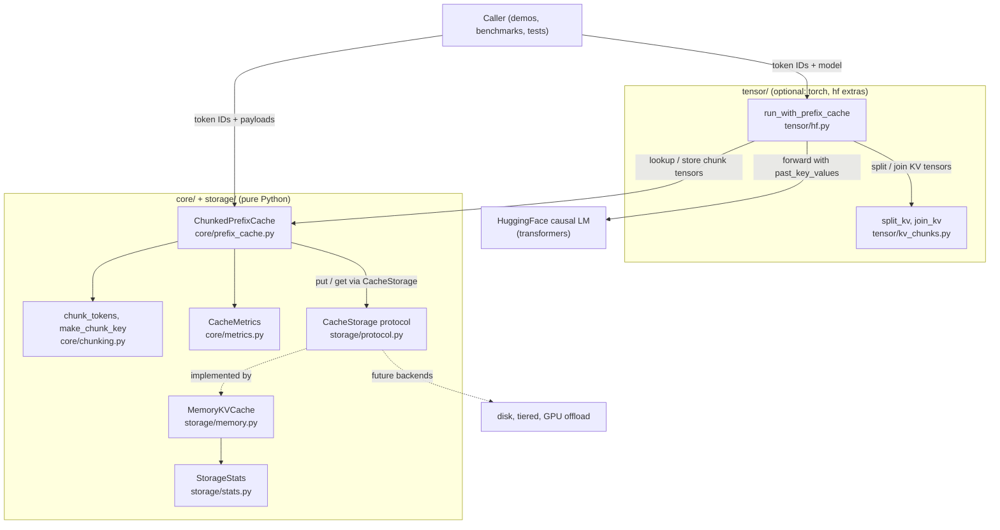
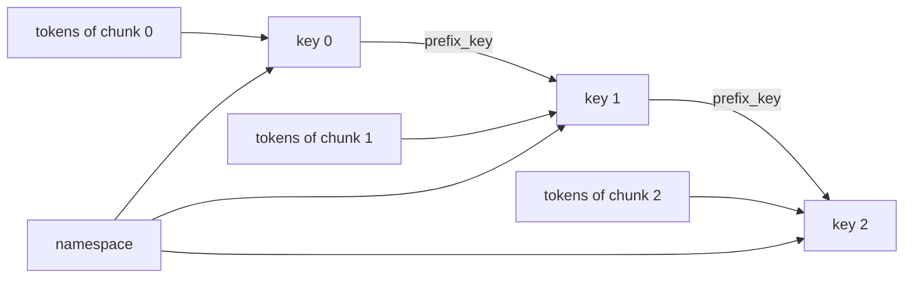
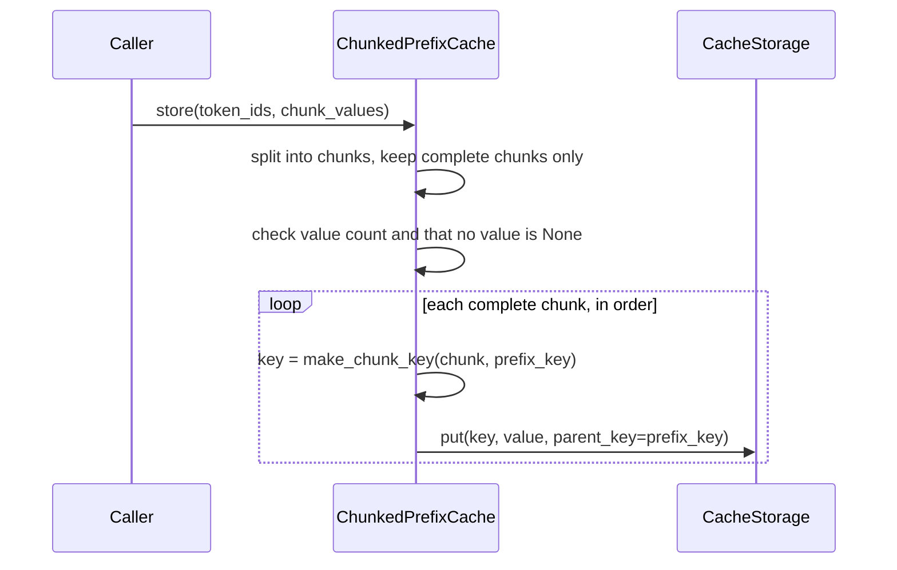
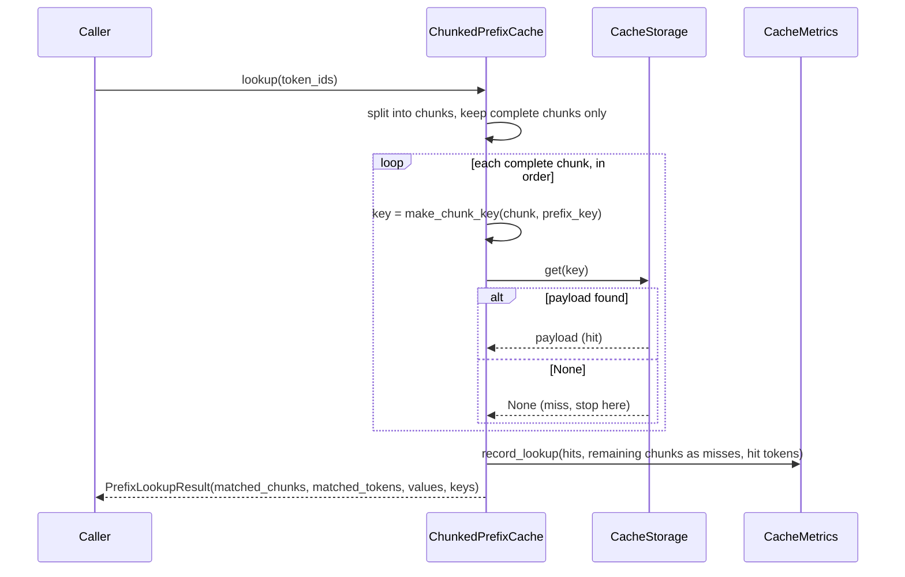
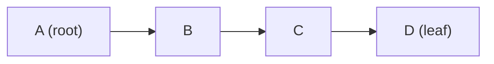

# Architecture

## Diagrams

GitHub renders the diagrams below directly. They describe the code in
`src/nano_lmcache/`; if you change behavior, update them too.

### Module relationships



`ChunkedPrefixCache` owns the matching logic and the metrics. It only
knows the `CacheStorage` protocol, so storage backends can change without
touching it.

There are two ways in. A caller can use `ChunkedPrefixCache` directly
with any payload, as the pure Python demos and tests do. Or it can call
`run_with_prefix_cache`, which drives a real model: it looks up the
cached prefix, turns the matched chunk tensors back into
`past_key_values` with `join_kv`, runs the model over the remaining
tokens, and stores the result split into chunks with `split_kv`.

Dependencies only point from `tensor/` into `core/`, never back. To
`ChunkedPrefixCache` and the storage a chunk tensor is just an opaque
payload, which is why the core still runs without PyTorch installed.

### How a chunk key is built

Each key hashes the namespace, the previous chunk's key, and the chunk's
own tokens. The chain is what makes a key depend on the whole prefix.



The first chunk has no `prefix_key`. Identical tokens after a different
prefix therefore get a different key and are never reused by mistake.

### `store(token_ids, chunk_values)`



Validation happens before the first write, so a rejected store never
leaves a partial prefix behind. The incomplete tail chunk is ignored.

### `lookup(token_ids)`



Lookup stops at the first miss: a later chunk can only be valid if every
chunk before it is. Chunks after the miss are counted as misses because
the caller must recompute them.

### Why eviction must respect prefix chains



Evicting `A` here would leave `B`, `C`, and `D` in memory, but a lookup
starts at `A` and stops at the first miss, so they could never be
reached. The storage therefore only evicts leaves (here, only `D`), and
evicts the least recently used leaf first. After `D` goes, `C` becomes a
leaf and is next in line.

## Nano: Core cache concepts

The current implementation covers a minimal cache lifecycle:

1. Receive a sequence of token IDs.
2. Split it into fixed-size chunks.
3. Derive a deterministic, prefix-aware key per chunk.
4. Match chunks from the start, stopping at the first miss.
5. Report how much of the prefix can be reused, and record hit/miss
   metrics.
6. Store newly computed chunk payloads in an in-memory backend.

Only complete chunks participate in reuse. A trailing chunk shorter than
`chunk_size` is neither stored nor matched, because its state would
depend on tokens that have not arrived yet.

The implementation is pure Python so that cache behavior can be
understood without a GPU or an inference engine.

### Components

| Module | Responsibility |
| --- | --- |
| `core/chunking.py` | Split tokens into chunks; derive prefix-aware keys |
| `core/prefix_cache.py` | `ChunkedPrefixCache`: the store/lookup loop |
| `core/metrics.py` | `CacheMetrics`: chunk-level hit/miss accounting |
| `storage/protocol.py` | `CacheStorage` protocol: the `put`/`get` contract |
| `storage/eviction.py` | `PrefixLRUIndex`: prefix-safe LRU bookkeeping shared by bounded backends |
| `storage/disk.py` | `DiskKVCache`: one file per entry, survives restarts |
| `storage/serializers.py` | `Serializer` protocol and the safe `JsonSerializer` default |
| `storage/tiered.py` | `TieredStorage`: fast tier in front of a slow tier, write-through |
| `storage/stats.py` | `StorageStats`: eviction and rejection counters |
| `storage/memory.py` | `MemoryKVCache`: optionally bounded, prefix-safe LRU storage |
| `tensor/kv_chunks.py` | `split_kv` / `join_kv`: per-layer KV tensors <-> chunk tensors (needs torch) |
| `tensor/offload.py` | `CPUOffloadKVCache`: GPU chunks kept in pinned CPU memory (needs torch) |
| `tensor/serializers.py` | `TensorSerializer`: safe tensor encoding for `DiskKVCache` (needs torch) |
| `tensor/hf.py` | `run_with_prefix_cache`: reuse prefix KV with a HuggingFace model (needs torch + transformers) |

The `tensor` package is optional. Nothing in `core` or `storage` imports
it, so the cache concepts work without PyTorch installed.

Callers go through `ChunkedPrefixCache`, which owns a `CacheMetrics`
instance and depends only on the `CacheStorage` protocol, never on a
concrete backend. `None` is reserved to mean "miss", so `store()`
rejects `None` payloads.

### Why metrics count the way they do

A lookup stops probing at its first miss, so every complete chunk after
that point still has to be computed by the caller. All of them are
counted as misses, which makes `hit_rate` readable as "what fraction of
reusable work was actually reused" rather than as a probe count.

### Capacity and eviction

`MemoryKVCache(max_entries=N)` limits the cache to N entries, where one
entry is one chunk payload. `MemoryKVCache(max_bytes=B, size_fn=...)` limits
the sum of recorded payload sizes to B bytes. Either limit can be omitted;
when both are set, **both must be satisfied**. With neither, the cache is
unbounded. `max_bytes` must be a positive integer.

Byte capacity is currently exposed only by `MemoryKVCache`. Although
`PrefixLRUIndex` is shared, `DiskKVCache` and `CPUOffloadKVCache` do not
expose `max_bytes` and omit `size_bytes` when admitting entries. Their
index sizes therefore default to zero; they enforce entry limits only.

The injectable `size_fn(value) -> int` must return a non-negative integer
(zero is allowed). It defaults to `sys.getsizeof`, which measures the
shallow Python object size, not recursively referenced objects or a
tensor's underlying storage.

**For tensors or containers of bytes, pass a custom `size_fn`.** The
default may count only a small Python wrapper while ignoring a large
backing buffer or referenced byte strings, so it cannot enforce the
intended payload-memory budget for those values. A tensor size function
can report `value.nelement() * value.element_size()`; a container size
function should explicitly measure its contained payloads. For bytes-only
payloads, for example:

```python
def byte_payload_size(value: object) -> int:
    if not isinstance(value, bytes):
        raise TypeError("expected bytes")
    return len(value)


storage = MemoryKVCache(max_entries=100, max_bytes=1024, size_fn=byte_payload_size)
```

The limit covers payload sizes as reported by that function, excluding
keys, index metadata, and container overhead; it is not a process-memory
limit. `storage.nbytes` exposes the recorded total, even without a byte
limit. Payloads are measured on each `put`, not on reads. Do not resize
cached payloads in place: their recorded sizes only change on another
successful `put`. A size function exception or invalid result raises
before any entries, recency, or counters change.
Sizing intentionally runs before checking for a missing parent, so even
a write that will be rejected for that reason pays the measurement cost.

Chunk keys chain: each key is derived from the previous chunk's key, and
a lookup walks the chain from its first chunk, stopping at the first
miss. So a stored chunk is only reusable if all of its ancestors are
also stored. A plain per-entry LRU would break this: evicting `A` from
`A -> B -> C -> D` leaves `B`, `C`, `D` in memory but unreachable.

The eviction rule therefore is:

1. Only an entry with no descendants (a leaf) may be evicted.
2. Among leaves, evict the least recently used. `get` refreshes recency.
3. The parent of the entry being inserted is never the victim.
4. If the new entry and its ancestors cannot fit, the write is dropped
   without evicting anything, so a prompt longer than the cache keeps its
   longest prefix that fits. This includes a single payload larger than
   `max_bytes`.
5. An entry whose parent is not stored is dropped.

These rules live in `PrefixLRUIndex` (`storage/eviction.py`), which only
tracks keys, parents, recency, and reported sizes, never payload objects.
A backend asks it whether a new entry is admitted and which keys to
evict, then moves the payloads itself, so
memory, disk, and CPU-offload backends share one eviction policy.

One write can evict several leaves until both limits are met. After a
leaf goes, its parent may become a candidate, but the incoming entry's
ancestor chain stays protected. Admission checks that this required chain
can fit before removing any victims, so a rejected write preserves all
existing data and recency.

Overwriting a key preserves its original parent and entry count, measures
the replacement payload, and adjusts `nbytes` by the size difference.
The overwritten key and its ancestors stay protected; its descendants
may be evicted to make room for a larger payload. If the replacement and
its ancestors cannot fit, the old payload and all other entries remain
unchanged. A successful overwrite refreshes recency; shrinking frees
bytes for later writes.

Victim selection uses a min-heap of `(last_access_tick, key)` leaf
candidates in bounded indexes (either `max_entries` or `max_bytes` set). A new entry enters as a leaf; a hit or
overwrite records a new tick. Old records are discarded lazily when a
key is gone, has children, or has a newer tick. After a last child is
evicted, its parent enters the heap using its **original last access
tick**, so becoming a leaf does not change LRU order. The protected parent
is skipped only for that admission and remains eligible for later writes.

Lazy records are periodically compacted once the heap exceeds both 64
records and twice the number of stored entries. This keeps auxiliary
memory O(n) and candidate maintenance O(log n) amortized. Individual
operations can still discard many stale records or rebuild the heap.
The 64-record floor avoids frequent rebuilds for tiny caches; above 2n
records, at least n are stale or duplicate because at most n records are
needed for current leaves. The O(n) rebuild costs O(1) per preceding addition
when amortized,
but the operation that triggers it can experience a latency spike.
Unbounded indexes do not maintain candidates or access ticks. This avoids
rescanning internal nodes on every eviction while keeping the exact
existing policy, including after disk recovery replays recency.

A simple FIFO-style leaf list could update in O(1), but appending a newly
exposed parent would treat it as most recently used and change eviction
order. The heap keeps current behavior, at the cost of extra bookkeeping
on bounded writes and leaf hits. The
[performance report](eviction-performance.md) compares both designs and
includes short-chain overhead and deep-chain gains.

Together these keep the invariant that every stored entry has its whole
ancestor chain stored, so eviction never strands memory. Callers pass the
chain relation through `put(key, value, parent_key=...)`; the matching
logic in `ChunkedPrefixCache` is unchanged and unaware of eviction.

Eviction is observable through `MemoryKVCache.stats` (a `StorageStats`):

- `evictions`: entries removed to make room.
- `rejected_no_room`: writes dropped because the payload and its required
  ancestors cannot fit within the entry or byte limits.
- `rejected_missing_parent`: writes dropped because the parent was not
  stored.

These live in the storage layer rather than in `CacheMetrics`: only the
storage knows when it evicts or refuses a write, while `CacheMetrics`
counts lookup outcomes. Reading both together separates "the working set
no longer fits" (evictions climbing) from "prompts stopped sharing
prefixes" (hit rate falling with few evictions).

The trade-off: shared prefixes are protected because they always have
descendants, while the tails of long prompts are evicted first. After
eviction a request typically still hits its prefix and recomputes only
the lost suffix, which the metrics count as misses.

### Real KV tensors

With a real model the payload of a chunk is one tensor holding the K and V
of every layer for that chunk's tokens:

    [num_layers, 2, num_kv_heads, chunk_tokens, head_dim]

`run_with_prefix_cache` looks up the longest cached prefix, rebuilds
`past_key_values` from the matched chunks, runs the model over only the
remaining tokens, and stores the chunks of the whole sequence for the next
request. A fully cached prompt still recomputes its last token, because
the model needs one forward step to produce next-token logits.

Reuse is exact, not approximate. In a causal model the K and V of a token
depend only on that token and the tokens before it, so identical leading
tokens have identical K/V. The same tokens after a different prefix do
not, which is why chunk keys hash the whole prefix. The tests check
reused-prefix logits against a from-scratch forward pass, and check that a
chunk with a different prefix has different K/V.

### Disk storage

`DiskKVCache(directory)` stores one file per entry, so cached chunks
outlive the process that computed them. That is the main thing an
external KV cache adds over an inference engine's own prefix cache, which
lives in GPU memory and is lost on restart.

- **File names** are the SHA-256 of the key, so no key can address a path
  outside the directory. Each file starts with a JSON header recording the
  key and its `parent_key`, which is what lets a new process rebuild the
  prefix chains.
- **Crash safety**: a write goes to a temporary file that is then renamed
  into place. A rename within one directory is atomic, so a crash leaves
  the old file, the new file, or a stray temp file, never half an entry.
  Evicted entries are always leaves, so deleting them one at a time never
  leaves an orphan behind.
- **Recovery** on open deletes stray temp files, unreadable files, and
  entries whose ancestors are missing, then rebuilds the `PrefixLRUIndex`
  parents-first. File modification times record last use, so LRU order
  also survives a restart.
- **Serialization** is pluggable. The default is JSON, not `pickle`:
  unpickling runs code chosen by whoever wrote the file, and a cache
  directory is easy to share. For KV tensors use `TensorSerializer`
  (`tensor/serializers.py`): it writes with `torch.save` and reads with
  `torch.load(weights_only=True)`, whose restricted unpickler rebuilds
  only tensors and plain containers and refuses every other class.

Only one process should write to a directory at a time, since each keeps
its own index.

### Tiered storage

`TieredStorage(fast=..., slow=...)` puts a small fast backend (usually
`MemoryKVCache`) in front of a large slow one (usually `DiskKVCache`),
the way LMCache keeps hot chunks in memory and the long tail on disk.

- **Write-through**: every `put` goes to the slow tier, then the fast
  tier. Write-back (demote to disk only when memory evicts) would save
  writes, but it breaks prefix safety: memory evicts a leaf whose parent
  may still exist only in memory, so a prefix-safe disk tier has to reject
  it and the chunk is lost. Write-through also means a crash never loses a
  stored chunk.
- **Promote on hit**: a slow-tier hit is copied into the fast tier with
  the parent the slow tier recorded. A prefix lookup walks a chain root
  first, so the parent is normally promoted just before its child. If the
  fast tier refuses the parent (no room), it also refuses the child, and
  the slow tier keeps serving both.
- **Invariant**: each tier keeps whole chains on its own, so their union
  does too. A randomized test checks this after every step.

`TieredStorage.tier_stats` counts hits per tier, misses, and promotions,
which shows how much of the working set fits in the fast tier.

### GPU to CPU offload

`CPUOffloadKVCache(device="cuda")` keeps chunk tensors in CPU memory and
copies them back to the GPU on a hit. GPU memory is shared by the model
weights and the KV cache of running requests, while CPU memory is usually
several times larger, so offloading lets a server keep far more reusable
prefixes. It satisfies `CacheStorage` and evicts with `PrefixLRUIndex`, so
it can be used on its own or as the fast tier of a `TieredStorage`.
`run_with_prefix_cache` moves reused chunks to the model's device, so any
backend may hand chunks back on the CPU.

Two copy details matter, measured with `benchmarks/bench_offload.py` on an
RTX 4090 (PCIe), 28 MiB per copy (one 256-token Qwen3-0.6B chunk in
bfloat16):

| CPU memory | `non_blocking` | GPU->CPU | CPU->GPU | call returns after |
| --- | --- | --- | --- | --- |
| pageable | no | 10.7 GB/s | 11.3 GB/s | 2.7 ms |
| pinned | no | 26.0 GB/s | 24.9 GB/s | 1.1 ms |
| pinned | yes | 26.2 GB/s | 25.2 GB/s | 0.005 ms |

- **Pinned memory** is page-locked, so the GPU can DMA straight into it.
  Pageable memory is first staged through a hidden pinned buffer, which
  cuts bandwidth by more than half.
- **`non_blocking`** does not make the copy faster; it makes the Python
  call return as soon as the copy is queued, so the CPU can keep
  scheduling work. Both directions are queued on the same CUDA stream, so
  a copy back to the GPU always runs after the copy it depends on. Only
  code reading the CPU buffer directly must wait (`peek` does).

At ~25 GB/s, loading one 28 MiB chunk takes about 1.1 ms. Whether that
beats recomputing those 256 tokens depends on the model and GPU, which is
what roadmap task G3 measures.

The full LMCache-style hierarchy is a composition of these pieces:

```python
TieredStorage(
    fast=CPUOffloadKVCache(device="cuda"),
    slow=DiskKVCache("/var/cache/kv", serializer=TensorSerializer()),
)
```

The model computes on the GPU, cached chunks live in pinned CPU memory,
and every chunk is written through to disk, so a restarted process reuses
them. `examples/demo_kv_reuse.py --offload --disk DIR` runs exactly this.

## Mini: Extend the cache model

The storage interface is in place: cache logic depends on the
`CacheStorage` protocol, so file, CPU, GPU, or remote backends can be
added without touching the cache loop. Capacity limits and prefix-safe
eviction, including byte-based capacity, are implemented in `MemoryKVCache`;
other eviction policies are future work.

Those backends are not implemented ahead of need.

## Inference integration

A later stage explores KV tensor handling and integration with an
inference engine such as vLLM.

The core package should remain independently understandable and
testable. Integration-specific dependencies should be introduced only
when required.

## Design principle

Each stage should add one meaningful concept, with tests and runnable
examples demonstrating its behavior.
