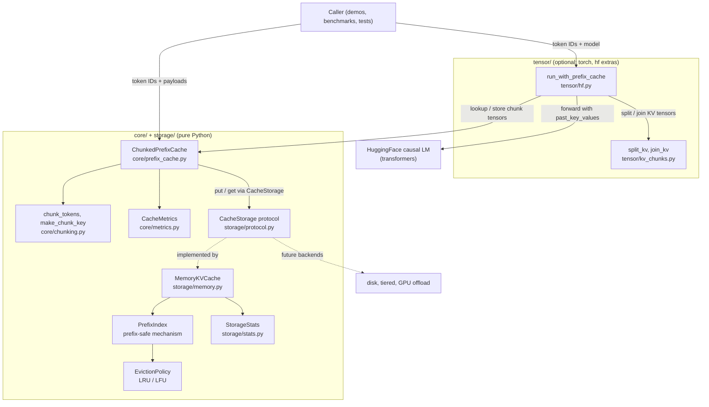
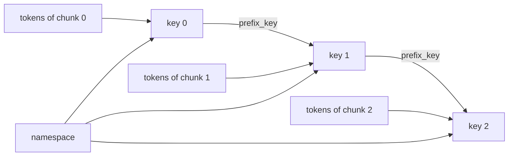
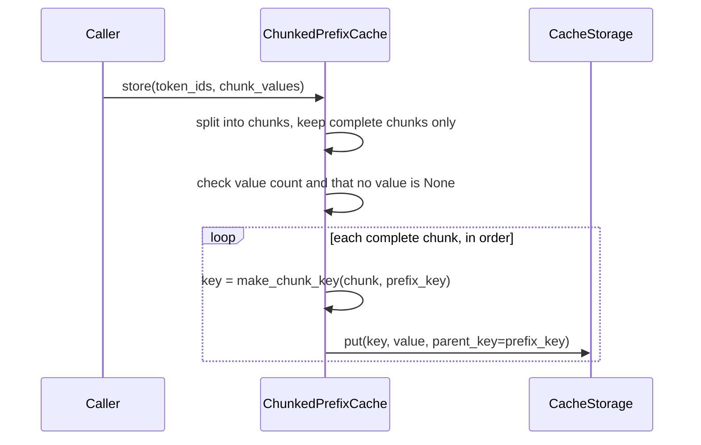
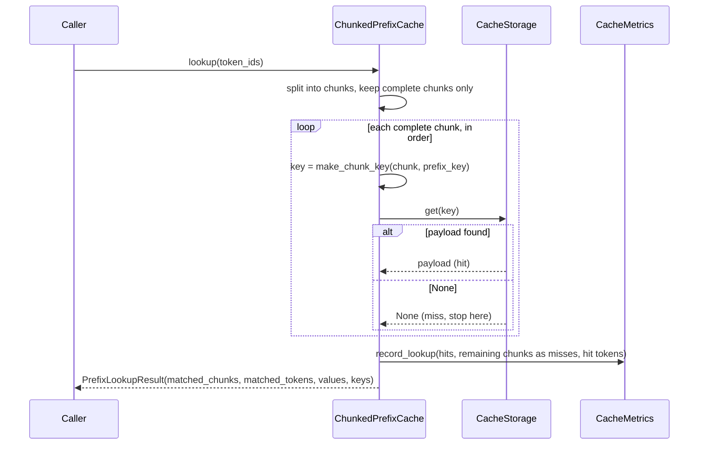
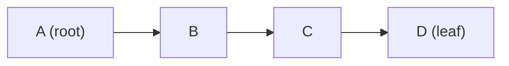

English | [简体中文](zh-CN/architecture.md)

# Architecture

This page describes implemented behavior. Start with the
[guided tutorial](tutorial/README.md) for runnable experiments, or use the
[documentation index](README.md) to find a topic. Task status lives in
[ROADMAP.md](../ROADMAP.md).

Read by topic: [capacity](#capacity-and-eviction), [eviction policies](#pluggable-eviction-policies), [disk](#disk-storage),
[INT8 compression](#optional-int8-kv-compression), [tiers](#tiered-storage),
[thread safety](#thread-safety), [offload](#gpu-to-cpu-offload),
[experimental data plane](#experimental-data-plane-abi), and
[engine integration](#inference-integration).

## Diagrams

GitHub renders the diagrams below directly. They focus on the core
prefix-cache loop and optional Hugging Face tensor path. Engine-specific
hooks are explained in [the integration design](nanovllm-integration.md);
replay and rendering are introduced in [the tutorial](tutorial/README.md).
If you change behavior, update the relevant diagrams too.

### Module relationships



`ChunkedPrefixCache` owns the matching logic and the metrics. It only
knows the `CacheStorage` protocol, so storage backends can change without
touching it.

There are two ways in. A caller can use `ChunkedPrefixCache` directly
with any payload, as the pure Python demos and tests do. Or it can call
`run_with_prefix_cache`, which drives a real model: it looks up the
cached prefix, turns the matched chunk tensors back into
`past_key_values` with `join_kv`, runs the model over the remaining
tokens, and stores the result split into chunks with `split_kv`.

Dependencies only point from `tensor/` into `core/`, never back. To
`ChunkedPrefixCache` and the storage a chunk tensor is just an opaque
payload, which is why the core still runs without PyTorch installed.

### Experimental data-plane ABI

The experimental `nano_lmcache.experimental.dataplane` package starts the
next layer without changing the teaching API. `KVLayout` describes model
namespace, model revision, tokenizer fingerprint, page size, dtype, NHD/HND key
and value axes, and layer ordering without importing PyTorch. `KVPageRef` describes one physical copy and keeps
its reservation, transfer, ready, failure, and eviction states explicit.

`KVPageDirectory` owns the logical-to-physical mapping. One logical page can
therefore have independent GPU, pinned-CPU, CPU, NVMe, or remote replicas;
the directory chooses a ready authoritative copy and falls back to another
ready replica when that copy is evicted. Layout, token range, and generation
must match across replicas, while compression and physical page IDs may
differ. The optional tensor adapters consume this ABI without making the core
package depend on PyTorch; the descriptor package itself intentionally contains
no GPU code.

### Experimental execution and storage adapters

`tensor/kernels.py` provides opt-in CUDA/Triton gather/scatter;
`tensor/codecs.py` adds GPU INT8 and reference blockwise FP8/INT4 codecs.
`tensor/mapped_host.py` writes directly to mapped pinned host memory from GPU
threads. It can regress latency, so it is not selected automatically.
`tensor/peer.py` reports whether cross-GPU copies use peer access or explicit
pinned-host staging. Callers keep inputs immutable until completion and release
transfer buffers only after the corresponding event.

`storage/remote.py` exposes batch lookup over a local TCP service.
`storage/async_write.py` queues owned, immutable payloads, rejects submissions
while closing, drains accepted writes and stops its worker even after a backend
failure. A pending key's read waits for committed data. The nano-vLLM demo's
`--async-store` moves tier writes to that worker; GPU export still runs on the
request path. This is a write-behind prototype, not a complete GPU pipeline.

`storage/coalesced.py` packs payloads into an append-only file with an atomic
checksummed index. Its capacity counts live payload bytes, not dead file extents;
there is no compactor yet. `storage/prefetch.py` bounds threaded read batches and
returns caller-owned futures. `storage/uring.py` is a separate optional Linux
registered-buffer reader; it raises when unsupported and is not wired into the
packed backend. None of these paths implies GDS or cold-NVMe throughput.

See [the experiment report](gpu-experiment-report.md) for commands, hardware,
measured regressions and remaining serving validation.

### How a chunk key is built

Each key hashes the namespace, the previous chunk's key, and the chunk's
own tokens. The chain is what makes a key depend on the whole prefix.



The first chunk has no `prefix_key`. Identical tokens after a different
prefix therefore get a different key and are never reused by mistake.

For Hugging Face models, use `tensor.hf.namespace_for(model)` after loading
the weights and converting to the inference dtype, as in
`examples/demo_kv_reuse.py`. It hashes sorted JSON containing the model name,
resolved revision, actual `model.dtype`, model class, and KV-relevant config
into a versioned `hf-kv/v1/...` namespace. The core still receives only a
string and never imports torch.

The config is retained conservatively, excluding known loading metadata,
output flags, and decoding settings. Layer count, attention and KV head
counts, head dimension, hidden size, RoPE settings (including nested
`rope_parameters` or `rope_scaling`), normalization epsilon, and MLP/activation
settings matter: they change tensor layout or the hidden states used to
compute later layers' KV. Unknown fields are kept; an extra miss is safer
than a wrong hit. Generation settings such as temperature, top-k, and beam
count do not change KV for *given input token IDs*. They can change future
sampled tokens, which are already part of the chunk keys.

Hub checkpoints use `config._commit_hash` as the resolved revision. Local or
synthetic models must supply a nonempty `config.name_or_path` and a stable
`config.revision` identifying the exact weights; missing identity raises
`ValueError`. This is a metadata fingerprint, not a weight checksum. After
fine-tuning, adapter changes, or replacing weights at the same path, assign
a new identity and create a new cache. Use evaluation mode and a fixed dtype
without changing autocast policy. Identical configs with different random
weights are not interchangeable. Old model-name-only disk entries remain
isolated and will miss under the new namespace.

### `store(token_ids, chunk_values)`



Validation happens before the first write, so a rejected store never
leaves a partial prefix behind. The incomplete tail chunk is ignored.

### `lookup(token_ids)`



Lookup stops at the first miss: a later chunk can only be valid if every
chunk before it is. Chunks after the miss are counted as misses because
the caller must recompute them.

### Why eviction must respect prefix chains



Evicting `A` here would leave `B`, `C`, and `D` in memory, but a lookup
starts at `A` and stops at the first miss, so they could never be
reached. The storage therefore only evicts leaves (here, only `D`). The
configured policy chooses among those leaves; with the default LRU policy, the
least recently used leaf goes first. After `D` goes, `C` becomes a leaf and can
be ranked by the same policy.

## Nano: Core cache concepts

The current implementation covers a minimal cache lifecycle:

1. Receive a sequence of token IDs.
2. Split it into fixed-size chunks.
3. Derive a deterministic, prefix-aware key per chunk.
4. Match chunks from the start, stopping at the first miss.
5. Report how much of the prefix can be reused, and record hit/miss
   metrics.
6. Store newly computed chunk payloads in an in-memory backend.

Only complete chunks participate in reuse. A trailing chunk shorter than
`chunk_size` is neither stored nor matched, because its state would
depend on tokens that have not arrived yet.

The implementation is pure Python so that cache behavior can be
understood without a GPU or an inference engine.

### Components

| Module | Responsibility |
| --- | --- |
| `core/chunking.py` | Split tokens into chunks; derive prefix-aware keys |
| `core/prefix_cache.py` | `ChunkedPrefixCache`: the store/lookup loop |
| `core/metrics.py` | `CacheMetrics`: chunk-level hit/miss accounting |
| `storage/protocol.py` | `CacheStorage` protocol: the `put`/`get` contract |
| `storage/eviction.py` | `PrefixIndex`: prefix-safe tree, admission, capacity, and byte accounting shared by bounded backends |
| `storage/eviction_policies.py` | `EvictionPolicy`, `LRUEvictionPolicy`, and `LFUEvictionPolicy`: leaf candidate ranking |
| `storage/disk.py` | `DiskKVCache`: one file per entry, survives restarts |
| `storage/serializers.py` | `Serializer` protocol and the safe `JsonSerializer` default |
| `storage/tiered.py` | `TieredStorage`: fast tier in front of a slow tier, write-through |
| `storage/stats.py` | `StorageStats`: eviction and rejection counters |
| `storage/memory.py` | `MemoryKVCache`: optionally bounded, prefix-safe LRU storage |
| `storage/remote.py` | Length-prefixed JSON shared-cache server/client with batch lookup |
| `storage/async_write.py` | Bounded write-behind queue with commit visibility and backpressure |
| `tensor/kv_chunks.py` | `split_kv` / `join_kv`: per-layer KV tensors <-> chunk tensors (needs torch) |
| `tensor/offload.py` | `CPUOffloadKVCache`: GPU chunks kept in pinned CPU memory (needs torch) |
| `tensor/transfer.py` | Pinned buffer pool and stream/event-based asynchronous page copies (needs torch) |
| `tensor/page_ops.py` | Torch reference gather/scatter for non-contiguous page tables (needs torch) |
| `tensor/quantization.py` | Per-head/channel-axis INT8 reference quantization (needs torch) |
| `integrations/nanovllm/layout.py` | `KVBlockLayout`: what a nano-vLLM block's bytes depend on, and its cache namespace |
| `integrations/nanovllm/external_cache.py` | `NanoVLLMExternalCache`: count, fetch, and store nano-vLLM blocks in L2 |
| `integrations/nanovllm/engine.py` | `attach()`: restore L2 hits and store new blocks inside a running nano-vLLM engine (needs nano-vLLM) |
| `integrations/nanovllm/kv_blocks.py` | `export_block` / `import_block`: nano-vLLM KV blocks <-> chunks (needs torch) |
| `integrations/vllm/nano_lmcache_connector.py` | Partial vLLM 0.33.0 scheduler lookup and worker save path; external worker load remains open |
| `experimental/dataplane/` | PyTorch-independent `KVLayout`, page lifecycle, logical/physical replica directory, and CPU reference store |
| `experimental/scheduler.py` | Transparent recompute/load estimator and duplicate-safe prefetch state machine |
| `tensor/serializers.py` | `TensorSerializer` / `QuantizedTensorSerializer`: lossless or opt-in INT8 tensor encoding for disk (needs torch) |
| `tensor/hf.py` | `run_with_prefix_cache`: reuse prefix KV with a HuggingFace model (needs torch + transformers) |
| `observability/` | Request context, trace events, recorder, and storage tracing |
| `datasets/`, `replay/` | Synthetic/token workloads, FreeInference adaptation, and replay reports |
| `visualization/`, `visualize.py` | Import recorded traces and generate the offline HTML viewer |

The `tensor` package is optional. Nothing in `core` or `storage` imports
it, so the cache concepts work without PyTorch installed.

The GPU/data-plane measurements are collected in the
[GPU experiment report](gpu-experiment-report.md).
Callers go through `ChunkedPrefixCache`, which owns a `CacheMetrics`
instance and depends only on the `CacheStorage` protocol, never on a
concrete backend. `None` is reserved to mean "miss", so `store()`
rejects `None` payloads.

### Bounded workload replay

`WorkloadReplayRunner` and `BlockTraceReplayRunner` consume already-sorted
iterables incrementally with `sort_by_arrival=False`, checking arrival/ID
order as they go. `ReplaySummary` accumulates full-workload counters;
`max_requests` limits retained request details independently of those totals.
Each call starts a new recorder/report while preserving the simulated cache.
Opaque blocks use the same prefix-safe storage contract and capacity budgets
as token workloads, with model labels included in their keys. Token replay
requires one model per runner.

`TraceRecorder(max_events=..., sample_every=...)` counts every enabled event
and successful per-backend read, while retaining only a capped prefix of
every kth event. Original sequence IDs are preserved. CLI replay defaults to
10,000 cache entries per tier, 10,000 events, and 200 request details; its
HTML pages/windows the retained data. Memory also depends on the largest
record/request and payload sizes. The API's full-detail defaults and the
batch engine JSON importer remain available. See
[streaming replay](streaming-replay.md) for precise limits and experiments.

### Why metrics count the way they do

A lookup stops probing at its first miss, so every complete chunk after
that point still has to be computed by the caller. All of them are
counted as misses, which makes `hit_rate` readable as "what fraction of
reusable work was actually reused" rather than as a probe count.

### Capacity and eviction

`MemoryKVCache(max_entries=N)` limits the cache to N entries, where one
entry is one chunk payload. `MemoryKVCache(max_bytes=B, size_fn=...)` limits
the sum of recorded payload sizes to B bytes. Either limit can be omitted;
when both are set, **both must be satisfied**. With neither, the cache is
unbounded. `max_bytes` must be a positive integer.

`CPUOffloadKVCache` also exposes `max_bytes`, using each tensor's exact
`value.nbytes` as its payload size in the shared `PrefixIndex`.
`DiskKVCache` exposes the same limit, counting the complete serialized
entry files instead of in-memory payload sizes (see **Disk storage**).

The injectable `size_fn(value) -> int` must return a non-negative integer
(zero is allowed). It defaults to `sys.getsizeof`, which measures the
shallow Python object size, not recursively referenced objects or a
tensor's underlying storage.

**For tensors or containers of bytes, pass a custom `size_fn`.** The
default may count only a small Python wrapper while ignoring a large
backing buffer or referenced byte strings, so it cannot enforce the
intended payload-memory budget for those values. A tensor size function
can report `value.nelement() * value.element_size()`; a container size
function should explicitly measure its contained payloads. For bytes-only
payloads, for example:

```python
def byte_payload_size(value: object) -> int:
    if not isinstance(value, bytes):
        raise TypeError("expected bytes")
    return len(value)


storage = MemoryKVCache(max_entries=100, max_bytes=1024, size_fn=byte_payload_size)
```

The limit covers payload sizes as reported by that function, excluding
keys, index metadata, and container overhead; it is not a process-memory
limit. `storage.nbytes` exposes the recorded total, even without a byte
limit. Payloads are measured on each `put`, not on reads. Do not resize
cached payloads in place: their recorded sizes only change on another
successful `put`. A size function exception or invalid result raises
before any entries, recency, or counters change.
Sizing intentionally runs before checking for a missing parent, so even
a write that will be rejected for that reason pays the measurement cost.

Chunk keys chain: each key is derived from the previous chunk's key, and
a lookup walks the chain from its first chunk, stopping at the first
miss. So a stored chunk is only reusable if all of its ancestors are
also stored. A plain per-entry LRU would break this: evicting `A` from
`A -> B -> C -> D` leaves `B`, `C`, `D` in memory but unreachable.

The eviction rule therefore is:

1. Only an entry with no descendants (a leaf) may be evicted.
2. The configured policy chooses among leaves. With the default LRU policy,
   the least recently used leaf goes first; LFU uses frequency first. `get`
   refreshes access state.
3. The parent of the entry being inserted is never the victim.
4. If the new entry and its ancestors cannot fit, the write is dropped
   without evicting anything, so a prompt longer than the cache keeps its
   longest prefix that fits. This includes a single payload larger than
   `max_bytes`.
5. An entry whose parent is not stored is dropped.

These rules live in `PrefixIndex` (`storage/eviction.py`), which only tracks
keys, parents, leaf status, capacity, and reported sizes, never payload
objects. The configured `EvictionPolicy` ranks eligible leaves separately; a
backend asks the index which keys to remove and moves the payloads itself, so
memory, disk, and CPU-offload backends share one prefix-safe mechanism.

One write can evict several leaves until both limits are met. After a
leaf goes, its parent may become a candidate, but the incoming entry's
ancestor chain stays protected. Admission checks that this required chain
can fit before removing any victims, so a rejected write preserves all
existing data and recency.

Overwriting a key preserves its original parent and entry count, measures
the replacement payload, and adjusts `nbytes` by the size difference.
The overwritten key and its ancestors stay protected; its descendants
may be evicted to make room for a larger payload. If the replacement and
its ancestors cannot fit, the old payload and all other entries remain
unchanged. A successful overwrite refreshes recency; shrinking frees
bytes for later writes.

The default LRU victim selector uses a min-heap of
`(last_access_tick, key)` leaf candidates in bounded indexes (either
`max_entries` or `max_bytes` set). A new entry enters as a leaf; a hit or
overwrite records a new tick. Old records are discarded lazily when a key is
gone, has children, or has a newer tick. After a last child is evicted, its
parent enters the heap using its **original last access tick**, so becoming a
leaf does not change LRU order. LFU uses the same candidate lifecycle but its
priority is `(frequency, last_access_tick, key)` and its internal-node
frequencies are retained.

Lazy records are periodically compacted once the heap exceeds both 64
records and twice the number of stored entries. This keeps auxiliary memory
O(n) and candidate maintenance O(log n) amortized. Individual operations can
still discard many stale records or rebuild the heap. The 64-record floor
avoids frequent rebuilds for tiny caches; above 2n records, at least n are
stale or duplicate because at most n records are needed for current leaves.
The O(n) rebuild costs O(1) per preceding addition when amortized, but the
operation that triggers it can experience a latency spike.

Unbounded LRU indexes do not maintain candidate ticks because they never
select a victim. LFU still records frequencies so its state is available for
diagnostics, although no heap is needed until a bounded index is created.
The [performance report](eviction-performance.md) compares LRU and LFU on
uniform and skewed shared-prefix workloads.

Together these keep the invariant that every stored entry has its whole
ancestor chain stored, so eviction never strands memory. Callers pass the
chain relation through `put(key, value, parent_key=...)`; the matching
logic in `ChunkedPrefixCache` is unchanged and unaware of eviction.

Eviction is observable through `MemoryKVCache.stats` (a `StorageStats`):

- `evictions`: entries removed to make room.
- `rejected_no_room`: writes dropped because the payload and its required
  ancestors cannot fit within the entry or byte limits.
- `rejected_missing_parent`: writes dropped because the parent was not
  stored.

These live in the storage layer rather than in `CacheMetrics`: only the
storage knows when it evicts or refuses a write, while `CacheMetrics`
counts lookup outcomes. Reading both together separates "the working set
no longer fits" (evictions climbing) from "prompts stopped sharing
prefixes" (hit rate falling with few evictions).

The trade-off: shared prefixes are protected because they always have
descendants, while the tails of long prompts are evicted first. After
eviction a request typically still hits its prefix and recomputes only
the lost suffix, which the metrics count as misses.

### Pluggable eviction policies

Prefix safety and eviction order are deliberately separate layers:

- `PrefixIndex` (`storage/eviction.py`) owns parent/child links, leaf status,
  protected incoming chains, admission/rejection, entry limits, and byte
  accounting. It never sees payload objects.
- `EvictionPolicy` (`storage/eviction_policies.py`) owns access metadata and
  ranks only the keys that the index reports as leaves. It does not maintain a
  second prefix tree. When a child disappears, the index marks the parent as a
  candidate and the policy reuses that node's existing access state.

The memory, disk, and CPU-offload backends accept `eviction_policy="lru"` or
`eviction_policy="lfu"`; the default is `"lru"`. A policy object or factory is
copied/constructed per index, so two cache instances do not share mutable
access state. In a `TieredStorage`, configure each tier independently; each
tier must preserve a complete chain of its own.

#### LRU

`LRUEvictionPolicy` preserves the original behavior. A bounded index keeps a
min-heap of `(last_access_tick, key)` leaf candidates. Hits and overwrites add a
new lazy record; internal-node hits update their tick without making them
eligible. Removing the last child exposes the parent using its previous tick,
not a fresh access. A protected incoming parent is skipped for that admission
and returned to the heap. Stale records are discarded lazily, and the heap is
rebuilt above 64 records and twice the number of stored entries. Candidate
operations are O(log n) amortized, with an occasional O(n) compaction.

#### LFU

`LFUEvictionPolicy` initializes every stored key at frequency 1. A real
`get`/`touch` increments frequency and refreshes the last-access tick. A
successful overwrite refreshes recency but is not counted as a cache hit. A
leaf is ranked by `(frequency, last_access_tick, key)`, so lower frequency wins,
then the older access, then stable lexicographic key order. Frequency state is
kept for internal nodes too: if `A -> B -> C` loses `C`, `B` becomes a leaf
with its accumulated frequency rather than being reset.

LFU uses the same lazy min-heap and compaction thresholds as LRU. The prefix
index still decides which keys are legal victims, so LFU cannot remove an
internal node or an incoming protected ancestor. Heap records remain O(n)
bounded; normal updates are O(log n) amortized and an occasional compaction is
O(n).

Disk recovery does not persist a new frequency field or change the entry-file
format. Reopening a disk cache restores each key at LFU frequency 1 and uses
file mtime only as the last-access tie-breaker; replaying mtime never calls
`touch` and therefore never manufactures LFU hits. LRU continues to recover
its exact recency order. This reset is intentional and should be considered
when comparing a fresh process with a warm one.


With a real model the payload of a chunk is one tensor holding the K and V
of every layer for that chunk's tokens:

    [num_layers, 2, num_kv_heads, chunk_tokens, head_dim]

`run_with_prefix_cache` looks up the longest cached prefix, rebuilds
`past_key_values` from the matched chunks, runs the model over only the
remaining tokens, and stores the chunks of the whole sequence for the next
request. A fully cached prompt still recomputes its last token, because
the model needs one forward step to produce next-token logits.

With lossless storage, prefix reuse preserves the cached K/V. In a causal
model the K and V of a token depend only on that token and the tokens
before it, so identical leading
tokens have identical K/V. The same tokens after a different prefix do
not, which is why chunk keys hash the whole prefix. The tests check
reused-prefix logits against a from-scratch forward pass, and check that a
chunk with a different prefix has different K/V. Low-precision full-prefill
and suffix-only execution can still differ numerically. The optional INT8
serializer below additionally changes the cached K/V through quantization.

### Disk storage

`DiskKVCache(directory)` stores one file per entry, so cached chunks
outlive the process that computed them. That is the main thing an
external KV cache adds over an inference engine's own prefix cache, which
lives in GPU memory and is lost on restart.

`max_bytes` limits the total size of complete `.entry` files.
`nbytes` reports that total even when no byte limit is set.

- **File names** are the SHA-256 of the key, so no key can address a path
  outside the directory. Each file starts with a JSON header recording the
  key, its `parent_key`, and a CRC32 of its payload. The parent link lets a
  new process rebuild prefix chains; the checksum turns a damaged payload
  into a cache miss instead of a deserialization failure.
- **Crash safety**: a write goes to a temporary file that is then renamed
  into place. A rename within one directory is atomic, so a crash leaves
  the old file, the new file, or a stray temp file, never half an entry.
  Evicted entries are always leaves, so deleting them one at a time never
  leaves an orphan behind.
- **I/O exceptions**: if an operation raises `OSError`, resolve the filesystem
  error and reopen before further use. Completed evictions are not rolled back.
- **Recovery** on open deletes stray temp files, unreadable files, entries
  whose payload checksum is missing or mismatched, and entries whose
  ancestors are missing, then rebuilds the `PrefixIndex` parents-first.
  An entry written before checksum support is discarded and regenerated on
  demand. Sizes come from `stat().st_size`; file modification times restore
  LRU order. Opening above `max_bytes` or `max_entries` raises `ValueError`
  without evicting valid entries.
- **Serialization** is pluggable. The default is JSON, not `pickle`:
  unpickling runs code chosen by whoever wrote the file, and a cache
  directory is easy to share. For KV tensors use `TensorSerializer`
  (`tensor/serializers.py`): it writes with `torch.save` and reads with
  `torch.load(weights_only=True)`, whose restricted unpickler rebuilds
  only tensors and plain containers and refuses every other class.

Only one process should write to a directory at a time, since each keeps
its own index.

Try `examples/demo_disk_cache.py --dir /tmp/limited-kv --max-bytes 400`
with a fresh directory to see a byte budget.

### Optional INT8 KV compression

`QuantizedTensorSerializer` trades numerical accuracy for smaller disk
payloads. It is always opt-in; `TensorSerializer` remains the lossless
choice for tensor storage. For a chunk shaped
`[layers, 2, kv_heads, tokens, head_dim]`, it computes one FP32 scale per
layer, K/V, head, and channel over the token axis (`-2`):

```text
scale = max(abs(values_across_tokens)) / 127
quantized = round(values / scale), clamped to [-127, 127]
restored = quantized * scale, cast back to the original dtype
```

An all-zero channel uses scale 1 and remains zero. Separating channels
keeps an outlier in one channel from reducing another channel's precision.
The serializer accepts FP16, BF16, and FP32 chunks, preserves shape and
dtype, and restores them on CPU. Inputs are not modified, and loading
uses `torch.load(weights_only=True)`.

Try a round trip on CPU after `uv sync --locked --group tensor-test`:

```python
import tempfile

import torch

from nano_lmcache.storage.disk import DiskKVCache
from nano_lmcache.tensor.serializers import QuantizedTensorSerializer

torch.manual_seed(0)
original = torch.randn(2, 2, 2, 16, 8, dtype=torch.float16)
with tempfile.TemporaryDirectory() as directory:
    disk = DiskKVCache(directory, serializer=QuantizedTensorSerializer())
    disk.put("prefix-0", original)
    restored = disk.get("prefix-0")
    print(restored.shape, restored.dtype, restored.device)
    print("maximum error:", (restored.float() - original.float()).abs().max().item())
```

Use a separate cache directory when changing serializers: existing
lossless tensor files and quantized files have different payload formats.
Reading back a quantized chunk does not restore the discarded precision.

INT8 values take one byte each, but each scale adds four bytes per channel.
Before serialization overhead, a chunk with `T` tokens uses about
`1 + 4 / T` bytes per value, versus two for FP16/BF16. At 16 tokens this
is about 1.6x compression; very short chunks may not shrink at all. Encoding
and decoding also cost time, so smaller files alone do not establish a
latency improvement.

Whether the error is acceptable depends on the model and workload. Compare
maximum K/V error, logits error, greedy token agreement, and task quality
against a full recompute on representative inputs and generation lengths.
Choose acceptance thresholds for that workload before enabling compression;
there is no universal safe error threshold. A small logit change can change
the highest-scoring token and affect later generated tokens. This is why
quantization is never the default and why the tiny-model checks do not
guarantee equivalent generation on other models.

The [compression experiment](quantized-kv.md) provides CPU reproduction
commands, measured sizes and times, separate K/V errors, and the G1
full-prefill versus lossless/INT8 reuse comparison. Exercise: change the
chunk's token count from 16 to 4 or 32 and predict how scale overhead
changes the compression ratio before measuring it.

### Tiered storage

`TieredStorage(fast=..., slow=...)` puts a small fast backend (usually
`MemoryKVCache`) in front of a large slow one (usually `DiskKVCache`),
the way LMCache keeps hot chunks in memory and the long tail on disk.

- **Write-through**: every `put` goes to the slow tier, then the fast
  tier. Write-back (demote to disk only when memory evicts) would save
  writes, but it breaks prefix safety: memory evicts a leaf whose parent
  may still exist only in memory, so a prefix-safe disk tier has to reject
  it and the chunk is lost. A disk-backed slow tier persists the writes it
  admits; an entry held only by the fast tier is lost on restart.
- **Promote on hit**: a slow-tier hit is copied into the fast tier with
  the parent the slow tier recorded. A prefix lookup walks a chain root
  first, so the parent is normally promoted just before its child. If the
  fast tier refuses the parent (no room), it also refuses the child, and
  the slow tier keeps serving both.
- **Rejected overwrites**: `MemoryKVCache` and `CPUOffloadKVCache` expose
  `try_put` to report admission and `invalidate` to remove a key with its
  descendants. If the fast tier rejects an overwrite, `TieredStorage`
  invalidates that subtree so reads use the updated slow copy. Removed
  entries count as evictions; unrelated entries retain their recency.
  Standalone `put` still preserves the old payload on rejection. Custom
  fast tiers that can reject overwrites should implement these methods.
  `DiskKVCache.try_put` also reports admission: rejected slow-tier overwrites
  leave the fast copy unchanged. Rejected new entries may still fit fast memory.
- **Invariant**: each tier keeps whole chains on its own, so their union
  does too. A randomized test checks this after every step.

`TieredStorage.tier_stats` counts hits per tier, misses, and promotions,
which shows how much of the working set fits in the fast tier.

### Thread safety

Each `MemoryKVCache`, `DiskKVCache`, and `TieredStorage` instance owns one
`threading.RLock`. The lock covers a backend's complete state change, not
only `PrefixIndex`: the index decides admission and eviction, while the
backend also owns the corresponding payload dictionary or files. Holding one
backend lock across both prevents a reader from seeing a payload after its
index entry was removed, or an index entry before its file exists.

`TieredStorage` additionally holds its own lock around a complete slow-tier
write -> fast-tier write/invalidation or fast lookup -> slow lookup ->
promotion sequence. Its child backends retain their own locks for standalone
use; callers that need the cross-tier transaction use `TieredStorage` itself.
The lock order is always tiered storage first, then a child backend; child
backends never acquire a parent lock.

Runtime entry-file operations in `DiskKVCache` run under its lock: reads,
writes, `fsync`, replacement, deletion, mtime updates, and corruption
cleanup. This favors a simple consistent view of the index and files over
parallel disk I/O. It applies only to threads sharing one backend object;
it does not make mutable payloads safe to modify in place, make a multi-chunk
lookup a snapshot, or allow multiple cache objects or processes to write the
same disk directory.

`MemoryKVCache.stats`, `DiskKVCache.stats`, and `TieredStorage.tier_stats`
return detached snapshots. `CacheMetrics` synchronizes lookup updates and
computed totals/rates; its individual public counters are still mutable,
so callers must not modify them concurrently. `CPUOffloadKVCache`, tracing
wrappers, and shared trace recorders are outside this thread-safety guarantee.

### GPU to CPU offload

`CPUOffloadKVCache(device="cuda")` keeps chunk tensors in CPU memory and
copies them back to the GPU on a hit. GPU memory is shared by the model
weights and the KV cache of running requests, while CPU memory is usually
several times larger, so offloading lets a server keep far more reusable
prefixes. It satisfies `CacheStorage` and evicts with the shared `PrefixIndex`
and configured policy, so it can be used on its own or as the fast tier of a
`run_with_prefix_cache` moves reused chunks to the model's device, so any
backend may hand chunks back on the CPU.

`CPUOffloadKVCache(max_bytes=B)` limits cached tensor payloads to B bytes,
excluding keys, bookkeeping, and allocator overhead. The read-only
`max_bytes` property is `None` by default; `nbytes` reports the actual cached
payload total. If `max_entries` is also set, both limits must be satisfied.
Only LRU leaves may be evicted. A tensor whose required prefix cannot fit
is rejected without evicting existing data. Overwrites account for the new
tensor size. Use `device="cpu", pin_memory=False` to run without a GPU.

Two copy details matter, measured with `benchmarks/bench_offload.py` on an
RTX 4090 (PCIe), 28 MiB per copy (one 256-token Qwen3-0.6B chunk in
bfloat16):

| CPU memory | `non_blocking` | GPU->CPU | CPU->GPU | call returns after |
| --- | --- | --- | --- | --- |
| pageable | no | 10.7 GB/s | 11.3 GB/s | 2.7 ms |
| pinned | no | 26.0 GB/s | 24.9 GB/s | 1.1 ms |
| pinned | yes | 26.2 GB/s | 25.2 GB/s | 0.005 ms |

- **Pinned memory** is page-locked, so the GPU can DMA straight into it.
  Pageable memory is first staged through a hidden pinned buffer, which
  cuts bandwidth by more than half.
- **`non_blocking`** does not make the copy faster; it makes the Python
  call return as soon as the copy is queued, so the CPU can keep
  scheduling work. Both directions are queued on the same CUDA stream, so
  a copy back to the GPU always runs after the copy it depends on. Only
  code reading the CPU buffer directly must wait (`peek` does).

At ~25 GB/s, loading one 28 MiB chunk takes about 1.1 ms. Whether that
beats recomputing those 256 tokens depends on the model and GPU. The
[TTFT experiment](nanovllm-benchmark.md) measures that trade-off in nano-vLLM
(task N4, which incorporated G3).

The full LMCache-style hierarchy is a composition of these pieces:

```python
TieredStorage(
    fast=CPUOffloadKVCache(device="cuda"),
    slow=DiskKVCache("/var/cache/kv", serializer=TensorSerializer()),
)
```

The model computes on the GPU, cached chunks live in pinned CPU memory,
and every chunk is written through to disk, so a restarted process reuses
them. `examples/demo_kv_reuse.py --offload --disk DIR` runs exactly this.
With a byte-limited fast tier, disk hits still return data when promotion
is rejected for insufficient capacity or a missing parent; each tier keeps
its own complete prefix chains.

## Mini: Extend the cache model

The storage interface is in place: cache logic depends on the
`CacheStorage` protocol, so file, CPU, GPU, or remote backends can be
added without touching the cache loop. Capacity limits and prefix-safe
eviction, including byte-based capacity, are implemented in `MemoryKVCache`,
`DiskKVCache`, and `CPUOffloadKVCache`. Memory, disk, and tiered storage
support threads sharing one instance as described above. Pluggable LRU/LFU
eviction policies are implemented in M11; a shared cache server remains
roadmap task M12.

## Inference integration

nano-lmcache implements an external (L2) KV cache for nano-vLLM, behind
nano-vLLM's own GPU prefix cache (L1). The design, including the block
format in `integrations/nanovllm/kv_blocks.py`, is in
[nanovllm-integration.md](nanovllm-integration.md). Version 1 restores L2
blocks before prefill and saves completed blocks synchronously. See the
[TTFT report](nanovllm-benchmark.md) for measured costs and
[engine trace guide](engine-traces.md) for L1/L2 and GPU transfer events.

The core package should remain independently understandable and
testable. Integration-specific dependencies should be introduced only
when required.

## Prefill/decode disaggregation

`disaggregation.py` is a pure Python teaching module, independent of
`tensor/` and `integrations/`. `prefill` computes a prompt's KV with
`ToyModel`, serializes it with a checksum, and puts it in a channel.
`decode` claims the bytes, checks model identity and KV completeness, and
continues generation. The small `timeline` function compares colocated and
disaggregated scheduling. See the [PD guide](pd-disaggregation.md).

## Design principle

Each stage should add one meaningful concept, with tests and runnable
examples demonstrating its behavior.
