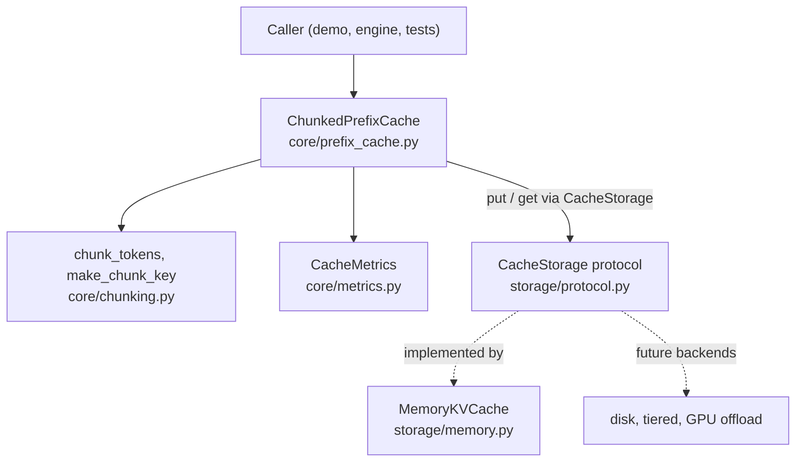
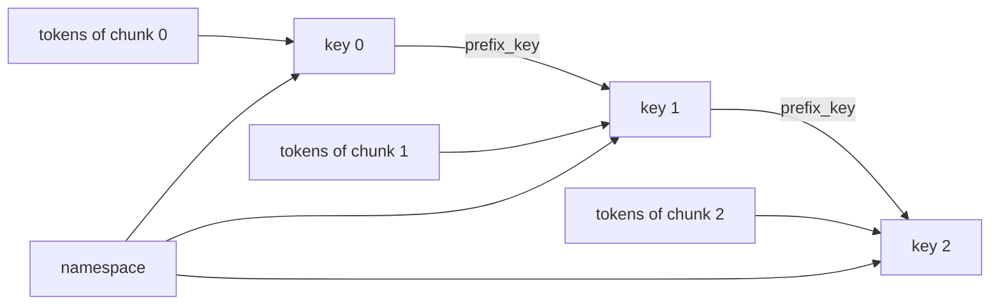
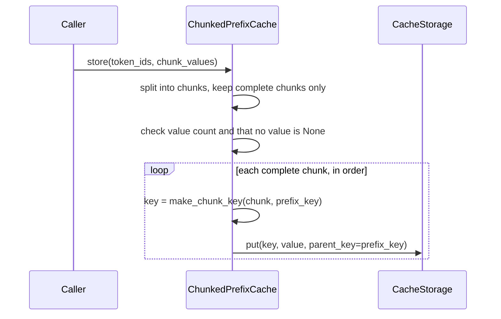
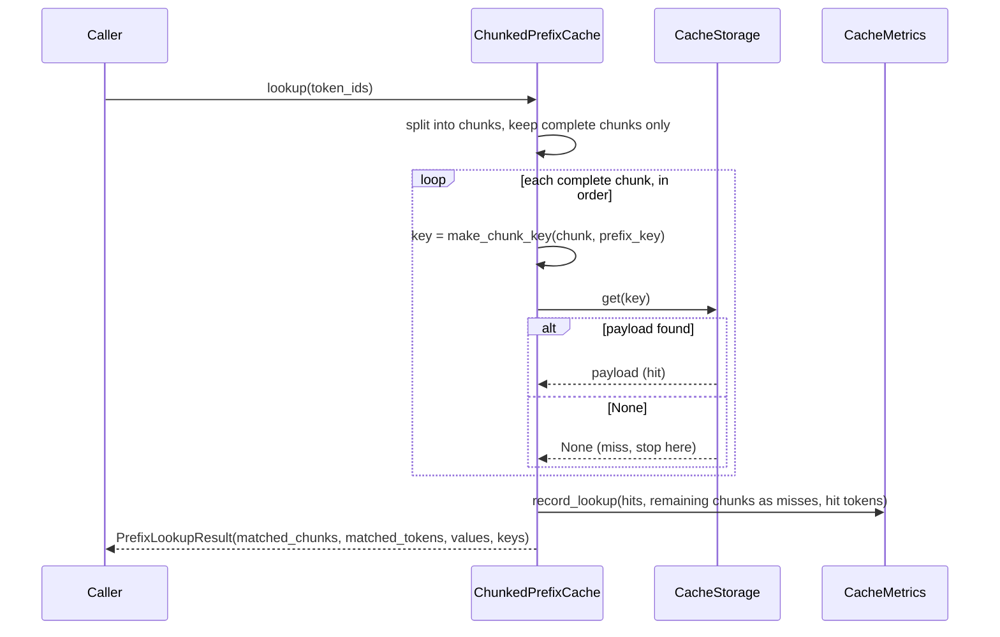
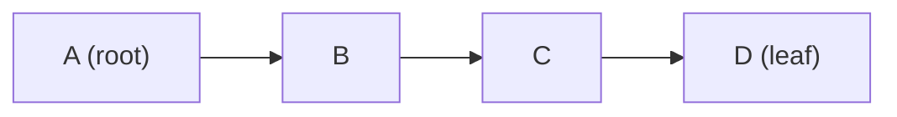

# Architecture

## Diagrams

GitHub renders the diagrams below directly. They describe the code in
`src/nano_lmcache/`; if you change behavior, update them too.

### Module relationships

`ChunkedPrefixCache` owns the matching logic and the metrics. It only
knows the `CacheStorage` protocol, so storage backends can change without
touching it.

### How a chunk key is built

Each key hashes the namespace, the previous chunk's key, and the chunk's
own tokens. The chain is what makes a key depend on the whole prefix.

The first chunk has no `prefix_key`. Identical tokens after a different
prefix therefore get a different key and are never reused by mistake.

### `store(token_ids, chunk_values)`

Validation happens before the first write, so a rejected store never
leaves a partial prefix behind. The incomplete tail chunk is ignored.

### `lookup(token_ids)`

Lookup stops at the first miss: a later chunk can only be valid if every
chunk before it is. Chunks after the miss are counted as misses because
the caller must recompute them.

### Why eviction must respect prefix chains

Evicting `A` here would leave `B`, `C`, and `D` in memory, but a lookup
starts at `A` and stops at the first miss, so they could never be
reached. The storage therefore only evicts leaves (here, only `D`), and
evicts the least recently used leaf first. After `D` goes, `C` becomes a
leaf and is next in line.

## Nano: Core cache concepts

The current implementation covers a minimal cache lifecycle:

1. Receive a sequence of token IDs.
2. Split it into fixed-size chunks.
3. Derive a deterministic, prefix-aware key per chunk.
4. Match chunks from the start, stopping at the first miss.
5. Report how much of the prefix can be reused, and record hit/miss
   metrics.
6. Store newly computed chunk payloads in an in-memory backend.

Only complete chunks participate in reuse. A trailing chunk shorter than
`chunk_size` is neither stored nor matched, because its state would
depend on tokens that have not arrived yet.

The implementation is pure Python so that cache behavior can be
understood without a GPU or an inference engine.

### Components

| Module | Responsibility |
| --- | --- |
| `core/chunking.py` | Split tokens into chunks; derive prefix-aware keys |
| `core/prefix_cache.py` | `ChunkedPrefixCache`: the store/lookup loop |
| `core/metrics.py` | `CacheMetrics`: chunk-level hit/miss accounting |
| `storage/protocol.py` | `CacheStorage` protocol: the `put`/`get` contract |
| `storage/memory.py` | `MemoryKVCache`: optionally bounded, prefix-safe LRU storage |

| `tensor/kv_chunks.py` | `split_kv` / `join_kv`: per-layer KV tensors <-> chunk tensors (needs torch) |
| `tensor/hf.py` | `run_with_prefix_cache`: reuse prefix KV with a HuggingFace model (needs torch + transformers) |

The `tensor` package is optional. Nothing in `core` or `storage` imports
it, so the cache concepts work without PyTorch installed.

Callers go through `ChunkedPrefixCache`, which owns a `CacheMetrics`
instance and depends only on the `CacheStorage` protocol, never on a
concrete backend. `None` is reserved to mean "miss", so `store()`
rejects `None` payloads.

### Why metrics count the way they do

A lookup stops probing at its first miss, so every complete chunk after
that point still has to be computed by the caller. All of them are
counted as misses, which makes `hit_rate` readable as "what fraction of
reusable work was actually reused" rather than as a probe count.

### Capacity and eviction

`MemoryKVCache(max_entries=N)` limits the cache to N entries, where one
entry is one chunk payload. Without `max_entries` the cache is unbounded
and behaves exactly as before.

Chunk keys chain: each key is derived from the previous chunk's key, and
a lookup walks the chain from its first chunk, stopping at the first
miss. So a stored chunk is only reusable if all of its ancestors are
also stored. A plain per-entry LRU would break this: evicting `A` from
`A -> B -> C -> D` leaves `B`, `C`, `D` in memory but unreachable.

The eviction rule therefore is:

1. Only an entry with no descendants (a leaf) may be evicted.
2. Among leaves, evict the least recently used. `get` refreshes recency.
3. The parent of the entry being inserted is never the victim.
4. If no victim exists, the new entry is dropped, so a prompt longer
   than the cache keeps its longest prefix that fits.
5. An entry whose parent is not stored is dropped.

Together these keep the invariant that every stored entry has its whole
ancestor chain stored, so eviction never strands memory. Callers pass the
chain relation through `put(key, value, parent_key=...)`; the matching
logic in `ChunkedPrefixCache` is unchanged and unaware of eviction.

The trade-off: shared prefixes are protected because they always have
descendants, while the tails of long prompts are evicted first. After
eviction a request typically still hits its prefix and recomputes only
the lost suffix, which the metrics count as misses.

### Real KV tensors

With a real model the payload of a chunk is one tensor holding the K and V
of every layer for that chunk's tokens:

    [num_layers, 2, num_kv_heads, chunk_tokens, head_dim]

`run_with_prefix_cache` looks up the longest cached prefix, rebuilds
`past_key_values` from the matched chunks, runs the model over only the
remaining tokens, and stores the chunks of the whole sequence for the next
request. A fully cached prompt still recomputes its last token, because
the model needs one forward step to produce next-token logits.

Reuse is exact, not approximate. In a causal model the K and V of a token
depend only on that token and the tokens before it, so identical leading
tokens have identical K/V. The same tokens after a different prefix do
not, which is why chunk keys hash the whole prefix. The tests check
reused-prefix logits against a from-scratch forward pass, and check that a
chunk with a different prefix has different K/V.

## Mini: Extend the cache model

The storage interface is in place: cache logic depends on the
`CacheStorage` protocol, so file, CPU, GPU, or remote backends can be
added without touching the cache loop. Capacity limits and prefix-safe
eviction are implemented in `MemoryKVCache`; other eviction policies and
byte-based capacity are future work.

Those backends are not implemented ahead of need.

## Inference integration

A later stage explores KV tensor handling and integration with an
inference engine such as vLLM.

The core package should remain independently understandable and
testable. Integration-specific dependencies should be introduced only
when required.

## Design principle

Each stage should add one meaningful concept, with tests and runnable
examples demonstrating its behavior.
