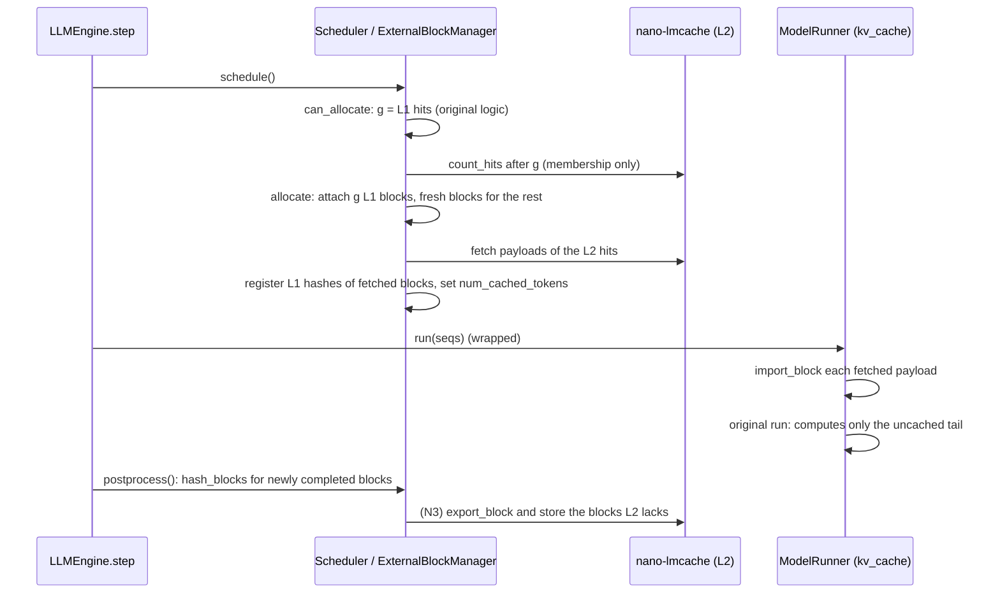

# Integrating nano-lmcache with nano-vLLM

This is the design for nano-lmcache's integration with
[nano-vLLM](https://github.com/GeeeekExplorer/nano-vllm): which nano-vLLM
code is involved, what each side owns, and the rules the integration must
not break. Roadmap tasks N0 to N4 implement it.

**Pinned version:** nano-vLLM commit `bb823b3` ("Merge pull request #218,
chunked-prefill-refactor"), its `main` at the time of writing. Every file
and behavior below refers to that commit. Upgrading is a separate task.

**Python:** nano-vLLM requires `>=3.10,<3.13` and nano-lmcache `>=3.11`, so
the integration targets Python 3.11 and 3.12. nano-vLLM also needs
`flash-attn`, `triton`, and `xxhash`; their versions must be checked
against this project's PyTorch (see N2).

## Why nano-vLLM

nano-vLLM is a ~1,200-line reimplementation of vLLM's core: a paged KV
cache, a block manager with prefix caching, continuous batching, chunked
prefill, CUDA graphs, and tensor parallelism. It is small enough to read
end to end, which fits a teaching project better than vLLM itself, and it
has a real GPU prefix cache to build on and compare against.

## Two cache levels

| Level | Where | What it reuses | Owner |
| --- | --- | --- | --- |
| L1 | GPU memory | KV blocks still resident in this nano-vLLM process | nano-vLLM's `BlockManager` |
| L2 | CPU memory, disk, or tiers of both | KV blocks the GPU no longer has, including from other processes and from before a restart | nano-lmcache |

nano-lmcache does not replace L1; it only answers for blocks L1 does not
have. An L1 hit is free: the block is already where attention reads it.
**An L2 hit is not free**: the block has to be read from CPU memory or
disk and copied into a GPU block before the forward pass. L2 pays off
when that copy costs less than recomputing the block, which N4 measures.

## What nano-vLLM looks like at `bb823b3`

### KV cache layout (`engine/model_runner.py`, `allocate_kv_cache`)

One tensor holds the whole KV cache:

```python
kv_cache = torch.empty(2, num_layers, num_blocks, block_size, num_kv_heads, head_dim)
# dtype = hf_config.dtype (for example bfloat16), device = cuda
```

Each attention layer gets the views `k_cache = kv_cache[0, layer]` and
`v_cache = kv_cache[1, layer]`. The Triton kernel `store_kvcache` in
`layers/attention.py` writes new K/V into them at `slot_mapping` positions
(`slot = block_id * block_size + offset`). One **physical block** is the
strided view `kv_cache[:, :, block_id]`, shaped
`[2, num_layers, block_size, num_kv_heads, head_dim]`.

For Qwen3-0.6B in bfloat16 (28 layers, 8 KV heads, head_dim 128) one
256-token block is 28 MiB.

### Sequences (`engine/sequence.py`)

- `Sequence.block_size` is `Config.kvcache_block_size` (256 by default,
  and it must be a multiple of 256).
- `seq.block(i)` returns the token IDs of block `i`; the last block may be
  partial.
- `seq.block_table` maps block index to physical block ID. Batched block
  tables are padded with `-1`.
- `seq.num_cached_tokens` is how many leading tokens already have KV on
  the GPU; prefill starts computing there.
- `seq.num_scheduled_tokens` is how many tokens this step computes; chunked
  prefill may split a prompt across several steps.

### L1 prefix cache (`engine/block_manager.py`)

- `compute_hash(token_ids, prefix)` chains an xxh64 hash over the previous
  block's hash and this block's tokens, so a block's hash identifies its
  whole prefix, the same idea as nano-lmcache's chunk keys.
- `can_allocate(seq) -> int` walks blocks while `hash_to_block_id` has a
  match with equal `token_ids`, and returns the number of cached blocks,
  or `-1` if there are not enough free blocks. The loop is
  `range(seq.num_blocks - 1)`: **the last block is never reused, even when
  it is full**, so there are always tokens left to produce logits from.
- `allocate(seq, num_cached_blocks)` attaches the cached blocks (bumping
  their reference counts), allocates fresh blocks for the rest, and sets
  `seq.num_cached_tokens = num_cached_blocks * block_size`. It assumes
  every cached block is in L1: it looks each one up in `hash_to_block_id`.
- `hash_blocks(seq)` runs after each model step and registers the blocks
  that step completed (`start = num_cached_tokens // block_size`,
  `end = (num_cached_tokens + num_scheduled_tokens) // block_size`). It
  seeds the chain with **the hash stored on block `start - 1`**.

### Scheduler and engine (`engine/scheduler.py`, `engine/llm_engine.py`)

`LLMEngine.step()` calls `scheduler.schedule()`, then
`model_runner.call("run", ...)`, then `scheduler.postprocess()`.

For a new sequence, `schedule()` calls `can_allocate`, computes how many
tokens remain to prefill from the returned block count, checks the token
budget, and calls `allocate`. `postprocess()` calls `hash_blocks`,
advances `num_cached_tokens`, and deallocates finished sequences, which
returns their blocks to the free list. `preempt()` deallocates a
sequence and puts it back in the waiting queue. Decode never touches the
prefix cache.

With `tensor_parallel_size == 1` everything runs in one process. With
tensor parallelism, ranks 1..N run `ModelRunner.loop()` in separate
processes, each holding its own slice of the KV heads, and rank 0
broadcasts calls to them through shared memory (`ModelRunner.call`).

## Block format (N0)

nano-lmcache stores tensors in one chunk format, used by
`tensor/kv_chunks.py` and every backend that holds tensors:

```
chunk: [num_layers, 2, num_kv_heads, chunk_tokens, head_dim]
```

With `chunk_tokens == block_size`, a physical block and a chunk hold the
same numbers in a different axis order:

```
block view kv_cache[:, :, b]: [2, layers, tokens, heads, dim]
        permute(1, 0, 3, 2, 4)
chunk:                        [layers, 2, heads, tokens, dim]
```

`integrations/nanovllm/kv_blocks.py` provides `export_block(kv_cache,
block_id)` and `import_block(kv_cache, block_id, payload)` for this. Using
the existing chunk format means `TensorSerializer`, `CPUOffloadKVCache`,
`DiskKVCache`, and `TieredStorage` store nano-vLLM blocks unchanged.

- Export returns an independent contiguous copy: nano-vLLM reuses a
  physical block for other tokens once its sequence finishes.
- Import checks layers, KV heads, head size, block size, and dtype before
  writing anything, and accepts a payload on another device (a disk tier
  returns CPU tensors).
- Block IDs are range-checked. Negative IDs are rejected on purpose:
  `-1` pads nano-vLLM's block tables, and `kv_cache[:, :, -1]` would
  quietly address the last block.
- Import copies on the current CUDA stream, the stream nano-vLLM's
  forward pass runs on, so attention cannot read a block before its copy
  finishes. Code that runs the model on another stream must synchronize.

## Keys, namespace, and lookup (N1)

`integrations/nanovllm/layout.py` and `external_cache.py` address L2 by
nano-vLLM token blocks.

**Keys.** Block `i` of a prompt gets the nano-lmcache chunk key of its
256 tokens, chained to the key of block `i - 1`, exactly what
`ChunkedPrefixCache` computes with `chunk_size == block_size`. A key
names the whole prefix up to that block. Keys come from token IDs alone;
building them reads nothing from storage.

**Namespace.** `KVBlockLayout` holds everything that changes a block's
bytes, and `namespace()` hashes it into every key:

- model identity and weight revision;
- KV cache dtype, layers, KV heads per rank, head size, block size;
- tensor-parallel size and rank;
- a fingerprint of the whole model config (`model_config_fingerprint`).

The config is hashed as a whole, minus a short list of fields that cannot
change KV (token IDs such as `eos_token_id`, `use_cache`, the load path,
the transformers version), instead of picking the fields that seem to
matter. A field wrongly included only costs a miss; a field wrongly left
out causes a wrong hit. Fields that do matter include the RoPE parameters
(nano-vLLM caches keys after rotary embedding), the norm epsilon (Qwen3
normalizes keys before caching), and the MLP settings (they shape every
later layer's input). `KVBlockLayout.from_hf_config` sizes the layout
exactly as `ModelRunner.allocate_kv_cache` sizes the KV cache; for
Qwen3-0.6B that is 28 layers, 8 KV heads, head size 128, bfloat16, and
28 MiB per block.

**Calls.** `NanoVLLMExternalCache(layout, storage)` gives each hook one
call. The storage must support `key in storage`, which every nano-lmcache
backend does.

| Call | Used by | Reads payloads? |
| --- | --- | --- |
| `count_hits(token_ids, num_gpu_cached_blocks)` | `can_allocate` (N2) | No, membership only (rule 3) |
| `fetch(token_ids, start_block, num_blocks)` | `allocate` (N2) | Yes, once; may return fewer if evicted (rule 5) |
| `missing_blocks(token_ids, num_completed_blocks)` | after each step (N3) | No |
| `store(token_ids, start_block, payloads)` | after each step (N3) | Writes, linking each block to its parent (rule 8) |

`count_hits` and `fetch` never go past `max_reusable_blocks`, the
last-block limit of rule 1. Blocks L2 holds always form a prefix of the
prompt, because storage is prefix-safe, so `missing_blocks` is simply
"everything from the first missing block on".

## The integration

nano-vLLM has no plugin interface for external KV caches. Instead of
patching it, `attach(llm, external)` (`integrations/nanovllm/engine.py`)
changes two objects of a running engine:

- **The block manager** becomes `ExternalBlockManager`, a `BlockManager`
  subclass that decides *which* blocks: it counts L2 hits after the L1
  hits, fetches their payloads, assigns physical blocks, and keeps hashes,
  reference counts, and `num_cached_tokens` correct.
- **`ModelRunner.run`** is wrapped: before the forward pass it copies the
  fetched payloads into their GPU blocks with N0's `import_block`, then
  runs the original method. `ModelRunner.call` looks methods up on the
  instance, so the wrapper takes over without touching the class.

`Scheduler`, attention, and the model code are unchanged, and nano-vLLM
stays an unmodified dependency pinned to `bb823b3` (dependency group
`nanovllm`). The cost of not keeping a patched fork is that `attach`
relies on the internal method names of that commit, which is one more
reason the commit is pinned. Tensor parallelism is rejected for now: ranks
1..N run their own `ModelRunner.loop` in other processes and would each
need to copy their slice of the KV heads.



All cache logic stays in nano-lmcache; nothing from its storage or keying
is copied into nano-vLLM.

## Rules the integration must keep

1. **Never reuse the last block.** L2 hits may cover blocks
   `g .. num_blocks - 2` at most, the same limit as L1.
2. **Register L1 hashes for restored blocks, and only for those.**
   `hash_blocks` chains from the hash on block `start - 1`. A restored
   block left with the reset hash `-1` makes every later block of the
   sequence hash wrongly, and L1 could then serve wrong KV to a later
   request. Set `block.update(h, token_ids)` and
   `hash_to_block_id[h] = block_id` exactly as `hash_blocks` would, but
   only for blocks whose payload was actually fetched; a hash on a block
   that never receives its KV is worse than no hash.
3. **Keep `can_allocate` cheap.** It runs on every scheduling step while a
   sequence waits. It may only check key membership in L2, never fetch
   payloads; fetching happens once, in `allocate`.
4. **Count GPU blocks honestly.** An L2 hit still needs a free GPU block
   to load into, so `can_allocate` must not reduce `num_new_blocks` for
   L2 blocks (only for L1 blocks already in use).
5. **Tolerate a promise that cannot be kept.** If an entry disappears
   between `can_allocate` and `allocate`, use what was fetched and set
   `num_cached_tokens` accordingly. The scheduler then computes the rest,
   in this or a later step: it only marks a sequence running once
   `num_cached_tokens + num_scheduled_tokens` reaches its length.
6. **Copy in before the forward pass.** The `run` wrapper's copies must finish
   before `run` reads those blocks; on one CUDA stream that is automatic.
7. **Copy out before the next schedule.** `postprocess` returns a finished
   sequence's blocks to the free list, and the next step may overwrite
   them. Export completed blocks in the same step, before the next
   `schedule()`.
8. **Store only complete, computed blocks, each once.** `hash_blocks`
   already identifies these, including blocks completed by chunked
   prefill or by decode. Skip blocks L2 already has, and start from the
   first missing block, so every stored block's parent is present
   (prefix-safe storage rejects orphans).
9. **Leave reference counts alone.** Restored blocks are fresh
   allocations (`ref_count = 1`), exactly like computed ones, so
   `deallocate` and preemption need no changes. L2 is unaffected by
   preemption; a re-admitted sequence simply hits again.
10. **Isolate incompatible KV.** L2 outlives the process, so keys must
    cover everything that changes a block's bytes: model identity and
    revision, dtype, layers, KV heads, head size, block size, and the
    tensor-parallel layout (N1).

## Version 1 scope

- `kvcache_block_size = 256` and nano-lmcache `chunk_size = 256`: one
  chunk is one block.
- `tensor_parallel_size = 1`: one process, one GPU.
- `enforce_eager = True`: CUDA graphs only capture decode, but disabling
  them takes one source of confusion out of debugging KV problems.
- Synchronous: loads finish before the forward pass, stores before the
  next step.
- Pinned nano-vLLM commit, single model.

Later: tensor parallelism (a namespace per rank, copies in every rank's
process), asynchronous loads overlapped with compute, and scheduling that
waits for L2 loads instead of blocking on them.

## Tasks

| Task | Deliverable |
| --- | --- |
| N0 | Block format and `export_block` / `import_block` (`integrations/nanovllm/kv_blocks.py`), tested without nano-vLLM |
| N1 | External prefix lookup over whole blocks, cache keys, and the model namespace (`integrations/nanovllm/layout.py`, `external_cache.py`) |
| N2 | Restore: `ExternalBlockManager` and `attach()` (`integrations/nanovllm/engine.py`), rules 1 to 6 and 9 (done) |
| N3 | Save: completed blocks exported in the `hash_blocks` hook and stored in L2 (rules 7, 8) |
| N4 | Correctness against a no-cache baseline, reuse across restarts, TTFT benchmarks (absorbs G3) |
