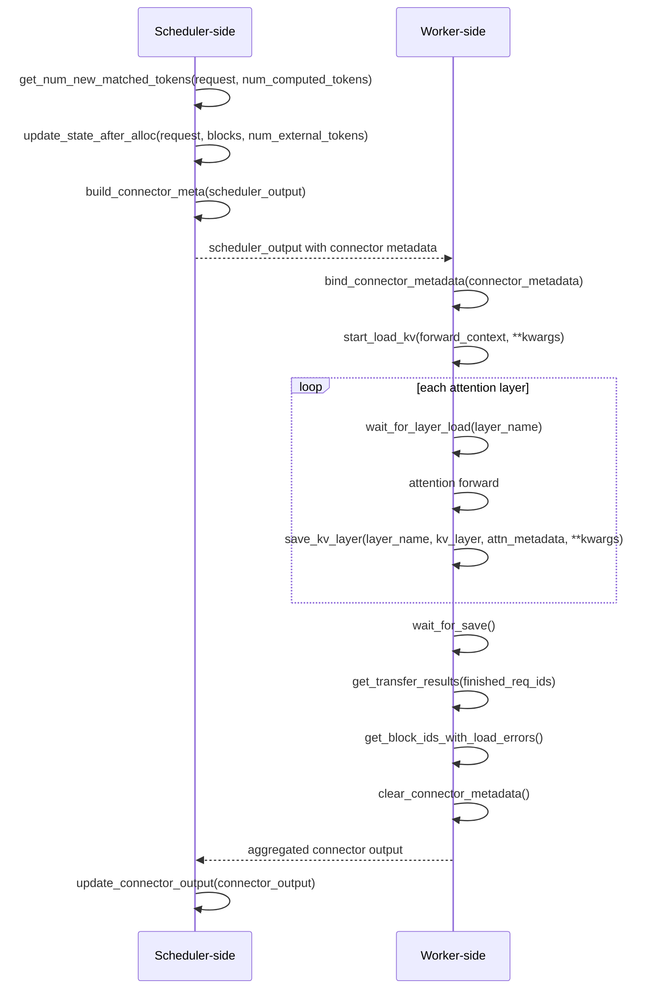

# vLLM KV connector lifecycle and validation

## vLLM version baseline (vllm==0.33.0)

**Installation:**
```bash
mkdir -p vllm-0.33.0
cd vllm-0.33.0

uv venv --python 3.11 .venv
source .venv/bin/activate

uv pip install --python .venv/bin/python "vllm==0.33.0"
```

**Reason:** Pinning 0.33.0, gives V1–V5 a reproducible baseline for connector development and testing.


## KVConnectorBase_V1 interfaces used during request processing

## Request-processing sequence

This shows a synchronous load step. The scheduler and worker are separate
roles, and planning, forwarding, and feedback repeat for many steps.



## No-op connector lifecycle tracing
The current Qwen3-0.6B test completed **2 passed in 52.20 seconds**. Both
APC settings were tested with independent baseline and connector-enabled
engines, for four engine starts and twelve generation requests in total.
The measured time includes initialization and logging; it is not an inference
performance benchmark.

### Environment and reproduction

| Setting | Recorded value |
| --- | --- |
| GPU / driver | NVIDIA GeForce RTX 4080, 16,376 MiB / 595.99.02 |
| Python / vLLM | 3.11.18 / 0.33.0 |
| PyTorch / Transformers | 2.14.0 / 5.20.2 |
| Model | `Qwen/Qwen3-0.6B` |
| Cached model revision | `c1899de289a04d12100db370d81485cdf75e47ca3` |
| Execution | One GPU, tensor parallel size 1, V2 model runner, FlashAttention 2, eager |
| KV / model dtype | BF16; block size 16; one full-attention cache group |
| Capacity | Context 512, one sequence, GPU memory utilization 0.5 |
| Generation | Seed 0, temperature 0, max tokens 8, `ignore_eos=True`, `generation_config="vllm"` |
| Connector | External module `nano_lmcache.integrations.vllm.nano_lmcache_connector`, `kv_both`; hybrid KV manager disabled |

The prompt is the first 97 token IDs obtained by tokenizing
`"The city council discussed new bus routes and the library budget. " * 40`.
The test uses plain token input, without a chat template. The complete input
IDs and all twelve outputs are preserved in the
[comparison results](validation/vllm-v1-qwen3-results.json).
The model ID is fixed in the test, but the snapshot revision is not: reproducing
this exact record requires the recorded revision to be the locally resolved
snapshot. No downloads occur during the test.

Run from the repository root using the existing vLLM environment:

```bash
set -o pipefail
CUDA_VISIBLE_DEVICES=0 VLLM_LOGGING_LEVEL=INFO \
  .venv/bin/python -m pytest -q -s \
  tests/integration/vllm/test_vllm_with_nano_lmcache_connector.py \
  2>&1 | tee /tmp/nano-lmcache-vllm-v1-qwen3.log
```

The test sets the offline and `spawn` environment variables itself. The
`VLLM_CONNECTOR_COMPARISON` lines in this output contain the actual comparison
records after the assertions pass.

### Generated tokens and reuse

Every baseline and connected request produced exactly these token IDs:

```text
[3283, 14833, 14078, 501, 5828, 11291, 323, 279]
```

Every completion had `finish_reason="length"`. Cached-token counts were:

| APC | Phase | Without connector | With connector |
| --- | --- | ---: | ---: |
| Off | Cold | 0 | 0 |
| Off | Warm | 0 | 0 |
| Off | After prefix-cache reset | 0 | 0 |
| On | Cold | 0 | 0 |
| On | Warm | 96 | 96 |
| On | After prefix-cache reset | 0 | 0 |

The 96 reused tokens come from six local GPU blocks. The connector still
reports zero **additional external** hits. These checks establish identical
generation and local reuse for this model and workload, not external KV
restoration or equality of raw KV tensor bytes.

### Recorded scheduler and worker calls

The [request log](validation/vllm-v1-qwen3-request.log) preserves the original
log lines for the APC-enabled connector engine, from initialization through
cleanup of the warm request's first step. It includes every layer and decode
step of the first cold request. The excerpt below removes only the standard
vLLM timestamp/file prefix and selects representative records; PID, call
numbers, step IDs, request IDs and argument summaries are unchanged. Gaps in
call numbers are omitted records, not missing callbacks.

```text
nano_lmcache pid=50769 role=WORKER call=1 step=None request_ids=() method=__init__ args={'num_blocks': 3853}
nano_lmcache pid=50769 role=SCHEDULER call=1 step=None request_ids=() method=__init__ args={'num_blocks': 3853}
nano_lmcache pid=50769 role=SCHEDULER call=2 step=None request_ids=() method=get_num_new_matched_tokens args={'request_id': '0-a9494691', 'num_computed_tokens': 0, 'result': (0, False)}
nano_lmcache pid=50769 role=SCHEDULER call=3 step=None request_ids=() method=update_state_after_alloc args={'request_id': '0-a9494691', 'block_ids': ([1, 2, 3, 4, 5, 6, 7],), 'num_external_tokens': 0}
nano_lmcache pid=50769 role=SCHEDULER call=4 step=1 request_ids=('0-a9494691',) method=build_connector_meta args={'num_scheduled_tokens': {'0-a9494691': 97}}
nano_lmcache pid=50769 role=WORKER call=3 step=None request_ids=() method=handle_preemptions args={'incoming_step': 1, 'incoming_request_ids': ('0-a9494691',)}
nano_lmcache pid=50769 role=WORKER call=4 step=1 request_ids=('0-a9494691',) method=bind_connector_metadata args={'metadata_type': 'NanoLMCacheConnectorMetadata'}
nano_lmcache pid=50769 role=WORKER call=5 step=1 request_ids=('0-a9494691',) method=wait_for_layer_load args={'layer_name': 'model.layers.0.self_attn.attn'}
nano_lmcache pid=50769 role=WORKER call=6 step=1 request_ids=('0-a9494691',) method=save_kv_layer args={'layer_name': 'model.layers.0.self_attn.attn', 'shape': (3853, 8, 16, 256), 'dtype': 'torch.bfloat16', 'device': 'cuda:0', 'attn_metadata_type': 'FlashAttentionMetadata', 'kwargs_keys': []}
nano_lmcache pid=50769 role=WORKER call=61 step=1 request_ids=('0-a9494691',) method=finish_forward args={}
nano_lmcache pid=50769 role=WORKER call=62 step=1 request_ids=('0-a9494691',) method=start_load_kv args={'context_type': 'ForwardContext', 'attn_metadata_type': 'NoneType', 'kwargs_keys': ['num_tokens', 'request_ids', 'request_state_indices', 'scheduler_output']}
nano_lmcache pid=50769 role=WORKER call=63 step=1 request_ids=('0-a9494691',) method=wait_for_save args={}
nano_lmcache pid=50769 role=WORKER call=64 step=1 request_ids=('0-a9494691',) method=get_transfer_results args={'finished_req_ids': []}
nano_lmcache pid=50769 role=WORKER call=65 step=1 request_ids=('0-a9494691',) method=get_finished args={'finished_req_ids': []}
nano_lmcache pid=50769 role=WORKER call=66 step=1 request_ids=('0-a9494691',) method=get_block_ids_with_load_errors args={}
nano_lmcache pid=50769 role=WORKER call=67 step=1 request_ids=('0-a9494691',) method=get_kv_connector_kv_cache_events args={}
nano_lmcache pid=50769 role=WORKER call=68 step=1 request_ids=('0-a9494691',) method=clear_connector_metadata args={}
nano_lmcache pid=50769 role=SCHEDULER call=5 step=2 request_ids=('0-a9494691',) method=build_connector_meta args={'num_scheduled_tokens': {'0-a9494691': 1}}
nano_lmcache pid=50769 role=SCHEDULER call=6 step=None request_ids=() method=update_connector_output args={'finished_sending': [], 'finished_recving': [], 'failed_recving': [], 'invalid_block_ids': []}
nano_lmcache pid=50769 role=SCHEDULER call=20 step=None request_ids=() method=request_finished args={'request_id': '0-a9494691', 'block_ids': [1, 2, 3, 4, 5, 6, 7]}
nano_lmcache pid=50769 role=SCHEDULER call=22 step=None request_ids=() method=get_num_new_matched_tokens args={'request_id': '1-b50dad1c', 'num_computed_tokens': 96, 'result': (0, False)}
nano_lmcache pid=50769 role=SCHEDULER call=24 step=10 request_ids=('1-b50dad1c',) method=build_connector_meta args={'num_scheduled_tokens': {'1-b50dad1c': 1}}
nano_lmcache pid=50769 role=WORKER call=602 step=10 request_ids=('1-b50dad1c',) method=get_transfer_results args={'finished_req_ids': ['0-a9494691']}
nano_lmcache pid=50769 role=WORKER call=603 step=10 request_ids=('1-b50dad1c',) method=get_finished args={'finished_req_ids': ['0-a9494691']}
nano_lmcache pid=50769 role=WORKER call=606 step=10 request_ids=('1-b50dad1c',) method=clear_connector_metadata args={}
```

Interpret this against the [V0 sequence diagram](#request-processing-sequence):

1. **Initialization and request lookup.** Worker and scheduler each start at
   `call=1`, even though this single-GPU run places both instances in engine
   PID 50769. The cold request `0-a9494691` has no local hits and receives
   `(0, False)` from external lookup. Allocation supplies blocks 1–7;
   metadata step 1 schedules all 97 prompt tokens. `register_kv_caches()` is
   in the linked log before the request, with tensor descriptions for 28 layers.
2. **Binding and layer callbacks.** `handle_preemptions()` precedes binding
   and therefore records `incoming_step=1` while the log's current step is
   still `None`. Binding associates worker callbacks with request `0-a9494691`.
   Calls 5–60 are the wait/save pairs for 28 attention layers. Attention runs
   between each pair; the connector itself does not log attention execution.
   The KV view is `[3853, 8, 16, 256]`, where the last axis combines K and V.
3. **Why loading appears after forward.** Unlike the synchronous-load diagram,
   worker call 61 is `finish_forward()` and call 62 is `start_load_kv()`.
   In the pinned [V2 runner adapter](https://github.com/vllm-project/vllm/blob/v0.33.0/vllm/v1/worker/gpu/kv_connector.py),
   `pre_forward()` invokes loading early only when `has_sync_kv_loads` is true;
   otherwise `post_forward()` invokes the pending load hook. This run has
   zero external matches and no synchronous loads. The delayed hook performs
   no work; it does not mean missing KV was consumed or that an actual async
   transfer occurred. Its `attn_metadata_type='NoneType'` comes from the
   temporary forward context used outside the model forward.
4. **Results and cleanup.** Calls 63–68 wait for saves, collect transfer
   results and load errors, collect cache events, and clear metadata.
   `get_transfer_results()` calls `get_finished()` internally. Empty scheduler
   feedback confirms there were no completed transfers, failed receives or
   invalid blocks. The next step's metadata may be built before feedback for
   previous work arrives (scheduler calls 5–6); the diagram shows dependencies,
   not a global serial ordering of scheduler and worker callbacks.
5. **Decode and request completion.** The full log shows steps 2–8 scheduling
   one token each, then an empty step 9. Scheduler call 20 records
   `request_finished()` for the cold request's blocks. Its `(False, None)`
   return is established by the implementation and direct tests; the trace
   logs method entry and does not print this return value. The scheduler can
   release the blocks without waiting for a save. The cold request ID is
   subsequently passed to `get_finished()` during warm step 10: this argument
   reports generation completion, not a cache transfer or external hit.
6. **Local reuse.** Warm request `1-b50dad1c` reaches scheduler call 22 with
   `num_computed_tokens=96`. External lookup again returns `(0, False)`, and
   step 10 schedules only the remaining one prompt token. Its generated token
   IDs match the cold result and the baseline. Resetting APC returns the next
   request to zero local hits, as recorded in the comparison JSON.

Startup/profiling callbacks must be distinguished from request callbacks by
request ID and step. In this run the worker registration precedes the first
request binding, and initialization/registration records have no request ID.
Shutdown callbacks occur after these requests; they are outside the selected
request-log artifact. Scheduler and worker call counters are independent,
and scheduler callbacks outside metadata construction intentionally show
`step=None`.

### Repository checks

Checks used isolated environments under `/tmp` so syncing the core and CPU
Tensor dependencies did not replace the working vLLM environment. Each was
synced from the current lockfile with `uv sync --locked --offline` (plus
`--group tensor-test` for the CPU tensor environment).

| Check | Result |
| --- | --- |
| Core environment: `python -m pytest -q` | 361 passed, 15 skipped |
| Core environment: `ruff check .` | Passed |
| Core environment: `mypy src/nano_lmcache` | Passed, 46 source files |
| CPU tensor environment: `python -m pytest -q -m "torch and not gpu"` | 177 passed, 3 skipped, 394 deselected |
| vLLM environment: direct connector lifecycle tests | 23 passed |
| vLLM environment: real Qwen3-0.6B comparison | 2 passed, 52.20 seconds |

The CPU collection check exposed a namespace collision: `tests/integration/vllm`
can be importable as `vllm` even without the engine installed. The connector
tests now check `vllm.config` before importing engine interfaces, so missing
optional vLLM dependencies skip cleanly. Core/tensor skip counts include
unavailable optional dependencies or hardware; the two real generation tests
above ran on the GPU and did not skip. These results do not cover the separate
nano-vLLM GPU suite or establish performance benefits.

## Paged KV cache: blocks, block tables and slot mapping

For ordinary unquantized full attention on one GPU, with one cache group,
equal K/V head dimensions and no kernel-block splitting:

- **Block:** stores KV for `block_size` token positions. A request's logical
  blocks can occupy nonconsecutive physical blocks in GPU memory.
- **Block table:** maps each logical block to its physical block ID,
  allowing attention to locate the request's cached context.
- **Slot mapping:** identifies where each scheduled token's KV should be
  written within the physical blocks.

For a token at `token_position` in the request:

```text
physical_block_id = block_table[token_position // block_size]
slot = physical_block_id * block_size + token_position % block_size
```

For example, `block_size = 16` and `block_table = [7, 2, 9]` place tokens 0–15 in
block 7 and tokens 16–31 in block 2. Token 18 therefore uses slot
`2 * 16 + 2 = 34`.

For this scope, the standardized per-layer KV view used by
[ExampleConnector](https://github.com/vllm-project/vllm/blob/v0.33.0/vllm/distributed/kv_transfer/kv_connector/v1/example_connector.py)
and [FlashAttention](https://github.com/vllm-project/vllm/blob/v0.33.0/vllm/v1/attention/backends/flash_attn.py)
is below. Do not apply this indexing to quantized or hybrid layouts without
checking their backend-specific representation and strides.

```text
layer.kv_cache: [num_blocks, num_kv_heads, block_size, 2 * head_dim]
keys:          layer.kv_cache[..., :head_dim]
values:        layer.kv_cache[..., head_dim:]
```

### Mapping blocks to nano-lmcache chunks

A vLLM **block** is a unit of GPU KV allocation. A nano-lmcache **chunk**
stores the keys and values of all layers for `chunk_size` consecutive tokens,
using this [tensor format](../src/nano_lmcache/tensor/kv_chunks.py):

```text
[num_layers, 2, num_kv_heads, chunk_size, head_dim]
             keys/values
```

For a small illustrative example, let `block_size = 4` and `chunk_size = 8`:

| Tokens | vLLM logical block | nano-lmcache chunk |
| --- | --- | --- |
| A B C D | block 0 | First half of chunk 0 |
| E F G H | block 1 | Second half of chunk 0 |
| I J K L | block 2 | Incomplete next chunk; not stored |

The letters represent tokens; the chunk contains their KV tensors.
If `block_table = [7, 2, 9]`, saving chunk 0 gathers KV from physical blocks
7 and 2 in token order, across all layers. Restoring it writes into the new
request's allocated blocks, which may have different physical IDs.

**Start with `chunk_size == block_size`.** An integer multiple also keeps
chunk boundaries aligned with complete blocks:

```text
chunk_size = blocks_per_chunk * block_size
```

Here `blocks_per_chunk` is a positive integer. Larger chunks reduce storage
entries but make reuse coarser: the last four tokens above form a complete
block, yet not a complete eight-token chunk. Integer-multiple alignment is
an adapter design choice, not a `KVConnectorBase_V1` requirement; other
sizes need partial-block handling or assembly from multiple chunks.

## Automatic prefix caching versus an external KV cache

Both reuse previously computed KV to avoid repeating prefix computation.

| Aspect | Built-in APC | External KV cache, such as LMCache |
| --- | --- | --- |
| Storage | The engine's GPU block pool. | CPU memory, disk or a shared cache service. |
| Reuse | Reuse resident GPU blocks directly. | Load cached KV into allocated GPU blocks before attention uses it. |
| Scope and lifetime | Shared within the engine; lost on shutdown. | Can span compatible instances and restarts, depending on the backend. |
| Cost | Lookup and block management. | Additional transfer and storage I/O; a hit may cost more than recomputation. |

They can work together: reuse local GPU KV first, load any additional
external prefix, then compute the remaining tokens. Cross-instance reuse
requires compatible model/KV settings and shared storage or a transfer
service. Restart reuse requires a surviving cache service or recoverable
persistent storage; an in-process CPU cache is not persistent.

See [vLLM's APC design](https://github.com/vllm-project/vllm/blob/v0.33.0/docs/design/prefix_caching.md)
and [LMCache storage options](https://docs.lmcache.ai/dev/kv_cache/storage_backends/local_storage.html).

## Reference implementation: ExampleConnector

[`ExampleConnector`](https://github.com/vllm-project/vllm/blob/v0.33.0/vllm/distributed/kv_transfer/kv_connector/v1/example_connector.py)
is a small `KVConnectorBase_V1` implementation that stores KV in local
`safetensors` files under `shared_storage_path`, one file per layer for a
selected prompt prefix.

| Step | Implementation |
| --- | --- |
| Find cached KV | `get_num_new_matched_tokens()` checks a directory keyed by prefix tokens and multimodal hashes. |
| Prepare transfers | `update_state_after_alloc()` and `build_connector_meta()` record requests and destination slot mappings. |
| Save KV | `save_kv_layer()` gathers selected slots, copies KV to CPU and writes the layer file. |
| Restore KV | `start_load_kv()` reads the files and copies KV into the current request's GPU slots. |

`wait_for_layer_load()` and `wait_for_save()` are no-ops in this example.
The prefill/decode demos use separate engines with the same storage
directory; their model and KV settings must match.

Use its metadata flow and slot-based copying as a reference for
nano-lmcache, replacing file lookup with our chunk keys and storage.
The example needs stronger model/dtype isolation and complete-file checks.
Its prefix-length alignment also needs correction: with 65 prompt tokens
and `block_size = 16`, lookup selects 48 tokens while load metadata selects
64. The helper computes `(n - 1) // block_size * block_size`; lookup passes
`len(prompt) - 1`, while `ReqMeta.make_meta()` passes `len(prompt)`. This can
select different storage directories. It is a teaching reference, not a
complete cache backend.

Return to the [documentation index](README.md).
