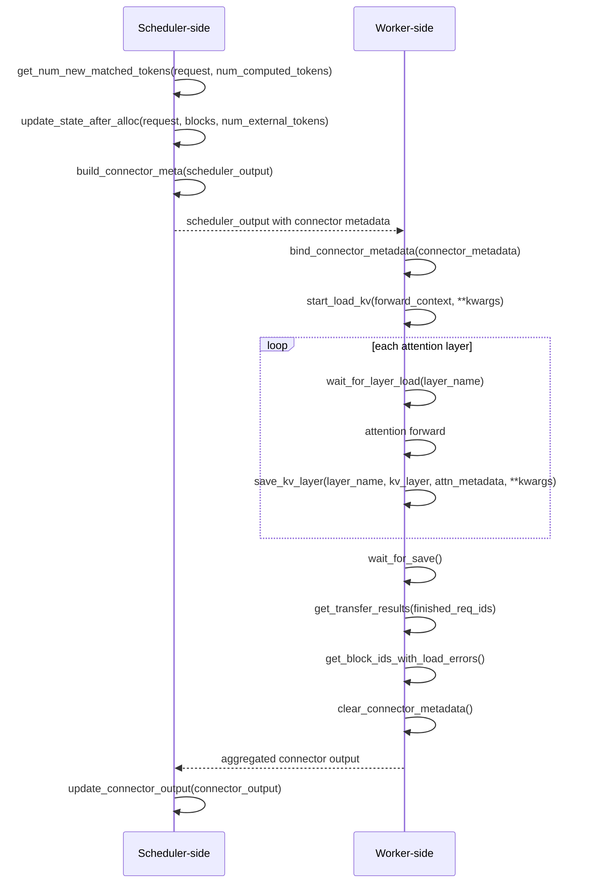

# vLLM KV connector lifecycle and validation

## vLLM version baseline (vllm==0.33.0)

**Installation:**
```bash
mkdir -p vllm-0.33.0
cd vllm-0.33.0

uv venv --python 3.11 .venv
source .venv/bin/activate

uv pip install --python .venv/bin/python "vllm==0.33.0"
```

**Reason:** Pinning 0.33.0, gives V1–V5 a reproducible baseline for connector development and testing.


## KVConnectorBase_V1 interfaces used during request processing

## Request-processing sequence

This shows a synchronous load step. The scheduler and worker are separate
roles, and planning, forwarding, and feedback repeat for many steps.



## Scheduler-generated save plans

`build_connector_meta()` now fills `metadata.requests` with `ReqMeta` save
plans for one full-attention KV cache group. Each plan contains a request ID,
complete prompt-prefix token IDs, and their physical slots. Slot counts and
ranges are assumed to be valid upstream.

For each prefill step, the saved prefix ends at
`floor(min(prompt_length, num_computed_tokens + num_scheduled_tokens) / chunk_size)
* chunk_size`. For example, with ten prompt tokens and chunks of four, a step
ending at token count six saves four tokens; a later step ending at ten saves
eight. Plans include locally cached prefix tokens but exclude generated tokens
and incomplete chunks. Decode-only and empty steps emit no save plans.

The connector keeps prompt IDs and block tables across steps, appends new
allocations, and replaces tables when requests resume after preemption. When
available, the scheduler's current block table takes precedence, including
copy-on-write replacements. Finished requests release their planning state.

The worker gathers the whole planned prefix again on each prefill step and
stores chunks after all layers arrive. Incremental writes remain follow-up
work. By default, scheduler and worker in-memory caches remain separate;
worker saves do not enable external hits in the scheduler. The shared-store
option below enables external loads. Cache namespaces fingerprint the model
path/ID, revision, HF configuration, model/KV dtype, quantization, parallel
sizes, chunk size and layout version. Local paths must identify immutable
weights; this is a configuration fingerprint, not a weight-content hash.

## V4: shared external worker KV loads

Configure **the same endpoint** for the scheduler and worker roles:

```python
from vllm.config import KVTransferConfig

transfer_config = KVTransferConfig(
    kv_connector="NanoLMCacheConnector",
    kv_connector_module_path="nano_lmcache.integrations.vllm.nano_lmcache_connector",
    kv_role="kv_both",
    kv_load_failure_policy="recompute",
    kv_connector_extra_config={
        "remote_cache": {"host": "127.0.0.1", "port": 9000},
    },
)
# Pass kv_transfer_config=transfer_config to LLM(...).
```

Run the existing cache service separately, keeping its process alive:

```python
import threading
from nano_lmcache.storage.remote import RemoteCacheServer

server = RemoteCacheServer(host="127.0.0.1", port=9000)
server.start()
try:
    threading.Event().wait()
finally:
    server.close()
```

The service is an experimental, in-memory TCP store: no authentication, TLS
or restart persistence. Use a trusted network only. Scheduler and workers
create separate `RemoteCacheClient` instances using the existing
`TensorSerializer` (`weights_only=True`, CPU decoding). Without `remote_cache`,
the connector remains save-only and **always reports zero external hits**,
even if its scheduler-local cache has entries.

The supported shared-load scope is deliberately narrow: vLLM **0.33.0**, one
ordinary causal full-attention cache group, equal K/V head dimensions,
FP16/BF16/FP32, `cache_dtype="auto"`, no model quantization, no LoRA or
multimodal models, TP=PP=1 and no kernel-block splitting. The shared option
rejects unsupported configured groups/parallelism/dtypes, and registration
checks `[num_blocks, num_kv_heads, block_size, 2 * head_dim]` views. Chunk size
is exactly block size. This does not add hybrid, MLA, sliding-window,
quantized KV, asynchronous scheduler loads or sleep-mode support.

1. Scheduler lookup tests chained chunk-key **presence**, not tensor payloads.
   It stops at the first miss, subtracts the local APC prefix and leaves at
   least one prompt token for logits. It returns `(additional_tokens, False)`;
   the scheduler sets `has_sync_kv_loads` for a positive allocated hit.
2. Allocation records the local boundary and admitted external range.
   `metadata.loads` contains picklable `ChunkLoadPlan(request_id, key,
   slot_mapping)` objects, one per chunk, with no tensors or engine/request
   objects. Plans use the current destination block table, including resumed
   requests and scheduler-provided replacements. Already-local slots are not
   loaded. For example, chunks saved from blocks `[7, 2]` can load into
   `[3, 8]` in the next request.
3. `start_load_kv()` fetches CPU chunks and scatters every layer's K and V into
   registered worker buffers. It does **not** require attention metadata:
   the 0.33 V2 runner can call it with `ForwardContext.attn_metadata=None`.
   Remote reads are synchronous; CUDA writes use the device's current stream
   and record per-layer completion events. `wait_for_layer_load()` enqueues
   a stream wait before attention. CPU writes finish immediately. Repeated
   starts in the same step do not overwrite KV again; clearing/rebinding
   metadata drains outstanding events and resets step-local state.
4. Missing entries (including eviction after lookup), undecodable payloads,
   wrong shape/dtype or non-finite tensors report the affected **destination
   block IDs** through `get_block_ids_with_load_errors()` in the same step.
   Validation precedes all-layer writes for each chunk. Failed requests do
   not publish any saves from that forward, including downstream KV. vLLM
   discards the affected output and recomputes from the first invalid block
   when `kv_load_failure_policy="recompute"`; its default `"fail"` instead
   fails the request. Successful synchronous loads do not report asynchronous
   `finished_recving` IDs. Arbitrary finite-valued corruption is not detected:
   the existing tensor serializer has no content checksum.

### V4 validation and limitations

Engine-independent CPU tests in
[`test_vllm_kv_load.py`](../tests/unit/test_vllm_kv_load.py) exercise the actual
adapter against a live local cache service, with independent writer/reader
clients, pickle round trips, nonconsecutive slots, all-layer K/V comparisons,
APC-prefix exclusion, missing/corrupt chunks, step reset and event-wait
semantics. The adapter module imports without either torch or vLLM.
The optional real-vLLM connector unit tests also cover scheduler-to-worker
plans, new/resumed requests, independent role clients and failed-forward save
suppression. A CUDA-marked adapter test checks another stream's event wait.

Run targeted validation from the repository root:

```bash
.venv/bin/python -m pytest -q \
  tests/unit/test_vllm_kv_load.py \
  tests/unit/test_nano_lmcache_connector.py \
  tests/integration/vllm/test_vllm_with_nano_lmcache_connector.py
.venv/bin/ruff check src/nano_lmcache/integrations/vllm \
  tests/unit/test_vllm_kv_load.py tests/unit/test_nano_lmcache_connector.py
.venv/bin/mypy --follow-imports=silent src/nano_lmcache/integrations/vllm
```

The implementation's local validation environment has CPU PyTorch, **no
vLLM installation and no CUDA**. The targeted run completed **17 passed,
6 skipped** (one whole real-vLLM unit module, the CUDA adapter test and four
GPU integration cases). Ruff and source-only mypy checks passed. The existing
integration file remains the V3 save/generation regression; no real-model warm
external-hit generation or performance result is claimed for V4.

## V3: scheduler-to-worker and real-model KV validation

The connector unit test `test_scheduler_plans_reach_worker_across_prefill_steps`
uses real vLLM scheduler data classes and serializes the generated metadata
before binding it to the worker. Logical blocks reside at physical IDs
`[7, 2, 9]`. Four forwards advance the computed token count through
`3, 6, 8, 10`; the cache must contain `0, 4, 8, 8` tokens respectively.
Uncomputed slots contain NaNs, and source buffers are overwritten immediately
after each save callback. Exact tensor comparisons verify token order, K/V
separation, all-layer assembly, complete-chunk boundaries and copy ownership.

The real-model test lives in
[`test_vllm_with_nano_lmcache_connector.py`](../tests/integration/vllm/test_vllm_with_nano_lmcache_connector.py)
alongside the existing BF16 generation comparison. It runs the actual vLLM
scheduler and GPU worker, then uses a local worker RPC to export chunks from
the worker's `ChunkedPrefixCache`. It does not populate that cache with the HF
reference or synthetic tensors. The RPC observer records incoming plans
without changing their contents. Pickle-based RPC serialization is enabled
only for these trusted local test functions.

Both frameworks load the same cached Qwen3-0.6B snapshot,
`c1899de289a04d12100db370d81485cdf75e47ca`, and receive the same 97 token IDs
with positions 0–96. Raw KV acceptance uses **FP32**: vLLM uses `TRITON_ATTN`
with `TRITON_F32_DEFAULT=ieee` and TF32 disabled; Transformers uses eager
attention with highest FP32 matmul precision. Execution is eager, single GPU,
TP=1, APC off, one sequence and a single full-attention cache group.

Each run saves six `[28, 2, 8, 16, 128]` chunks covering 96 tokens; the final
token is excluded. The full-prefill budget is 512 tokens and emits one
96-token plan. A 32-token budget emits plans for 32, 64, 96 and 96 tokens.
Decode steps emit none. Every element of every layer's K and V is compared
using `atol=1e-3, rtol=1e-3`, plus a per-layer/KV relative RMS limit of `1e-3`.
Negative controls require token-shifted and K/V-swapped chunks to fail.

| FP32 mode | Layer/KV comparisons | Maximum absolute error | Maximum relative RMS |
| --- | ---: | ---: | ---: |
| Full prefill | 336 | 0.001202 | 0.00001217 |
| Chunked prefill | 336 | 0.001683 | 0.00001531 |

An absolute error can exceed `atol` while still passing the combined
`abs(actual - reference) <= atol + rtol * abs(reference)` criterion.
The recorded environment is RTX 4080 / driver 595.99.02, vLLM 0.33.0,
PyTorch 2.14.0+cu130 and Transformers 5.20.2.

Final validation: **70 connector unit tests passed**, and the complete GPU
integration file finished **4 passed in 77.51 seconds** (two BF16 generation
comparisons and two FP32 KV comparisons). Ruff checks also passed for the
connector and both test modules. The separately recorded
[NanoLMCacheConnector call log](validation/vllm-v3-qwen3-request.log) covers
the two FP32 KV comparisons with INFO-level scheduler and worker tracing.

The initial BF16 raw-KV comparison did **not** meet its proposed bounds:
maximum relative RMS was about 0.286 (full) and 0.357 (chunked). The same
extraction path passes in FP32, which is consistent with accumulated
cross-framework numerical differences. This validates FP32 KV extraction;
it does not establish BF16 raw-KV equivalence or V4 external-cache reuse.
The original BF16 generation regression remains separate.

Run from the repository root, with the pinned model already cached:

```bash
.venv/bin/python -m pytest -q tests/unit/test_nano_lmcache_connector.py
CUDA_VISIBLE_DEVICES=0 \
  NANO_LMCACHE_V3_REPORT_DIR=/tmp/nano-lmcache-v3-results \
  .venv/bin/python -m pytest -q -s \
  tests/integration/vllm/test_vllm_with_nano_lmcache_connector.py
```

Add `-k saved_kv` to run only the two KV comparisons. JSON reports include
the exact input IDs, positions, plans, layer order, namespace, shapes,
tolerances and per-layer errors. Reports are generated under the selected
`/tmp` directory; tensor exports stay in pytest's temporary directory.
`docs/validation/` retains only `NanoLMCacheConnector` method calls from the
V3 run, with the logger's process, timestamp and source-location prefixes
removed. Model-loading output, framework warnings and pytest output are excluded.

## NanoLMCacheConnector lifecycle tracing (V3)

The [NanoLMCacheConnector call log](validation/vllm-v3-qwen3-request.log)
contains 672 entries emitted by the connector's `_log_call()` helper while
saving real Qwen3 KV, in both full and chunked prefill. This INFO
trace run completed **2 passed, 2 deselected in 76.30 seconds**. In that V3
run external loading was unimplemented; scheduler-side external lookup
returned zero because its storage was separate from the worker's CPU chunks.
V4's opt-in shared-store load path is described above.

| Setting | Recorded value |
| --- | --- |
| Model revision | `c1899de289a04d12100db370d81485cdf75e47ca` |
| GPU / driver | NVIDIA GeForce RTX 4080 / 595.99.02 |
| Python / vLLM | 3.11.18 / 0.33.0 |
| PyTorch / Transformers | 2.14.0+cu130 / 5.20.2 |
| Execution | One GPU, TP=1, V2 model runner, Triton attention, eager |
| Model / KV dtype | FP32; block size 16; one full-attention cache group |
| Input | 97 prompt tokens, positions 0–96; no chat template |
| Prefill token budget | 512 for full prefill; 32 for chunked prefill |
| Capacity | Context 512, one sequence, GPU memory utilization 0.5 |
| Generation | Temperature 0, max tokens 3, seed 0, `ignore_eos=True` |
| Connector | `NanoLMCacheConnector`, `kv_both`; APC off; hybrid KV manager disabled |

To reproduce the call log, run from the repository root:

```bash
set -o pipefail
CUDA_VISIBLE_DEVICES=0 VLLM_LOGGING_LEVEL=INFO \
  NANO_LMCACHE_V3_REPORT_DIR=/tmp/nano-lmcache-v3-call-reports \
  .venv/bin/python -m pytest -q -s \
  tests/integration/vllm/test_vllm_with_nano_lmcache_connector.py \
  -k saved_kv --tb=short 2>&1 | tee /tmp/nano-lmcache-v3-calls.log

rg --only-matching \
  'nano_lmcache pid=[0-9]+ role=(SCHEDULER|WORKER) call=.* method=[A-Za-z_]+ args=.*' \
  /tmp/nano-lmcache-v3-calls.log > /tmp/nano-lmcache-connector-calls.log
```

The tests load cached weights offline, use `spawn`, and compare the worker's
saved chunks with Transformers. The final `rg` command extracts only
`NanoLMCacheConnector` calls in the same format as the retained log. Each entry
keeps the connector PID, role, call number, step, request IDs, method and arguments.
The excerpts below are exact lines from that filtered log in their original
order; repeated per-layer entries are omitted. The complete connector log
includes registration of all 28 layers, decode steps, feedback and shutdown.

### NanoLMCacheConnector calls during full prefill

```text
nano_lmcache pid=267636 role=WORKER call=1 step=None request_ids=() method=__init__ args={'num_blocks': 1607}
nano_lmcache pid=267636 role=SCHEDULER call=1 step=None request_ids=() method=__init__ args={'num_blocks': 1607}
nano_lmcache pid=267636 role=SCHEDULER call=2 step=None request_ids=() method=get_num_new_matched_tokens args={'request_id': '0-b179a60e', 'prompt_tokens': 97, 'num_computed_tokens': 0, 'external_prefix_tokens': 0, 'matched_end': 0, 'additional_matched_tokens': 0, 'chunk_size': 16, 'block_size': 16, 'reason': 'lookup', 'result': (0, False)}
nano_lmcache pid=267636 role=SCHEDULER call=3 step=None request_ids=() method=update_state_after_alloc args={'request_id': '0-b179a60e', 'block_ids': ([1, 2, 3, 4, 5, 6, 7],), 'num_external_tokens': 0}
nano_lmcache pid=267636 role=SCHEDULER call=4 step=1 request_ids=('0-b179a60e',) method=build_connector_meta args={'num_scheduled_tokens': {'0-b179a60e': 97}}
nano_lmcache pid=267636 role=WORKER call=4 step=1 request_ids=('0-b179a60e',) method=bind_connector_metadata args={'metadata_type': 'NanoLMCacheConnectorMetadata'}
nano_lmcache pid=267636 role=WORKER call=5 step=1 request_ids=('0-b179a60e',) method=wait_for_layer_load args={'layer_name': 'model.layers.0.self_attn.attn'}
nano_lmcache pid=267636 role=WORKER call=6 step=1 request_ids=('0-b179a60e',) method=save_kv_layer args={'layer_name': 'model.layers.0.self_attn.attn', 'shape': (1607, 8, 16, 256), 'dtype': 'torch.float32', 'device': 'cuda:0', 'attn_metadata_type': 'TritonAttentionMetadata', 'kwargs_keys': []}
nano_lmcache pid=267636 role=WORKER call=60 step=1 request_ids=('0-b179a60e',) method=save_kv_layer args={'layer_name': 'model.layers.27.self_attn.attn', 'shape': (1607, 8, 16, 256), 'dtype': 'torch.float32', 'device': 'cuda:0', 'attn_metadata_type': 'TritonAttentionMetadata', 'kwargs_keys': []}
nano_lmcache pid=267636 role=WORKER call=61 step=1 request_ids=('0-b179a60e',) method=finish_forward args={}
nano_lmcache pid=267636 role=WORKER call=62 step=1 request_ids=('0-b179a60e',) method=start_load_kv args={'context_type': 'ForwardContext', 'attn_metadata_type': 'NoneType', 'kwargs_keys': ['num_tokens', 'request_ids', 'request_state_indices', 'scheduler_output']}
nano_lmcache pid=267636 role=WORKER call=63 step=1 request_ids=('0-b179a60e',) method=wait_for_save args={}
nano_lmcache pid=267636 role=WORKER call=64 step=1 request_ids=('0-b179a60e',) method=get_transfer_results args={'finished_req_ids': []}
nano_lmcache pid=267636 role=WORKER call=65 step=1 request_ids=('0-b179a60e',) method=get_finished args={'finished_req_ids': []}
nano_lmcache pid=267636 role=WORKER call=66 step=1 request_ids=('0-b179a60e',) method=get_block_ids_with_load_errors args={}
nano_lmcache pid=267636 role=WORKER call=68 step=1 request_ids=('0-b179a60e',) method=clear_connector_metadata args={}
nano_lmcache pid=267636 role=SCHEDULER call=10 step=None request_ids=() method=request_finished args={'request_id': '0-b179a60e', 'block_ids': [1, 2, 3, 4, 5, 6, 7]}
nano_lmcache pid=267636 role=WORKER call=221 step=None request_ids=() method=shutdown args={}
nano_lmcache pid=267636 role=SCHEDULER call=13 step=None request_ids=() method=shutdown args={}
```

The scheduler schedules 97 tokens and sends a plan for the first 96. Each
`save_kv_layer()` gathers that layer's K/V from the plan's slots and copies it
to CPU. The last required layer completes the six all-layer chunks and stores
them. `wait_for_save()` checks that no layers are missing.

The V2 runner invokes `start_load_kv()` after forward in this no-external-load
case. There is no load work. The earlier sequence diagram illustrates the
synchronous-load path; it is not the ordering of this save-only trace.

### NanoLMCacheConnector calls during chunked prefill

```text
nano_lmcache pid=268059 role=SCHEDULER call=4 step=1 request_ids=('0-83cf75d9',) method=build_connector_meta args={'num_scheduled_tokens': {'0-83cf75d9': 32}}
nano_lmcache pid=268059 role=WORKER call=6 step=1 request_ids=('0-83cf75d9',) method=save_kv_layer args={'layer_name': 'model.layers.0.self_attn.attn', 'shape': (1614, 8, 16, 256), 'dtype': 'torch.float32', 'device': 'cuda:0', 'attn_metadata_type': 'TritonAttentionMetadata', 'kwargs_keys': []}
nano_lmcache pid=268059 role=WORKER call=63 step=1 request_ids=('0-83cf75d9',) method=wait_for_save args={}
nano_lmcache pid=268059 role=SCHEDULER call=5 step=2 request_ids=('0-83cf75d9',) method=build_connector_meta args={'num_scheduled_tokens': {'0-83cf75d9': 32}}
nano_lmcache pid=268059 role=WORKER call=72 step=2 request_ids=('0-83cf75d9',) method=save_kv_layer args={'layer_name': 'model.layers.0.self_attn.attn', 'shape': (1614, 8, 16, 256), 'dtype': 'torch.float32', 'device': 'cuda:0', 'attn_metadata_type': 'TritonAttentionMetadata', 'kwargs_keys': []}
nano_lmcache pid=268059 role=WORKER call=129 step=2 request_ids=('0-83cf75d9',) method=wait_for_save args={}
nano_lmcache pid=268059 role=SCHEDULER call=7 step=3 request_ids=('0-83cf75d9',) method=build_connector_meta args={'num_scheduled_tokens': {'0-83cf75d9': 32}}
nano_lmcache pid=268059 role=WORKER call=138 step=3 request_ids=('0-83cf75d9',) method=save_kv_layer args={'layer_name': 'model.layers.0.self_attn.attn', 'shape': (1614, 8, 16, 256), 'dtype': 'torch.float32', 'device': 'cuda:0', 'attn_metadata_type': 'TritonAttentionMetadata', 'kwargs_keys': []}
nano_lmcache pid=268059 role=WORKER call=195 step=3 request_ids=('0-83cf75d9',) method=wait_for_save args={}
nano_lmcache pid=268059 role=SCHEDULER call=9 step=4 request_ids=('0-83cf75d9',) method=build_connector_meta args={'num_scheduled_tokens': {'0-83cf75d9': 1}}
nano_lmcache pid=268059 role=WORKER call=204 step=4 request_ids=('0-83cf75d9',) method=save_kv_layer args={'layer_name': 'model.layers.0.self_attn.attn', 'shape': (1614, 8, 16, 256), 'dtype': 'torch.float32', 'device': 'cuda:0', 'attn_metadata_type': 'TritonAttentionMetadata', 'kwargs_keys': []}
nano_lmcache pid=268059 role=WORKER call=261 step=4 request_ids=('0-83cf75d9',) method=wait_for_save args={}
```

The scheduled token counts are 32, 32, 32 and 1. Their save plans cover 32, 64,
96 and 96 prefix tokens respectively, as checked by the real-model test.
Each plan gathers the complete valid prefix again. Later decode steps have no
save plans, even though vLLM still invokes the layer hooks.

## Paged KV cache: blocks, block tables and slot mapping

For ordinary unquantized full attention on one GPU, with one cache group,
equal K/V head dimensions and no kernel-block splitting:

- **Block:** stores KV for `block_size` token positions. A request's logical
  blocks can occupy nonconsecutive physical blocks in GPU memory.
- **Block table:** maps each logical block to its physical block ID,
  allowing attention to locate the request's cached context.
- **Slot mapping:** identifies where each scheduled token's KV should be
  written within the physical blocks.

For a token at `token_position` in the request:

```text
physical_block_id = block_table[token_position // block_size]
slot = physical_block_id * block_size + token_position % block_size
```

For example, `block_size = 16` and `block_table = [7, 2, 9]` place tokens 0–15 in
block 7 and tokens 16–31 in block 2. Token 18 therefore uses slot
`2 * 16 + 2 = 34`.

For this scope, the standardized per-layer KV view used by
[ExampleConnector](https://github.com/vllm-project/vllm/blob/v0.33.0/vllm/distributed/kv_transfer/kv_connector/v1/example_connector.py)
and [FlashAttention](https://github.com/vllm-project/vllm/blob/v0.33.0/vllm/v1/attention/backends/flash_attn.py)
is below. Do not apply this indexing to quantized or hybrid layouts without
checking their backend-specific representation and strides.

```text
layer.kv_cache: [num_blocks, num_kv_heads, block_size, 2 * head_dim]
keys:          layer.kv_cache[..., :head_dim]
values:        layer.kv_cache[..., head_dim:]
```

### Mapping blocks to nano-lmcache chunks

A vLLM **block** is a unit of GPU KV allocation. A nano-lmcache **chunk**
stores the keys and values of all layers for `chunk_size` consecutive tokens,
using this [tensor format](../src/nano_lmcache/tensor/kv_chunks.py):

```text
[num_layers, 2, num_kv_heads, chunk_size, head_dim]
             keys/values
```

For a small illustrative example, let `block_size = 4` and `chunk_size = 8`:

| Tokens | vLLM logical block | nano-lmcache chunk |
| --- | --- | --- |
| A B C D | block 0 | First half of chunk 0 |
| E F G H | block 1 | Second half of chunk 0 |
| I J K L | block 2 | Incomplete next chunk; not stored |

The letters represent tokens; the chunk contains their KV tensors.
If `block_table = [7, 2, 9]`, saving chunk 0 gathers KV from physical blocks
7 and 2 in token order, across all layers. Restoring it writes into the new
request's allocated blocks, which may have different physical IDs.

**Start with `chunk_size == block_size`.** An integer multiple also keeps
chunk boundaries aligned with complete blocks:

```text
chunk_size = blocks_per_chunk * block_size
```

Here `blocks_per_chunk` is a positive integer. Larger chunks reduce storage
entries but make reuse coarser: the last four tokens above form a complete
block, yet not a complete eight-token chunk. Integer-multiple alignment is
an adapter design choice, not a `KVConnectorBase_V1` requirement; other
sizes need partial-block handling or assembly from multiple chunks.

## Automatic prefix caching versus an external KV cache

Both reuse previously computed KV to avoid repeating prefix computation.

| Aspect | Built-in APC | External KV cache, such as LMCache |
| --- | --- | --- |
| Storage | The engine's GPU block pool. | CPU memory, disk or a shared cache service. |
| Reuse | Reuse resident GPU blocks directly. | Load cached KV into allocated GPU blocks before attention uses it. |
| Scope and lifetime | Shared within the engine; lost on shutdown. | Can span compatible instances and restarts, depending on the backend. |
| Cost | Lookup and block management. | Additional transfer and storage I/O; a hit may cost more than recomputation. |

They can work together: reuse local GPU KV first, load any additional
external prefix, then compute the remaining tokens. Cross-instance reuse
requires compatible model/KV settings and shared storage or a transfer
service. Restart reuse requires a surviving cache service or recoverable
persistent storage; an in-process CPU cache is not persistent.

See [vLLM's APC design](https://github.com/vllm-project/vllm/blob/v0.33.0/docs/design/prefix_caching.md)
and [LMCache storage options](https://docs.lmcache.ai/dev/kv_cache/storage_backends/local_storage.html).

