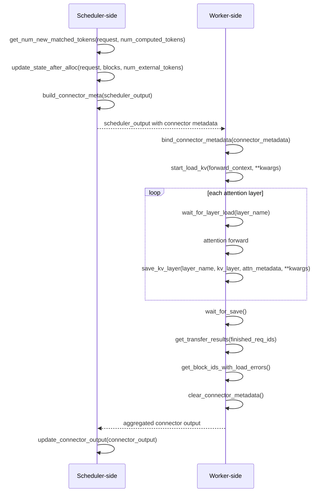

# vLLM KV connector research notes

## Recommended vLLM version

**Recommend pinning `vllm==0.32.0` for the first nano-lmcache connector**
(decision date: 2026-11-04). For a source checkout, use tag `v0.32.0`,
which resolves to commit `5df63a7203cdb9328d824a27b682e77c7b9928be`.

Reasons for this choice:

- **A reproducible release baseline.** A fixed release gives contributors
  the same scheduler and worker APIs. The
  [base class](https://github.com/vllm-project/vllm/blob/v0.32.0/vllm/distributed/kv_transfer/kv_connector/v1/base.py)
  explicitly labels the connector API experimental, so avoid an open-ended
  dependency such as `vllm>=0.32.0`.
- **It already provides the integration points we need.** It includes
  scheduler/worker hooks, the file-backed
  [ExampleConnector](https://github.com/vllm-project/vllm/blob/v0.32.0/vllm/distributed/kv_transfer/kv_connector/v1/example_connector.py),
  and [external connector loading](https://github.com/vllm-project/vllm/blob/v0.32.0/vllm/distributed/kv_transfer/kv_connector/factory.py)
  through `kv_connector_module_path`. Our connector can live in
  nano-lmcache without modifying vLLM's internal registry.
- **It retains a CUDA 12 build option.** The
  [0.32.0 release](https://github.com/vllm-project/vllm/releases/tag/v0.32.0)
  provides `vllm/vllm-openai:v0.32.0-cu129`. The newer
  [0.33.0 release notes](https://github.com/vllm-project/vllm/releases/tag/v0.33.0rc3)
  announce the removal of CUDA 12.9 artifacts and an upgrade to PyTorch
  2.14. For this project's initial connector, I would keep the CUDA 12
  option and defer that runtime migration.

Use a separate environment or the versioned container: this repository's
existing PyTorch CUDA 12.4 environment is not automatically compatible
with vLLM 0.32.0. The selected build still needs a compatible host driver.
Start validation with one GPU, a dense full-attention model and
unquantized KV; check cache misses, external hits and generated-output
agreement before treating this recommendation as a tested integration.

**Documentation scope:** the interfaces, KV view, and example below were
checked against `v0.32.0` (commit above). This is a source review, not an
installed or GPU-tested integration; no vLLM dependency is added here.

## KVConnectorBase_V1 interfaces used during request processing

### Scheduler-side

| Interface | Purpose |
| --- | --- |
| `get_num_new_matched_tokens(request, num_computed_tokens)` | Find the additional contiguous prompt prefix available in external KV storage and determine whether loading spans scheduling steps. |
| `update_state_after_alloc(request, blocks, num_external_tokens)` | Record allocated destination blocks and prepare the request's load plan. |
| `build_connector_meta(scheduler_output)` | Package this step's load/save plans into metadata for the workers and reset per-step planning state. |
| `update_connector_output(connector_output)` | Update the scheduler connector's state using aggregated worker feedback. |
| `request_finished(request, block_ids)` | Handle request completion, determine whether blocks must be retained for pending saves/sends, and provide optional transfer parameters. |


### Worker-side

| Interface | Purpose |
| --- | --- |
| `bind_connector_metadata(connector_metadata)` | Bind the scheduler's transfer plan for the current step. |
| `start_load_kv(forward_context, **kwargs)` | Start loading external KV into the allocated GPU buffers. |
| `wait_for_layer_load(layer_name)` | Ensure the layer's required KV is ready before attention reads it. |
| `save_kv_layer(layer_name, kv_layer, attn_metadata, **kwargs)` | Start saving the selected KV after the layer's attention operation. |
| `wait_for_save()` | Submit pending saves and enforce synchronization needed to keep source blocks safe. |
| `get_transfer_results(finished_req_ids)` | Collect completed sends, completed receives and failed receives for scheduler feedback. |
| `get_block_ids_with_load_errors()` | Report blocks whose loads failed, so the scheduler can invalidate them and handle recomputation or failure. |
| `clear_connector_metadata()` | Clear the current step's bound transfer plan after its users have finished. |

The match result is `(additional_tokens, load_async)`: `None` for the first
element defers scheduling until the lookup is resolved; zero requires
`load_async=False`. Only report the contiguous prefix that is actually
available, beyond the local hit. Failed synchronous loads must be reported
in that forward pass; asynchronous failures must be reported no later than
the receive-completion report. Never let attention consume missing KV.

## Request-processing sequence

This shows a synchronous load step. The scheduler and worker are separate
roles, and planning, forwarding, and feedback repeat for many steps.



The [worker lifecycle](https://github.com/vllm-project/vllm/blob/v0.32.0/vllm/v1/worker/kv_connector_model_runner_mixin.py)
may start independent asynchronous loads after the current forward is
submitted. Speculative decoding may defer `wait_for_save()` and metadata
cleanup until the draft forward has also finished.

`request_finished()` is a separate scheduler event, called once before
freeing a finished request's blocks. Returning `True` retains them until
the worker reports send/save completion via `get_finished()` (wrapped by
`get_transfer_results()`); returning `False` allows release. An asynchronous
save must keep its source blocks alive; otherwise `wait_for_save()` must
finish the save before returning.

## Paged KV cache: blocks, block tables and slot mapping

For ordinary unquantized full attention on one GPU, with one cache group,
equal K/V head dimensions and no kernel-block splitting:

- **Block:** stores KV for `block_size` token positions. A request's logical
  blocks can occupy nonconsecutive physical blocks in GPU memory.
- **Block table:** maps each logical block to its physical block ID,
  allowing attention to locate the request's cached context.
- **Slot mapping:** identifies where each scheduled token's KV should be
  written within the physical blocks.

For a token at `token_position` in the request:

```text
physical_block_id = block_table[token_position // block_size]
slot = physical_block_id * block_size + token_position % block_size
```

For example, `block_size = 16` and `block_table = [7, 2, 9]` place tokens 0–15 in
block 7 and tokens 16–31 in block 2. Token 18 therefore uses slot
`2 * 16 + 2 = 34`.

For this scope, the standardized per-layer KV view used by
[ExampleConnector](https://github.com/vllm-project/vllm/blob/v0.32.0/vllm/distributed/kv_transfer/kv_connector/v1/example_connector.py)
and [FlashAttention](https://github.com/vllm-project/vllm/blob/v0.32.0/vllm/v1/attention/backends/flash_attn.py)
is below. Do not apply this indexing to quantized or hybrid layouts without
checking their backend-specific representation and strides.

```text
layer.kv_cache: [num_blocks, num_kv_heads, block_size, 2 * head_dim]
keys:          layer.kv_cache[..., :head_dim]
values:        layer.kv_cache[..., head_dim:]
```

### Mapping blocks to nano-lmcache chunks

A vLLM **block** is a unit of GPU KV allocation. A nano-lmcache **chunk**
stores the keys and values of all layers for `chunk_size` consecutive tokens,
using this [tensor format](../src/nano_lmcache/tensor/kv_chunks.py):

```text
[num_layers, 2, num_kv_heads, chunk_size, head_dim]
             keys/values
```

For a small illustrative example, let `block_size = 4` and `chunk_size = 8`:

| Tokens | vLLM logical block | nano-lmcache chunk |
| --- | --- | --- |
| A B C D | block 0 | First half of chunk 0 |
| E F G H | block 1 | Second half of chunk 0 |
| I J K L | block 2 | Incomplete next chunk; not stored |

The letters represent tokens; the chunk contains their KV tensors.
If `block_table = [7, 2, 9]`, saving chunk 0 gathers KV from physical blocks
7 and 2 in token order, across all layers. Restoring it writes into the new
request's allocated blocks, which may have different physical IDs.

**Start with `chunk_size == block_size`.** An integer multiple also keeps
chunk boundaries aligned with complete blocks:

```text
chunk_size = blocks_per_chunk * block_size
```

Here `blocks_per_chunk` is a positive integer. Larger chunks reduce storage
entries but make reuse coarser: the last four tokens above form a complete
block, yet not a complete eight-token chunk. Integer-multiple alignment is
an adapter design choice, not a `KVConnectorBase_V1` requirement; other
sizes need partial-block handling or assembly from multiple chunks.

## Automatic prefix caching versus an external KV cache

Both reuse previously computed KV to avoid repeating prefix computation.

| Aspect | Built-in APC | External KV cache, such as LMCache |
| --- | --- | --- |
| Storage | The engine's GPU block pool. | CPU memory, disk or a shared cache service. |
| Reuse | Reuse resident GPU blocks directly. | Load cached KV into allocated GPU blocks before attention uses it. |
| Scope and lifetime | Shared within the engine; lost on shutdown. | Can span compatible instances and restarts, depending on the backend. |
| Cost | Lookup and block management. | Additional transfer and storage I/O; a hit may cost more than recomputation. |

They can work together: reuse local GPU KV first, load any additional
external prefix, then compute the remaining tokens. Cross-instance reuse
requires compatible model/KV settings and shared storage or a transfer
service. Restart reuse requires a surviving cache service or recoverable
persistent storage; an in-process CPU cache is not persistent.

See [vLLM's APC design](https://github.com/vllm-project/vllm/blob/v0.32.0/docs/design/prefix_caching.md)
and [LMCache storage options](https://docs.lmcache.ai/dev/kv_cache/storage_backends/local_storage.html).

## Reference implementation: ExampleConnector

[`ExampleConnector`](https://github.com/vllm-project/vllm/blob/v0.32.0/vllm/distributed/kv_transfer/kv_connector/v1/example_connector.py)
is a small `KVConnectorBase_V1` implementation that stores KV in local
`safetensors` files under `shared_storage_path`, one file per layer for a
selected prompt prefix.

| Step | Implementation |
| --- | --- |
| Find cached KV | `get_num_new_matched_tokens()` checks a directory keyed by prefix tokens and multimodal hashes. |
| Prepare transfers | `update_state_after_alloc()` and `build_connector_meta()` record requests and destination slot mappings. |
| Save KV | `save_kv_layer()` gathers selected slots, copies KV to CPU and writes the layer file. |
| Restore KV | `start_load_kv()` reads the files and copies KV into the current request's GPU slots. |

`wait_for_layer_load()` and `wait_for_save()` are no-ops in this example.
The prefill/decode demos use separate engines with the same storage
directory; their model and KV settings must match.

Use its metadata flow and slot-based copying as a reference for
nano-lmcache, replacing file lookup with our chunk keys and storage.
The example needs stronger model/dtype isolation and complete-file checks.
Its prefix-length alignment also needs correction: with 65 prompt tokens
and `block_size = 16`, lookup selects 48 tokens while load metadata selects
64. The helper computes `(n - 1) // block_size * block_size`; lookup passes
`len(prompt) - 1`, while `ReqMeta.make_meta()` passes `len(prompt)`. This can
select different storage directories. It is a teaching reference, not a
complete cache backend.

Return to the [documentation index](README.md).
