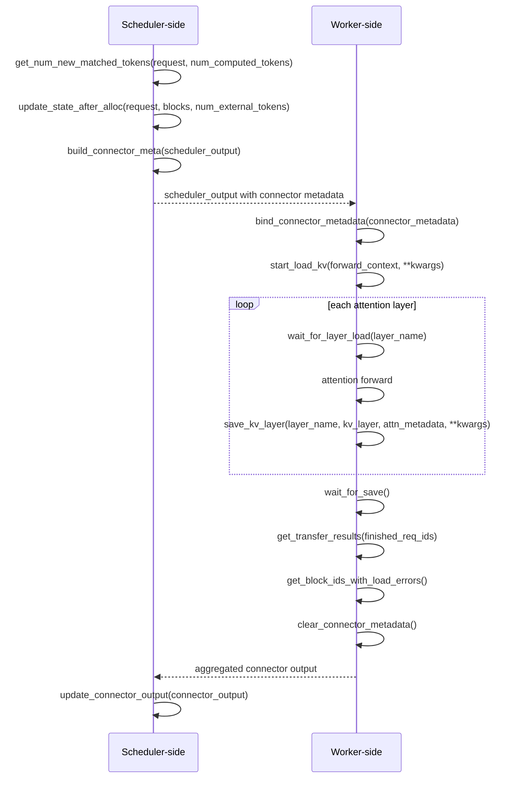

# vLLM with nano-lmcache connector

## vLLM version baseline (vllm==0.33.0)

```bash
uv sync --locked --group vllm
uv run python examples/demo_vllm_with_nano_lmcache_connector.py
```

**Reason:** Pinning 0.33.0, gives V1–V5 a reproducible baseline for connector development and testing.


## KVConnectorBase_V1 interfaces used during request processing

## Request-processing sequence

This shows a synchronous load step. The scheduler and worker are separate roles, and planning, forwarding, and feedback repeat for many steps.



## NanoLMCacheConnector lifecycle tracing

This is a concrete example with small prompts so slot numbers stay readable. It
uses Qwen3-0.6B (28 layers, 8 KV heads, `head_dim = 128`), BF16 KV,
`block_size = chunk_size = 16`, one full-attention cache group, TP = PP = 1,
APC off, and a shared `remote_cache`. One stored chunk has shape
`[28, 2, 8, 16, 128]`; one worker layer has shape
`[num_blocks, 8, 16, 256]`.

- **Request A (cold):** 48 prompt tokens, block table `[7, 2, 9]`. The
  external cache is empty. vLLM schedules all 48 tokens in one prefill step.
- **Request B (warm):** 48 prompt tokens. Tokens 0–31 are identical to A's;
  tokens 32–47 differ. Its block table is `[5, 8, 12]`, so the same logical
  KV occupies different physical blocks.
- After A, the external cache holds A's chunks 0–2. B can load chunks 0–1
  (32 tokens) and must compute and publish chunk 2.

Every hook also emits one `_log_call()` line with the process ID, role, call
number, step, request IDs, method name, and arguments. The flows below omit
that logging line.

The hook order for B is:

1. scheduler `get_num_new_matched_tokens` returns `(32, False)`;
2. scheduler `update_state_after_alloc` turns the match into a load plan;
3. scheduler `build_connector_meta` emits a `ReqMeta` with load=32 and
   save-skip=32;
4. worker `bind_connector_metadata` installs that metadata;
5. worker `start_load_kv` scatters chunks 0–1;
6. worker `wait_for_layer_load` waits for each layer's copy;
7. attention computes tokens 32–47;
8. worker `save_kv_layer` collects chunk 2 layer by layer;
9. worker `wait_for_save` verifies all 28 layers arrived;
10. worker `get_transfer_results`, `get_finished`, and
    `get_block_ids_with_load_errors` return their per-step results;
11. worker `clear_connector_metadata` clears the step;
12. scheduler `update_connector_output` consumes the worker feedback;
13. scheduler `request_finished` drops the request state;
14. worker `shutdown` releases connector state when the engine exits.

### __init__ (scheduler and worker)

1. Store the transfer role, `block_size`, `chunk_size = block_size`, and a
   namespace fingerprint over the model path/revision, HF config, dtype,
   quantization, KV dtype, TP/PP sizes, chunk size, and layout version.
2. `_validate_scope()` rejects more than one KV cache group, non-full
   attention, and speculative decoding.
3. If `remote_cache` is configured, validate the shared-load scope (TP = PP =
   1, unquantized text-only KV, one plain full-attention group with equal K/V
   head sizes, no sliding window, no attention chunking, causal attention),
   then parse `host`/`port` and create
   `RemoteCacheClient(..., serializer=TensorSerializer())`. Both roles point
   at the same server.
4. Create the role cache: the scheduler owns `_lookup_cache`; the worker owns
   `_save_cache`. Both are `ChunkedPrefixCache` instances using the shared
   storage. Without `remote_cache`, each process gets a private in-memory
   cache, so worker saves are invisible to scheduler lookups.
5. Initialize scheduler state (`_request_trackers`, `_load_specs`) or worker
   state (`_layer_names`, `_kv_caches`, `_pending_save_layers`,
   `_load_errors`, `_failed_loads`, `_load_events`, `_load_started`). The
   constructor performs no CUDA work.

In the example, both processes derive the same namespace, and each creates a
client for the shared server.

### Scheduler: get_num_new_matched_tokens

1. Drop any stale `_load_specs[request_id]` from an earlier scheduling
   attempt.
2. If the request has no prompt token IDs, report zero matches.
3. Without shared storage, call `_lookup_cache.lookup(token_ids)`, cap the
   match at `(len(token_ids) - 1) // 16 * 16`, and subtract
   `num_computed_tokens` to obtain the additional tokens.
4. With shared storage, reject an unaligned local prefix
   (`num_computed_tokens % 16 != 0`).
5. Otherwise build chained chunk keys for every complete chunk in
   `token_ids[:-1]`, stop at the first key absent from storage, and count the
   matching chunks. Cap the result at `(len(token_ids) - 1) // 16 * 16` and
   subtract `num_computed_tokens`.
6. If the additional count is positive, remember
   `LoadSpec(vllm_cached_tokens=num_computed_tokens,
   external_cached_tokens=matched_end)`. Return
   `(additional_matched_tokens, False)`; `False` means a synchronous load.

For A the cache is empty, so the method returns `(0, False)`. Even with a
nonempty cache it inspects only chunks 0–1, because `token_ids[:-1]` has 47
tokens and the final prompt token is reserved for logits.

For B the first 32 tokens are present. The method builds keys for chunks 0–1
of B's 47-token prefix, both `contains` checks succeed, and it returns
`(32, False)` with `LoadSpec(0, 32)`. vLLM therefore marks 32 tokens as
computed and schedules only the remaining 16 tokens.

### Scheduler: update_state_after_alloc

1. vLLM passes the request, the blocks it allocated, and
   `num_external_tokens`.
2. If no `LoadSpec` was stored, this is a cold request; return without
   enabling a load.
3. If `num_external_tokens <= 0`, set `can_load = False`.
4. Compute `expected = external_cached_tokens - vllm_cached_tokens`, take
   `allocated = min(num_external_tokens, expected)`, and round down to a
   complete chunk. If it is zero, set `can_load = False`.
5. Set `external_cached_tokens = vllm_cached_tokens + allocated` and
   `can_load = True`.

For B, vLLM allocates blocks `[5, 8, 12]` and reports 32 external tokens.
`expected` and `allocated` are both 32, so the load covers tokens 0–31.
Request A has no `LoadSpec`, so this hook returns immediately.

### Scheduler: build_connector_meta

1. Remove trackers and load specs for finished or preempted requests.
2. Create a `RequestTracker` for each new request, initialized with its full
   prompt, first-group block table, and current computed-token count. For
   cached requests, update the computed count and append new blocks; replace
   the table when the request resumed.
3. For every scheduled request, prefer the scheduler's current block state
   when supplied, then pop its `LoadSpec`.
4. If a load is possible, raise `tracker.num_saved_tokens` to at least the
   external hit rounded down to a chunk, so the worker does not republish
   loaded chunks.
5. Build `ReqMeta` from the tracker: `load_end` is the external hit;
   `compute_end` is `min(prompt_len, num_computed + num_scheduled)`;
   `save_end` is `compute_end` rounded down to a chunk; `skip` is
   `num_saved_tokens` rounded down; `can_save` requires uncomputed prompt
   tokens and `save_end > skip`. The span ends at
   `max(save_end if can_save else 0, load_end)`, slots are derived from the
   block table, and the load spec is attached when `load_end > 0`. When
   `can_save` is true the tracker's `num_saved_tokens` advances to
   `save_end`.
6. Increment the step number, record the scheduled request IDs, log, and
   return `NanoLMCacheConnectorMetadata`.

For A, the tracker is `(48 tokens, blocks [7, 2, 9], computed 0)`. The plan
has `skip=0`, `save_end=48`, slots for all 48 tokens
(`112–127, 32–47, 144–159`), and no load.

For B, the tracker starts at 32 computed tokens with blocks `[5, 8, 12]` and
16 scheduled tokens. The load spec sets `num_saved_tokens=32`; the plan has
`load_end=32`, `save_end=48`, `skip=32`, `can_save=True`, and spans all 48
tokens (`80–95, 128–143, 192–207`). The worker must load the first 32 slots
and save only the last 16.

### Worker: register_kv_caches

1. vLLM calls this once during worker initialization with a mapping from
   layer name to the layer's paged KV tensor.
2. Reject a later call that changes the layer set.
3. Sort layer names naturally (layer 2 before layer 10) and keep the ordered
   mapping used for chunk assembly.
4. With shared storage, validate that every tensor is four-dimensional,
   matches the first tensor's shape and dtype, has `block_size` in the token
   axis and an even last dimension. This is the
   `[num_blocks, num_kv_heads, block_size, 2 * head_dim]` layout.

In the example, 28 tensors of shape `[num_blocks, 8, 16, 256]` are registered;
the expected stored chunk shape is `[28, 2, 8, 16, 128]`.

### Worker: bind_connector_metadata

1. Reset per-step load state: synchronize every CUDA event left from the
   previous step, then clear events, load errors, failed requests, and the
   `load_started` flag.
2. Clear pending per-layer save buffers.
3. Remember the metadata for tracing, emit the log line, and delegate to the
   base class.

For B this installs the one-request metadata produced by
`build_connector_meta`; all load state starts empty.

### Worker: start_load_kv

1. Select requests whose `load_spec` exists and has `can_load=True`. If none
   exist, return immediately (request A). On a no-load step, vLLM's V2
   runner may place this call after forward, which is harmless because there
   is nothing to scatter.
2. Require registered KV layers and compute the expected chunk shape from the
   first layer: `[num_layers, 2, num_kv_heads, chunk_size, head_dim]`.
3. For each load request, validate that both cached counts are chunk-aligned
   and that the external count does not exceed the recorded token IDs. On
   failure, mark the request and all its slots as failed and continue.
4. Compute chained keys for `token_ids[:external_cached_tokens]`. Iterate
   chunk indices from `vllm_cached_tokens // 16` to
   `external_cached_tokens // 16`.
5. Fetch each chunk from shared storage, validate shape, dtype, and
   finiteness, then scatter it into all layers: concatenate the stored K and
   V halves, permute to `[tokens, heads, 2 * head_dim]`, and assign
   `layer[slot // block_size, :, slot % block_size]`.
6. After all requests, set `load_started = True` and record one CUDA event per
   layer on its current stream.

For B, chunk indices 0 and 1 are fetched and written to slots 80–95 (block 5)
and 128–143 (block 8) in every one of the 28 layers. Request A has no load
requests, so the method returns before touching the cache.

### Worker: wait_for_layer_load

1. Check whether the metadata contains any loadable request. If it does and
   `start_load_kv` has not run, raise an error; attention must not consume a
   layer before the scatter is issued.
2. If a CUDA event was recorded for this layer, make the layer's current
   stream wait on it.

For B, each layer waits for the event recorded after its scatter. For A no
events exist, so the hook is a no-op.

### Worker: save_kv_layer

1. Return immediately for a `kv_consumer` role.
2. If the metadata has no requests, return; decode-only steps and steps that
   complete no new chunk have nothing to save.
3. Validate that the layer name was registered.
4. For each request with `can_save=True`, set `start = skip_leading_tokens`
   and `end = floor(len(token_ids) / 16) * 16`. Skip if `start >= end` or
   `start` is not chunk-aligned. Skip the whole request if it had a load
   failure or if `[start:end]` touches a block reported as invalid.
5. Gather `kv_layer[slots // 16, :, slots % 16]` for that span, copy it to
   CPU, split K and V, permute each to `[heads, tokens, head_dim]`, and keep
   them in `_pending_save_layers[request_id][layer_name]`.
6. When all registered layer names are present, order the layers, call
   `split_kv()` to form chunks, and call
   `save_cache.store(token_ids[:end], chunks, start_chunk=start // 16,
   request_id=...)`.

For A, `start=0` and `end=48`; after all 28 layers arrive, three chunks are
stored. For B, `start=32` and `end=48`; only chunk 2 is gathered from block 12
and stored at index 2. The two loaded chunks are not saved again.

### Worker: wait_for_save

1. For every request in `_pending_save_layers`, compute the missing layer
   names against the registered set.
2. Raise an error if any layer is missing; otherwise the save is complete.

In the example all 28 layers arrive for both requests. If vLLM skipped a layer
hook, this check fails before the step can finish silently with partial KV.

### Worker: get_finished

1. Log the finished request IDs.
2. Delegate to the base implementation. This connector has no asynchronous
   sends or receives, so the result is empty.

Both A and B finish with no pending transfers.

### Worker: get_transfer_results

1. Log the finished request IDs.
2. Delegate to the base implementation, which calls `get_finished()` and
   builds an empty transfer-result snapshot.

The connector does not track asynchronous transfer results.

### Worker: get_block_ids_with_load_errors

1. Return a copy of `_load_errors`, whose entries are physical block IDs
   computed from failed slot ranges.
2. vLLM consumes these IDs through `KVConnectorOutput.invalid_block_ids` and
   applies `kv_load_failure_policy`.

On the successful A/B path the set is empty. If B's second chunk fetch failed,
the slots 128–143 would mark block 8 invalid, and the request would either be
recomputed or failed according to the configured policy.

### Worker: clear_connector_metadata

1. Delegate to the base class to clear the installed metadata.
2. Drop the tracing reference and pending save buffers.
3. Reset load state: synchronize events, then clear events, errors, failed
   requests, and `load_started`.

vLLM calls this after collecting feedback for a step, so the next
`bind_connector_metadata` starts from clean worker state.

### Scheduler: update_connector_output

1. Log `finished_sending`, `finished_recving`, and `invalid_block_ids` from
   the aggregated worker output.
2. Delegate to the base class.

In the example there are no asynchronous sends, and the invalid-block set is
empty on success.

### Scheduler: request_finished

1. Log the request ID and released block IDs.
2. Remove the request's `RequestTracker` and any leftover `LoadSpec`.
3. Delegate to the base class. Chunks already published to the external cache
   remain available for later requests.

When A and B finish, their planning state is dropped; A's chunks remain in the
cache and are what B reused.

### Worker: handle_preemptions

1. Log the incoming metadata's step and request IDs.
2. Delegate to the base class. Preemption can run before metadata is bound on
   the worker; this connector keeps no cross-step per-request worker state, so
   there is nothing else to clear. The scheduler drops the preempted request's
   load spec in `build_connector_meta`.

The example does not trigger preemption.

### Worker: finish_forward

1. Log and delegate to the base class. vLLM calls it after the model forward;
   the connector performs no additional work.

### Worker: get_kv_connector_kv_cache_events

1. Log and return `None`. This connector does not emit a KV cache event
   stream.

### Worker: shutdown

1. Clear pending save buffers.
2. Reset load state, synchronizing any remaining CUDA events.
3. Delegate to the base class. Shared cache entries are not deleted; disk or
   server contents survive for a later engine.

After B finishes, shutdown releases connector state while the external cache
still contains A's chunks and B's newly saved chunk 2.

