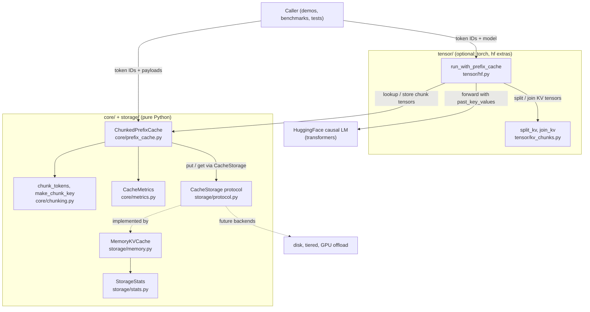
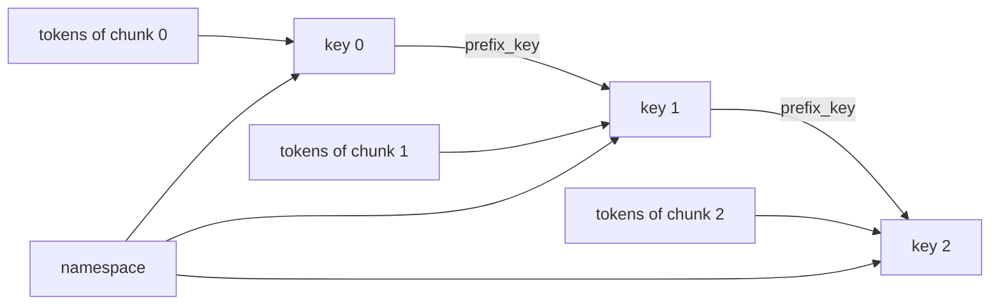
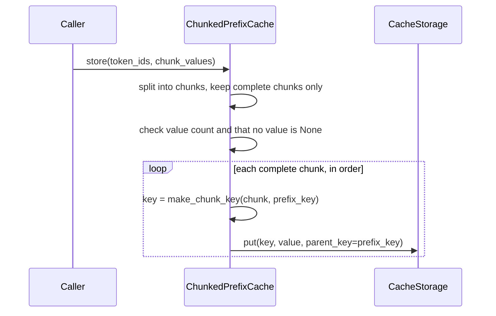
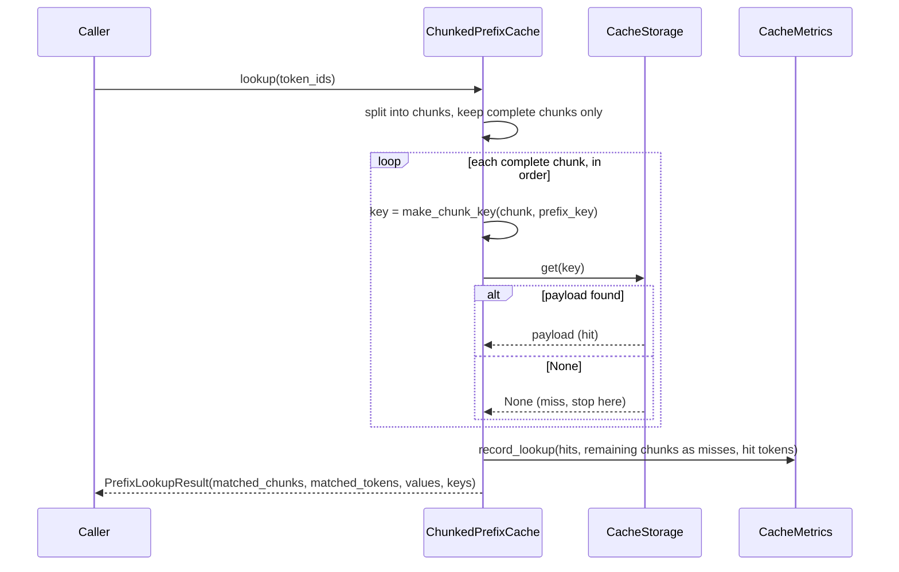
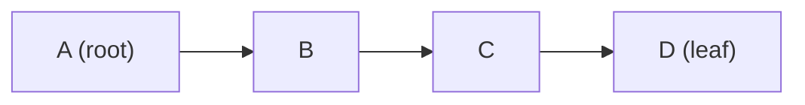

<!--
Chinese translation of docs/architecture.md
English source commit: 2aa6d0ae92b07eb9c8b0053e6a9a9c51df77ba40
-->

# 架构

## 图示

GitHub 会直接渲染以下图示。它们描述的是 `src/nano_lmcache/` 中的代码；如果修改了程序行为，也应同步更新这些图示。

### 模块关系



`ChunkedPrefixCache` 负责匹配逻辑和指标统计。它只依赖 `CacheStorage` 协议，因此可以更换存储后端，而不必修改缓存逻辑。

调用方有两种使用方式。第一种是直接使用 `ChunkedPrefixCache`，存储任意类型的数据载荷，纯 Python 示例和测试就是这样做的。第二种是调用 `run_with_prefix_cache` 来运行真实模型：该函数查找已缓存的前缀，通过 `join_kv` 将匹配到的分块张量还原为 `past_key_values`，让模型处理剩余 token，再通过 `split_kv` 将结果拆分为分块并存储。

依赖关系只允许从 `tensor/` 指向 `core/`，不能反向依赖。对于 `ChunkedPrefixCache` 和存储层而言，分块张量只是一个不透明的数据载荷，因此即使没有安装 PyTorch，核心逻辑仍然可以运行。

### 如何生成分块键

每个键都会对命名空间、前一个分块的键以及当前分块自身的 token 进行哈希计算。这样的链式结构使每个键都依赖于完整的前缀。



第一个分块没有 `prefix_key`。因此，即使两个分块包含相同的 token，只要它们之前的前缀不同，就会生成不同的键，从而避免错误复用缓存。

### `store(token_ids, chunk_values)`



在第一次写入之前会先完成验证，因此被拒绝的存储操作不会留下不完整的前缀。末尾不完整的分块会被忽略。

### `lookup(token_ids)`



查找会在第一次未命中时停止：只有当前面所有分块都有效时，后面的分块才可能被复用。首次未命中之后的分块也会计为未命中，因为调用方必须重新计算它们。

### 为什么淘汰操作必须遵守前缀链



如果此时淘汰 `A`，`B`、`C` 和 `D` 虽然仍留在内存中，却无法再通过查找访问到它们，因为查找从 `A` 开始，并会在第一次未命中时停止。

因此，存储层只淘汰叶节点（此处只有 `D`），并优先淘汰最近最少使用的叶节点。`D` 被淘汰后，`C` 就成为叶节点，可以成为下一个淘汰对象。

## Nano：核心缓存概念

当前实现覆盖了最基本的缓存生命周期：

1. 接收一系列 token ID。
2. 将它们拆分为固定大小的分块。
3. 为每个分块生成确定性的、感知前缀的键。
4. 从开头开始匹配分块，并在首次未命中时停止。
5. 报告可以复用多少前缀，并记录命中和未命中指标。
6. 将新计算的分块数据载荷存入内存后端。

只有完整分块才参与复用。末尾若有短于 `chunk_size` 的分块，则既不会被存储，也不会参与匹配，因为它的状态还取决于尚未到达的 token。

该实现使用纯 Python 编写，因此无需 GPU 或推理引擎，也能理解缓存的工作方式。

### 组件

| 模块 | 职责 |
| --- | --- |
| `core/chunking.py` | 将 token 拆分为分块，并生成感知前缀的键 |
| `core/prefix_cache.py` | `ChunkedPrefixCache`：负责存储和查找流程 |
| `core/metrics.py` | `CacheMetrics`：统计分块级别的命中和未命中 |
| `storage/protocol.py` | `CacheStorage` 协议：定义 `put` / `get` 契约 |
| `storage/eviction.py` | `PrefixLRUIndex`：供有界存储后端共享的、保证前缀安全的 LRU 管理机制 |
| `storage/disk.py` | `DiskKVCache`：每个条目存储为一个文件，进程重启后仍然保留 |
| `storage/serializers.py` | `Serializer` 协议和安全的默认实现 `JsonSerializer` |
| `storage/tiered.py` | `TieredStorage`：在较慢的存储层前设置较快的存储层，采用写穿透策略 |
| `storage/stats.py` | `StorageStats`：记录淘汰和拒绝写入的次数 |
| `storage/memory.py` | `MemoryKVCache`：可选有界容量、采用前缀安全 LRU 策略的内存存储 |
| `tensor/kv_chunks.py` | `split_kv` / `join_kv`：在逐层 KV 张量与分块张量之间转换（需要 torch） |
| `tensor/offload.py` | `CPUOffloadKVCache`：将 GPU 分块保存在固定页锁定的 CPU 内存中（需要 torch） |
| `tensor/serializers.py` | `TensorSerializer`：为 `DiskKVCache` 提供安全的张量编码（需要 torch） |
| `tensor/hf.py` | `run_with_prefix_cache`：与 HuggingFace 模型一起复用前缀 KV（需要 torch 和 transformers） |

`tensor` 包是可选的。`core` 和 `storage` 都不会导入它，因此即使没有安装 PyTorch，也可以使用缓存核心概念。

调用方通过 `ChunkedPrefixCache` 进行操作。它拥有一个 `CacheMetrics` 实例，并且只依赖 `CacheStorage` 协议，而不依赖任何具体的存储后端。`None` 专门用于表示未命中，因此 `store()` 会拒绝 `None` 数据载荷。

### 为什么指标采用这种统计方式

查找会在第一次未命中时停止探测，因此此后所有完整分块都必须由调用方重新计算。这些分块都会被计为未命中。这样，`hit_rate` 表示“可复用的计算工作中，实际被复用的比例”，而不是单纯的探测次数比例。

### 容量与淘汰

`MemoryKVCache(max_entries=N)` 将缓存限制为最多 N 个条目，每个条目对应一个分块数据载荷。如果不指定 `max_entries`，缓存容量不受限制，行为与之前相同。

分块键以链式方式关联：每个键都由前一个分块的键推导而来，查找从链的起点开始，并在第一次未命中时停止。因此，只有在所有祖先条目都仍然存在时，一个已存储的分块才能被复用。普通的逐条目 LRU 淘汰会破坏这一性质：如果从 `A -> B -> C -> D` 中淘汰 `A`，虽然 `B`、`C`、`D` 仍在内存中，却再也无法访问。

因此，淘汰规则如下：

1. 只有没有后代条目的条目（叶节点）才能被淘汰。
2. 在所有叶节点中，优先淘汰最近最少使用的条目。调用 `get` 会刷新其最近使用记录。
3. 正在插入的新条目的父节点绝不会被选为淘汰对象。
4. 如果没有可淘汰的条目，就丢弃新条目。因此，当提示词长于缓存容量时，缓存会保留能够容纳的最长前缀。
5. 如果某个条目的父节点未被存储，则丢弃该条目。

这些规则由 `PrefixLRUIndex`（`storage/eviction.py`）实现。它只跟踪键、父节点和最近使用顺序。存储后端会向它询问新条目能否被接纳，以及哪些键需要淘汰，然后由后端自行处理数据载荷。因此，内存、磁盘和 CPU 卸载后端可以共享同一套淘汰策略。

这些规则共同保证：每个已存储条目的完整祖先链也都处于存储状态，从而避免淘汰操作留下无法访问的条目。调用方通过 `put(key, value, parent_key=...)` 传递链式关系；`ChunkedPrefixCache` 的匹配逻辑不需要修改，也不必了解淘汰机制。

淘汰情况可以通过 `MemoryKVCache.stats`（一个 `StorageStats` 实例）观察：

- `evictions`：为了腾出空间而删除的条目数。
- `rejected_no_room`：由于唯一可淘汰的条目是新条目自己的父节点，因此被丢弃的写入数。
- `rejected_missing_parent`：由于父节点未被存储，因此被丢弃的写入数。

这些指标属于存储层，而不是 `CacheMetrics`：只有存储层知道何时淘汰条目或拒绝写入，而 `CacheMetrics` 负责统计查找结果。结合两者，可以区分“工作集超出了缓存容量”（淘汰次数不断增加）和“提示词之间不再共享前缀”（命中率下降但淘汰很少）。

这种设计的取舍是：共享前缀始终有后代，因此会受到保护；长提示词末尾的分块则会优先被淘汰。淘汰后，请求通常仍能命中前缀，只需重新计算丢失的后缀，而这些重新计算的分块会被指标统计为未命中。

### 真实 KV 张量

在真实模型中，一个分块的数据载荷是一个张量，其中包含该分块所有 token 在每一层的 K 和 V：

`[num_layers, 2, num_kv_heads, chunk_tokens, head_dim]`

`run_with_prefix_cache` 会查找最长的已缓存前缀，从匹配到的分块重建 `past_key_values`，只让模型处理剩余 token，并存储整个序列的分块，以供下一个请求复用。即使提示词已被完全缓存，模型仍然需要重新计算最后一个 token，因为它必须执行一次前向计算才能生成下一个 token 的 logits。

这种复用是精确的，而不是近似的。在因果模型中，一个 token 的 K 和 V 只取决于该 token 及其之前的 token，因此相同的前导 token 会产生相同的 K/V。但如果相同 token 出现在不同的前缀之后，其 K/V 就可能不同，这也是分块键需要对完整前缀进行哈希计算的原因。测试会将复用前缀后的 logits 与从头执行前向计算的结果进行比较，并检查前缀不同的分块是否具有不同的 K/V。

### 磁盘存储

`DiskKVCache(directory)` 为每个条目保存一个文件，因此即使计算该分块的进程退出，缓存内容也能保留下来。这是外部 KV 缓存相较于推理引擎自身前缀缓存的主要优势：后者通常驻留在 GPU 内存中，进程重启后就会丢失。

- **文件名**：使用键的 SHA-256 哈希值，因此任何键都无法将文件路径指向缓存目录之外。每个文件开头都有一个 JSON 头部，用于记录键及其 `parent_key`，使新进程能够重建前缀链。
- **崩溃安全性**：写入操作先写入临时文件，再将其重命名为正式文件。同一目录内的重命名是原子操作，因此发生崩溃时，可能留下旧文件、新文件或临时文件，但不会留下只写入一半的条目。被淘汰的条目始终是叶节点，因此逐个删除不会留下孤立条目。
- **恢复**：打开缓存时，会删除遗留的临时文件、无法读取的文件，以及祖先条目缺失的条目，然后按照先父节点、后子节点的顺序重建 `PrefixLRUIndex`。文件修改时间用于记录最近使用情况，因此重启后也能恢复 LRU 顺序。
- **序列化**：序列化方式可以替换。默认使用 JSON，而不是 `pickle`：反序列化 pickle 会执行写入文件的人所指定的代码，而缓存目录很容易被共享。对于 KV 张量，应使用 `TensorSerializer`（`tensor/serializers.py`）：它使用 `torch.save` 写入，并通过 `torch.load(weights_only=True)` 读取。受限制的反序列化器只重建张量和普通容器，并拒绝其他类。

同一时间只能有一个进程向同一个目录写入，因为每个进程都会维护自己的索引。

### 分层存储

`TieredStorage(fast=..., slow=...)` 会在较大的慢速后端（通常是 `DiskKVCache`）前放置一个较小的快速后端（通常是 `MemoryKVCache`）。这种设计类似于 LMCache：热点分块保存在内存中，其余较冷的数据保存在磁盘上。

- **写穿透（Write-through）**：每次 `put` 都先写入慢速层，再写入快速层。写回策略（仅在内存淘汰条目时才将其写入磁盘）虽然可以减少写入次数，却会破坏前缀安全性：内存淘汰某个叶节点时，它的父节点可能仍然只存在于内存中，因此磁盘层会因无法保证前缀完整而拒绝该条目，最终导致分块丢失。写穿透也意味着发生崩溃时，已经存储的分块不会只存在于内存层。
- **命中时提升（Promote on hit）**：如果慢速层命中，就将该条目复制到快速层，并使用慢速层记录的父节点。前缀查找按从根节点到子节点的顺序进行，因此通常会先提升父节点，再提升子节点。如果快速层因空间不足而拒绝父节点，也会拒绝子节点；此时慢速层仍然可以提供这两个条目。
- **不变量**：每一层都独立保存完整的前缀链，因此两层存储内容的并集也能保持这一性质。随机测试会在每一步操作后检查该性质。

`TieredStorage.tier_stats` 会统计每一层的命中次数、未命中次数和提升次数，用于观察快速层能够容纳多少工作集数据。

### GPU 到 CPU 的卸载

`CPUOffloadKVCache(device="cuda")` 将分块张量保存在 CPU 内存中，命中时再将其复制回 GPU。GPU 内存需要由模型权重和正在运行的请求的 KV 缓存共同使用，而 CPU 内存通常大得多，因此卸载可以让服务器保留更多可复用的前缀。它实现了 `CacheStorage` 协议，并使用 `PrefixLRUIndex` 进行淘汰，所以既可以单独使用，也可以作为 `TieredStorage` 的快速层。`run_with_prefix_cache` 会将复用的分块移动到模型所在的设备，因此任何后端都可以在 CPU 上返回分块。

以下两个复制细节很重要。数据来自在 RTX 4090（PCIe）上运行的 `benchmarks/bench_offload.py` 测试；每次复制的数据量为 28 MiB（一个采用 bfloat16 的 256-token Qwen3-0.6B 分块）：

| CPU 内存 | `non_blocking` | GPU 到 CPU | CPU 到 GPU | 调用返回耗时 |
| --- | --- | --- | --- | --- |
| 可分页内存 | 否 | 10.7 GB/s | 11.3 GB/s | 2.7 ms |
| 固定页锁定内存 | 否 | 26.0 GB/s | 24.9 GB/s | 1.1 ms |
| 固定页锁定内存 | 是 | 26.2 GB/s | 25.2 GB/s | 0.005 ms |

- **固定页锁定内存（Pinned memory）**：内存页被锁定，因此 GPU 可以直接使用 DMA 将数据传输到该内存中。可分页内存则必须先经过一个隐藏的固定页锁定缓冲区，这会使带宽降低一半以上。
- **`non_blocking`**：它不会让复制本身变得更快，而是让 Python 调用在复制任务进入队列后立即返回，使 CPU 能继续调度其他工作。两个方向的复制都在同一个 CUDA stream 上排队，因此复制回 GPU 的操作一定会在其依赖的复制操作之后执行。只有直接读取 CPU 缓冲区的代码才必须等待，例如 `peek`。

以约 25 GB/s 的速度传输时，加载一个 28 MiB 的分块大约需要 1.1 ms。能否比重新计算这 256 个 token 更快，取决于模型和 GPU；路线图任务 G3 将对此进行测量。

完整的、类似 LMCache 的存储层级可以组合如下：

```python
TieredStorage(
    fast=CPUOffloadKVCache(device="cuda"),
    slow=DiskKVCache("/var/cache/kv", serializer=TensorSerializer()),
)
```

模型在 GPU 上执行计算，缓存分块保存在固定页锁定的 CPU 内存中，并且每个分块都会写入磁盘，因此进程重启后仍然可以复用它们。运行 `examples/demo_kv_reuse.py --offload --disk DIR` 就可以演示这一流程。

## Mini：扩展缓存模型

存储接口已经就绪：缓存逻辑依赖 `CacheStorage` 协议，因此可以在不修改缓存处理流程的情况下添加文件、CPU、GPU 或远程存储后端。`MemoryKVCache` 已实现容量限制和前缀安全的淘汰机制；其他淘汰策略以及基于字节数的容量限制仍属于未来工作。

这些后端不会在尚无需求时提前实现。

## 推理引擎集成

后续阶段将探索 KV 张量的处理，以及如何与 vLLM 等推理引擎集成。

核心包应始终保持独立、易于理解并且可测试。只有在确实需要时，才应引入集成特定的依赖项。

## 设计原则

每个阶段都应引入一个有意义的新概念，并通过测试和可运行的示例来展示其行为。
