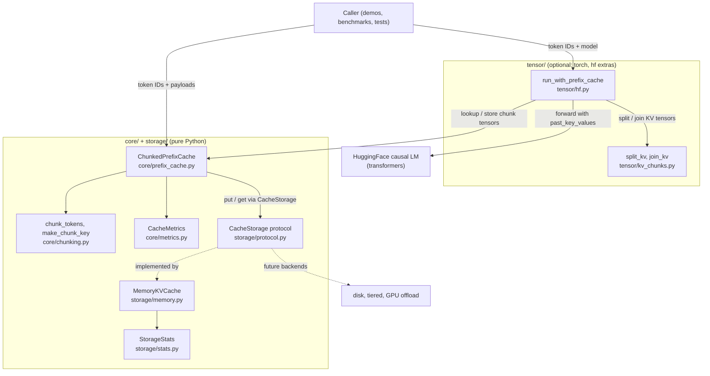
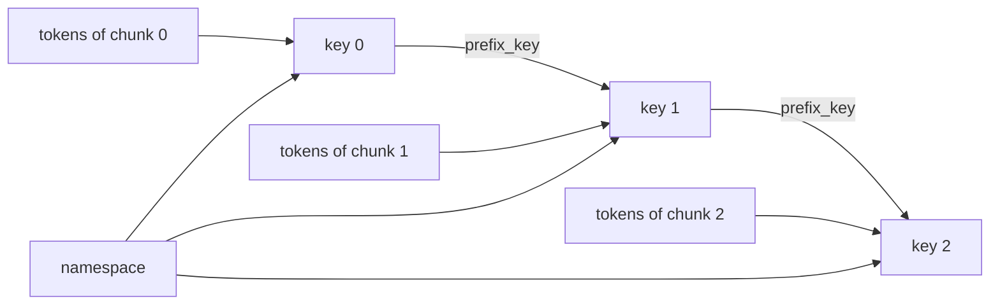
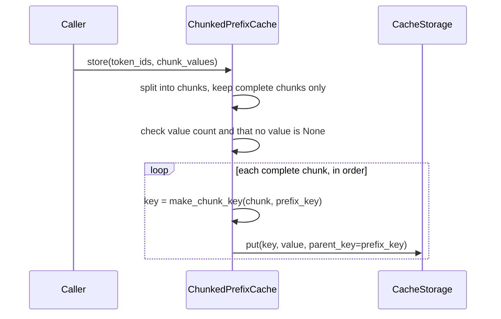
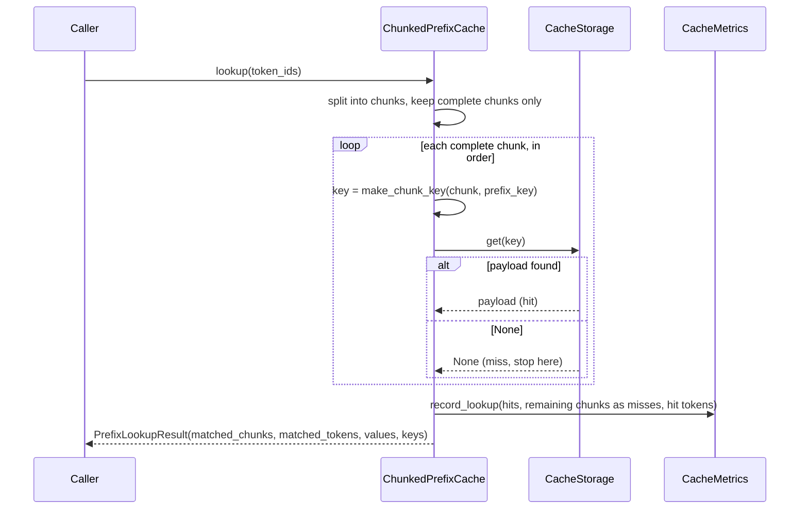
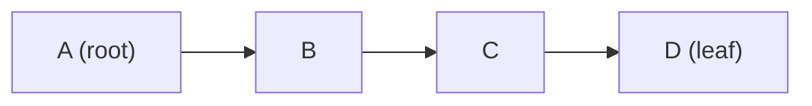

[English](../architecture.md) | [简体中文](architecture.md)

本文与[英文架构说明](../architecture.md)同步维护，最近校对：2026-11-03。实验报告与更完整的性能推导见对应英文专题。

# 架构

本文解释当前实现。运行实验请从[循序渐进教程](tutorial.md)开始；查找专题请使用
[文档目录](README.md)。任务状态统一见 [ROADMAP（英文）](../../ROADMAP.md)。

按主题阅读：[容量](#容量与淘汰)、[磁盘](#磁盘存储)、[INT8 压缩](#可选-int8-kv-压缩)、
[分层](#分层存储)、[线程安全](#线程安全)、[卸载](#gpu-到-cpu-的卸载)、
[实验性数据平面](#实验性数据平面-abi)和[引擎集成](#推理引擎集成)。

## 图示

GitHub 会直接渲染以下图示，重点展示核心前缀缓存循环与可选 Hugging Face 张量路径。
引擎钩子见[集成设计（英文）](../nanovllm-integration.md)，回放与渲染见[教程](tutorial.md)。
修改行为时，应同步更新相关图示。

### 模块关系



`ChunkedPrefixCache` 负责匹配逻辑和指标统计。它只依赖 `CacheStorage` 协议，因此可以更换存储后端，而不必修改缓存逻辑。

调用方有两种使用方式。第一种是直接使用 `ChunkedPrefixCache`，存储任意类型的数据载荷，纯 Python 示例和测试就是这样做的。第二种是调用 `run_with_prefix_cache` 来运行真实模型：该函数查找已缓存的前缀，通过 `join_kv` 将匹配到的分块张量还原为 `past_key_values`，让模型处理剩余 token，再通过 `split_kv` 将结果拆分为分块并存储。

依赖关系只允许从 `tensor/` 指向 `core/`，不能反向依赖。对于 `ChunkedPrefixCache` 和存储层而言，分块张量只是一个不透明的数据载荷，因此即使没有安装 PyTorch，核心逻辑仍然可以运行。

### 实验性数据平面 ABI

实验性的 `nano_lmcache.experimental.dataplane` 包在不改变教学 API 的前提下，开始提供下一层抽象。`KVLayout` 描述模型命名空间、模型 revision、tokenizer 指纹、page 大小、dtype、NHD/HND 的 K/V 轴顺序以及 layer 排列，而且不导入 PyTorch。`KVPageRef` 描述一个物理副本，并明确记录 reservation、transfer、ready、failure 和 eviction 状态。

`KVPageDirectory` 负责逻辑页到物理副本的映射。因此，同一个 logical page 可以同时拥有 GPU、pinned CPU、CPU、NVMe 或 remote 副本；目录会选择 ready 的 authoritative 副本，在它被淘汰后回退到其他 ready 副本。所有副本必须匹配 layout、token range 和 generation，但 compression 和物理 page ID 可以不同。可选的 tensor adapter 会消费这个 ABI，同时不让核心包依赖 PyTorch；descriptor 包本身刻意不包含 GPU 代码。

### 如何生成分块键

每个键都会对命名空间、前一个分块的键以及当前分块自身的 token 进行哈希计算。这样的链式结构使每个键都依赖于完整的前缀。



第一个分块没有 `prefix_key`。因此，即使两个分块包含相同的 token，只要它们之前的前缀不同，就会生成不同的键，从而避免错误复用缓存。

对于 Hugging Face 模型，在加载权重并转换到推理精度后调用
`tensor.hf.namespace_for(model)`，用法见 `examples/demo_kv_reuse.py`。
它将模型名称、确定的 revision、实际 `model.dtype`、模型类和影响 KV 的配置
序列化为键排序的 JSON，再生成带版本的 `hf-kv/v1/...` 哈希命名空间。
核心仍只接收字符串，不导入 torch。

配置采用保守保留策略，仅排除已知的加载元数据、输出格式开关和解码设置。
层数、注意力头及 KV 头数、head dimension、hidden size、RoPE 配置
（包括嵌套的 `rope_parameters` 或 `rope_scaling`）、归一化 epsilon、MLP 和激活函数
都会改变张量布局或后续层计算 KV 所用的隐藏状态。未知字段也予以保留；多一次 miss
比错误命中更安全。对于给定的输入 token ID，temperature、top-k、beam 数等生成设置
不会改变其 KV；它们可能改变未来采样出的 token，而这些 token 已参与分块键计算。

Hub 检查点使用 `config._commit_hash` 作为确定的 revision。本地或合成模型必须提供
非空 `config.name_or_path`，并用稳定的 `config.revision` 标识确切权重；缺少身份时
抛出 `ValueError`。这只是元数据指纹，不是权重校验和。微调、更换 adapter 或原地替换
权重后，需要更新身份并创建新的缓存。使用 eval 模式和固定 dtype，不要切换 autocast
策略。配置相同但随机权重不同的模型不能互换。旧的仅模型名磁盘缓存会被隔离，使用新
命名空间时不会命中。

### `store(token_ids, chunk_values)`



在第一次写入之前会先完成验证，因此被拒绝的存储操作不会留下不完整的前缀。末尾不完整的分块会被忽略。

### `lookup(token_ids)`



查找会在第一次未命中时停止：只有当前面所有分块都有效时，后面的分块才可能被复用。首次未命中之后的分块也会计为未命中，因为调用方必须重新计算它们。

### 为什么淘汰操作必须遵守前缀链



如果此时淘汰 `A`，`B`、`C` 和 `D` 虽然仍留在内存中，却无法再通过查找访问到它们，因为查找从 `A` 开始，并会在第一次未命中时停止。

因此，存储层只淘汰叶节点（此处只有 `D`），并优先淘汰最近最少使用的叶节点。`D` 被淘汰后，`C` 就成为叶节点，可以成为下一个淘汰对象。

## Nano：核心缓存概念

当前实现覆盖了最基本的缓存生命周期：

1. 接收一系列 token ID。
2. 将它们拆分为固定大小的分块。
3. 为每个分块生成确定性的、感知前缀的键。
4. 从开头开始匹配分块，并在首次未命中时停止。
5. 报告可以复用多少前缀，并记录命中和未命中指标。
6. 将新计算的分块数据载荷存入内存后端。

只有完整分块才参与复用。末尾若有短于 `chunk_size` 的分块，则既不会被存储，也不会参与匹配，因为它的状态还取决于尚未到达的 token。

该实现使用纯 Python 编写，因此无需 GPU 或推理引擎，也能理解缓存的工作方式。

### 组件

| 模块 | 职责 |
| --- | --- |
| `core/chunking.py` | 将 token 拆分为分块，并生成感知前缀的键 |
| `core/prefix_cache.py` | `ChunkedPrefixCache`：负责存储和查找流程 |
| `core/metrics.py` | `CacheMetrics`：统计分块级别的命中和未命中 |
| `storage/protocol.py` | `CacheStorage` 协议：定义 `put` / `get` 契约 |
| `storage/eviction.py` | `PrefixLRUIndex`：供有界存储后端共享的、保证前缀安全的 LRU 管理机制 |
| `storage/disk.py` | `DiskKVCache`：每个条目存储为一个文件，进程重启后仍然保留 |
| `storage/serializers.py` | `Serializer` 协议和安全的默认实现 `JsonSerializer` |
| `storage/tiered.py` | `TieredStorage`：在较慢的存储层前设置较快的存储层，采用写穿透策略 |
| `storage/stats.py` | `StorageStats`：记录淘汰和拒绝写入的次数 |
| `storage/memory.py` | `MemoryKVCache`：可选有界容量、采用前缀安全 LRU 策略的内存存储 |
| `storage/remote.py` | 长度前缀 JSON 共享缓存服务/客户端，支持批量查询 |
| `storage/async_write.py` | 有界 write-behind 队列、提交可见性与背压 |
| `tensor/kv_chunks.py` | `split_kv` / `join_kv`：在逐层 KV 张量与分块张量之间转换（需要 torch） |
| `tensor/offload.py` | `CPUOffloadKVCache`：将 GPU 分块保存在页锁定的 CPU 内存中（需要 torch） |
| `tensor/transfer.py` | 基于 pinned buffer pool 和 stream/event 的异步页面复制（需要 torch） |
| `tensor/page_ops.py` | 非连续 page table 的 torch gather/scatter 参考实现（需要 torch） |
| `tensor/quantization.py` | 按 head/channel 轴的 INT8 参考量化（需要 torch） |
| `tensor/serializers.py` | `TensorSerializer` / `QuantizedTensorSerializer`：为磁盘提供无损或可选 INT8 张量编码（需要 torch） |
| `tensor/hf.py` | `run_with_prefix_cache`：与 HuggingFace 模型一起复用前缀 KV（需要 torch 和 transformers） |
| `integrations/nanovllm/layout.py` | `KVBlockLayout`：引擎块字节布局及缓存命名空间 |
| `integrations/nanovllm/external_cache.py` | `NanoVLLMExternalCache`：L2 块计数、读取和保存 |
| `integrations/nanovllm/engine.py` | `attach()`：在运行中的引擎内恢复 L2、保存新块（需要 nano-vLLM） |
| `integrations/nanovllm/kv_blocks.py` | `export_block` / `import_block`：引擎块与张量载荷之间转换（需要 torch） |
| `integrations/vllm/nano_lmcache_connector.py` | vLLM 0.33.0 的部分 scheduler 查询和 worker 保存路径；worker 外部加载仍待完成 |
| `experimental/dataplane/` | 与 PyTorch 无关的 `KVLayout`、页面生命周期、逻辑/物理副本目录和 CPU 参考存储 |
| `experimental/scheduler.py` | 透明的重算/加载估算器和去重 prefetch 状态机 |
| `observability/` | 请求上下文、事件模式、Recorder 与存储 Trace |
| `datasets/`、`replay/` | 合成/Token 工作负载、FreeInference 适配与回放报告 |
| `visualization/`、`visualize.py` | 导入已有 Trace，生成离线 HTML 查看器 |

`tensor` 包是可选的。`core` 和 `storage` 都不会导入它，因此即使没有安装 PyTorch，也可以使用缓存核心概念。

GPU/数据平面实测见[GPU/数据平面实验报告（英文）](../gpu-experiment-report.md)。
调用方通过 `ChunkedPrefixCache` 进行操作。它拥有一个 `CacheMetrics` 实例，并且只依赖 `CacheStorage` 协议，而不依赖任何具体的存储后端。`None` 专门用于表示未命中，因此 `store()` 会拒绝 `None` 数据载荷。

### 有界工作负载回放

`WorkloadReplayRunner` 与 `BlockTraceReplayRunner` 在 `sort_by_arrival=False` 时逐条消费
已排序的迭代器，并检查到达时间/请求 ID 顺序。`ReplaySummary` 累计完整统计，`max_requests`
独立限制请求明细。每次调用会开始新的 recorder/报告，但保留模拟缓存。不透明块使用与 Token
工作负载相同的前缀安全存储和容量预算，键包含模型标识；Token 回放每个 runner 只接受一个模型。

`TraceRecorder(max_events=..., sample_every=...)` 统计每个启用的事件及各后端成功读取次数，
同时仅保留每隔 k 个事件取一个的有界前段样本，使用原始事件序号。CLI 默认每层缓存 10,000 条、
保留 10,000 个事件和 200 条请求明细；HTML 对保留内容分页或窗口化显示。内存还受最大输入记录/
请求及载荷大小影响。API 保留完整明细的默认行为，引擎 JSON 仍采用批量导入。
准确边界与实验见[流式回放](streaming-replay.md)。

### 为什么指标采用这种统计方式

查找会在第一次未命中时停止探测，因此此后所有完整分块都必须由调用方重新计算。这些分块都会被计为未命中。这样，`hit_rate` 表示“可复用的计算工作中，实际被复用的比例”，而不是单纯的探测次数比例。

### 容量与淘汰

`MemoryKVCache(max_entries=N)` 限制条目数，`MemoryKVCache(max_bytes=B, size_fn=...)`
限制记录的载荷字节总数。可以只设一种限制；两者都设置时必须同时满足；都不设置时无界。
`max_bytes` 必须为正整数。`storage.nbytes` 即使没有字节上限，也会报告记录的总量。

`CPUOffloadKVCache` 使用张量的 `value.nbytes`；`DiskKVCache` 使用完整序列化条目文件的大小，
包含头部。三者共享 `PrefixLRUIndex`，但统计的物理表示不同，不能把它们直接等同于进程内存。

内存后端的 `size_fn(value) -> int` 必须返回非负整数，默认 `sys.getsizeof` 只统计浅层对象。
对于张量或字节容器，应提供自定义函数，否则可能只计入包装对象、漏掉实际缓冲区。例如：

```python
from nano_lmcache.storage.memory import MemoryKVCache


def byte_payload_size(value: object) -> int:
    if not isinstance(value, bytes):
        raise TypeError("expected bytes")
    return len(value)


storage = MemoryKVCache(max_entries=100, max_bytes=1024, size_fn=byte_payload_size)
```

容量不包含键、索引和容器开销。载荷只在 `put` 时测量，不能原地扩容后指望统计自动更新。
大小函数异常或返回非法值时，索引、最近使用顺序和统计保持不变；大小测量发生在缺失父节点检查之前。

分块键构成前缀链，查询从链首开始、首次未命中即停止。若从 `A → B → C → D` 中删除 `A`，
后面的数据即使仍在存储中，也无法被复用。因此淘汰规则为：

1. 只能淘汰没有后代的叶节点。
2. 在叶节点中选择最近最少使用者，`get` 会刷新最近使用顺序。
3. 新条目的父节点受保护；覆盖写入时，被覆盖键及其祖先受保护。
4. 接纳前先检查新载荷与完整祖先链能否放入容量；若不能，则拒绝写入，不淘汰已有数据。
5. 父节点未存储时，拒绝写入。

一次写入可以连续淘汰多个叶节点，直到同时满足条目和字节限制。叶节点删除后，其父节点可能成为候选，
但传入条目所需的祖先链始终受保护。覆盖已有键不会改变其原始父节点或条目数；成功后按大小差更新
`nbytes` 并刷新最近使用顺序。较大的覆盖载荷可能淘汰其后代，无法容纳时则保留原值和其他条目。

`PrefixLRUIndex` 只记录键、父节点、大小和顺序，后端负责实际载荷。有界索引以
`(last_access_tick, key)` 最小堆选择叶节点，惰性丢弃失效候选。父节点刚成为叶节点时使用原来的访问时间，
不会被当作刚访问。堆超过 64 条且超过当前条目数两倍时会压缩，辅助空间保持 O(n)，候选维护摊销
O(log n)；单次清理或重建仍可能产生延迟峰值。无界索引不维护候选堆和访问 Tick。
具体取舍和测量见[淘汰性能报告（英文）](../eviction-performance.md)。

`MemoryKVCache.stats` 返回 `StorageStats` 快照：

- `evictions`：为腾出空间或显式失效而移除的条目数。
- `rejected_no_room`：载荷及其必要祖先无法同时满足条目或字节限制的写入数。
- `rejected_missing_parent`：父节点不存在而被拒绝的写入数。

存储统计解释容量压力；`CacheMetrics` 解释查询结果。命中率降低但淘汰很少，可能是请求不再共享前缀；
淘汰持续增加，则可能是工作集放不下。容量不足时通常仍保留可用前缀，仅重新计算丢失的尾部。

### 真实 KV 张量

一个分块的载荷包含所有层在该分块 Token 上的 K/V：

`[num_layers, 2, num_kv_heads, chunk_tokens, head_dim]`

`run_with_prefix_cache` 查找最长缓存前缀，重建 `past_key_values`，仅计算剩余 Token，
并保存完整分块供后续请求使用。即使 Prompt 已全部命中，也需重新计算最后一个 Token 以生成下一个 Token 的 Logits。

无损存储会保留原始 KV。在因果模型中，相同前导 Token 具有相同 K/V；相同 Token 出现在不同前缀之后则不同，
这正是键要包含完整前缀的原因。测试比较复用与完整前向的 Logits，并验证不同前缀产生不同 KV。
低精度下完整 Prefill 与仅计算后缀仍可能存在浮点差异；可选 INT8 序列化还会引入量化误差，不能笼统承诺完全相同输出。

### 磁盘存储

`DiskKVCache(directory)` 每条目保存一个文件，使缓存可以跨进程重启保留。
`max_bytes` 和 `nbytes` 统计完整 `.entry` 文件，包括 JSON 头部与序列化载荷。

- **文件名与校验**：文件名为键的 SHA-256，避免键逃逸缓存目录。JSON 头记录键、`parent_key`
  和载荷 CRC32。损坏的载荷会转为缓存未命中，并清除该条目及其后代。
- **原子写入**：先写临时文件并 `fsync`，再在同目录重命名；发生崩溃时留下旧文件、新文件或临时文件，
  不留下半个正式条目。淘汰按叶节点顺序删除，不产生孤立后代。
- **I/O 异常**：遇到 `OSError`，修复文件系统问题后重新打开缓存；已完成的淘汰不会回滚。
- **恢复**：打开时清除临时文件、不可读文件、校验缺失或不匹配文件和缺失祖先的条目，
  按先父后子重建索引，再从文件修改时间恢复 LRU。旧版无校验文件会丢弃并按需重新生成。
  大小来自 `stat().st_size`；若有效内容超过配置容量，抛出 `ValueError`，不自动淘汰有效文件。
- **序列化**：默认 JSON，避免普通 `pickle` 的任意代码执行风险。张量使用 `TensorSerializer`，
  通过 `torch.save` 写入、`torch.load(weights_only=True)` 读取，只接受张量和普通容器等受限内容。

同一目录只能由一个缓存对象负责写入；线程锁不协调不同对象或进程各自的索引。
用新目录运行 `examples/demo_disk_cache.py --dir /tmp/limited-kv --max-bytes 400` 可观察字节预算。

### 可选 INT8 KV 压缩

`QuantizedTensorSerializer` 用精度换磁盘空间，必须显式选择。`TensorSerializer` 仍为无损方案。
对于 `[layers, 2, kv_heads, tokens, head_dim]`，沿 Token 轴 `-2` 为每层、K/V、头和通道计算 FP32 缩放：

```text
scale = max(abs(values_across_tokens)) / 127
quantized = round(values / scale), clamped to [-127, 127]
restored = quantized * scale, cast back to the original dtype
```

全零通道使用 scale 1；逐通道缩放避免单个通道异常值降低其他通道精度。
支持 FP16、BF16、FP32，保持形状与类型，恢复到 CPU，不修改输入，加载使用 `weights_only=True`。

切换序列化器时必须换缓存目录，无损文件与量化文件的载荷格式不同。每值 INT8 占 1 字节，
每通道 Scale 额外占 4 字节；忽略序列化开销，T 个 Token 时每值约占 `1 + 4 / T` 字节。
T=16 相比 FP16/BF16 约压缩 1.6 倍，极短分块可能反而无法缩小。编码和解码也消耗时间。

应在代表性模型、输入与生成长度上比较 K/V 最大误差、Logit 误差、贪心 Token 一致性和任务质量，
预先确定可接受阈值。不存在通用安全阈值，小 Logit 变化也可能改变后续生成。
CPU 复现命令、尺寸与延迟、G1 对比见[INT8 实验（英文）](../quantized-kv.md)。
可将分块 Token 数由 16 改为 4 或 32，先预测 Scale 开销变化，再测量结果。

### 分层存储

`TieredStorage(fast=..., slow=...)` 在较大慢层（通常为磁盘）之前放置较小快层（通常为内存）。

- **写穿透**：先尝试慢层，再尝试快层，各层独立决定接纳。只有慢层成功保存的条目可以跨重启恢复。
  若仅在内存淘汰时写回磁盘，叶节点的父节点可能还只在内存，磁盘会因缺父节点拒绝写入。
- **命中提升**：慢层命中时，按慢层记录的父节点向快层写入。查询从根向后进行，因此通常先提升父节点；
  快层放不下父节点时，也拒绝其后代，但慢层仍可返回数据。
- **覆盖拒绝**：慢层拒绝已有键的覆盖时，两层原值不变。慢层更新成功、快层拒绝覆盖时，
  必须通过 `invalidate` 清除快层旧键及其后代，避免读到旧数据。移除计为淘汰，不改变无关条目的顺序。
  后端的独立 `put` 在拒绝时仍保留原值。自定义可拒绝覆盖的快层应实现 `try_put` 和 `invalidate`。
  慢层拒绝的新键仍可能被快层接纳，但这类条目不会持久化。
- **不变量**：每层各自保存完整祖先链，两层并集也满足前缀安全。

`TieredStorage.tier_stats` 返回每层命中、未命中和提升次数的快照，便于观察热点是否能放入快层。

### 线程安全

`MemoryKVCache`、`DiskKVCache` 和 `TieredStorage` 每个实例拥有一个 `threading.RLock`。
锁覆盖完整状态变化，包含索引接纳/淘汰以及对应字典载荷或磁盘文件，避免读者观察到索引与数据不一致的中间状态。

分层存储还在一次慢层写入 → 快层写入/失效，或快层查询 → 慢层查询 → 提升的全过程持锁。
锁顺序始终为分层存储在先、子后端在后；子后端不反向获取父锁。
跨层操作应通过 `TieredStorage`，直接操作子后端不构成跨层事务。

磁盘运行期的读取、写入、`fsync`、替换、删除、修改时间和损坏清理都在锁内，
以一致性换取实现简单，牺牲同实例的并行磁盘 I/O。

`MemoryKVCache.stats`、`DiskKVCache.stats` 和 `TieredStorage.tier_stats` 返回独立快照。
`CacheMetrics` 同步查询累计更新及合计/比率读取，但单独公开计数仍可修改，调用方不能并发直接写入。

保证仅适用于共享同一后端对象的线程：不保证载荷原地修改安全，不保证整个多分块查询是快照，
也不允许多个对象或进程写同一磁盘目录。`CPUOffloadKVCache`、Trace 包装器和共享 Trace Recorder
不在这项线程安全保证内。

### GPU 到 CPU 的卸载

`CPUOffloadKVCache(device="cuda")` 将分块张量保存在 CPU 内存中，命中时再将其复制回 GPU。GPU 内存需要由模型权重和正在运行的请求的 KV 缓存共同使用，而 CPU 内存通常大得多，因此卸载可以让服务器保留更多可复用的前缀。它实现了 `CacheStorage` 协议，并使用 `PrefixLRUIndex` 进行淘汰，所以既可以单独使用，也可以作为 `TieredStorage` 的快速层。`run_with_prefix_cache` 会将复用的分块移动到模型所在的设备，因此任何后端都可以在 CPU 上返回分块。

`CPUOffloadKVCache(max_bytes=B)` 按张量真实字节数限制缓存，不计页锁定分配器等额外开销。
`device="cpu"` 也支持无 CUDA 的容量检查；GPU 卸载需要 CUDA。覆盖拒绝与子树失效遵循分层存储约定。

以下两个复制细节很重要。数据来自在 RTX 4090（PCIe）上运行的 `benchmarks/bench_offload.py` 测试；每次复制的数据量为 28 MiB（一个采用 bfloat16 的 256-token Qwen3-0.6B 分块）：

| CPU 内存 | `non_blocking` | GPU 到 CPU | CPU 到 GPU | 调用返回耗时 |
| --- | --- | --- | --- | --- |
| 可分页内存 | 否 | 10.7 GB/s | 11.3 GB/s | 2.7 ms |
| 页锁定内存 | 否 | 26.0 GB/s | 24.9 GB/s | 1.1 ms |
| 页锁定内存 | 是 | 26.2 GB/s | 25.2 GB/s | 0.005 ms |

- **页锁定内存（Pinned memory）**：内存页被锁定，因此 GPU 可以直接使用 DMA 将数据传输到该内存中。可分页内存则必须先经过一个隐藏的页锁定缓冲区，这会使带宽降低一半以上。
- **`non_blocking`**：它不会让复制本身变得更快，而是让 Python 调用在复制任务进入队列后立即返回，使 CPU 能继续调度其他工作。两个方向的复制都在同一个 CUDA stream 上排队，因此复制回 GPU 的操作一定会在其依赖的复制操作之后执行。只有直接读取 CPU 缓冲区的代码才必须等待，例如 `peek`。

以约 25 GB/s 的速度传输时，加载一个 28 MiB 的分块大约需要 1.1 ms。能否比重新计算这 256 个 token 更快，取决于模型和 GPU；[TTFT 实验（英文）](../nanovllm-benchmark.md)已在 nano-vLLM 中测量这一取舍（N4，合并了原 G3）。

完整的、类似 LMCache 的存储层级可以组合如下：

```python
TieredStorage(
    fast=CPUOffloadKVCache(device="cuda"),
    slow=DiskKVCache("/var/cache/kv", serializer=TensorSerializer()),
)
```

模型在 GPU 上执行计算，缓存分块保存在页锁定的 CPU 内存中，并且每个分块都会写入磁盘，因此进程重启后仍然可以复用它们。运行 `examples/demo_kv_reuse.py --offload --disk DIR` 就可以演示这一流程。

## Mini：扩展缓存模型

缓存逻辑依赖 `CacheStorage` 协议。`MemoryKVCache`、`DiskKVCache` 和 `CPUOffloadKVCache`
已实现条目/字节容量与前缀安全淘汰。内存、磁盘和分层实例支持上述范围内的线程共享访问。
可插拔淘汰策略与多进程共享缓存服务分别是路线图 M11、M12，尚未实现。

## 推理引擎集成

nano-lmcache 已实现 nano-vLLM GPU L1 后的外部 L2 缓存。V1 在 Prefill 前恢复 L2 块，
并同步保存已完成块。块格式、命名空间、导入/导出与正确性约束见
[集成设计（英文）](../nanovllm-integration.md)；实测成本见
[TTFT 报告（英文）](../nanovllm-benchmark.md)；L1/L2 与 GPU 传输事件见
[引擎 Trace 指南（英文）](../engine-traces.md)。

核心包应始终保持独立、易于理解并且可测试。只有在确实需要时，才应引入集成特定的依赖项。

## Prefill/Decode 分离

`disaggregation.py` 是纯 Python 教学模块，不依赖 `tensor/` 和 `integrations/`。
`prefill` 用 `ToyModel` 计算 Prompt 的 KV，序列化后附带校验和并放入通道；
`decode` 认领字节，校验模型身份和 KV 完整性后继续生成。小型 `timeline` 函数用于比较合并与分离调度。
详见 [PD 分离指南](pd-disaggregation.md)。

## 设计原则

每个阶段都应引入一个有意义的新概念，并通过测试和可运行的示例来展示其行为。
